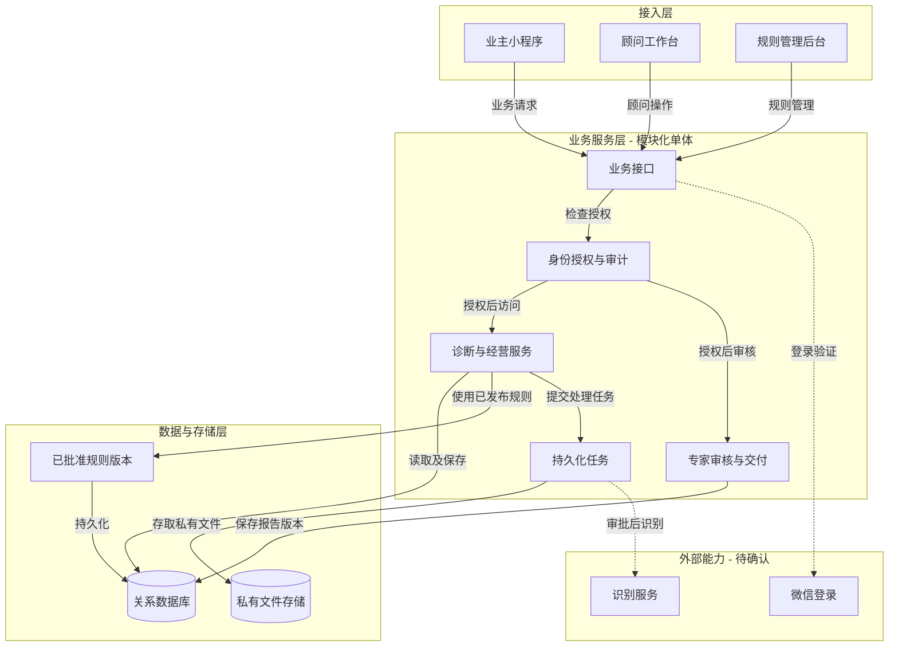
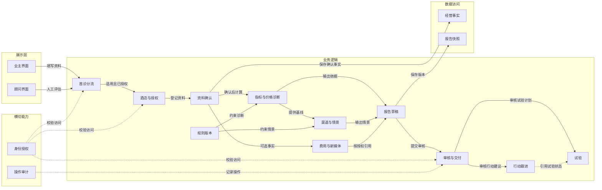

# Architecture Diagram

基于 [PRD V0.3.1](../../../../../docs/archive/酒店收入增长诊断小程序_PRD_V0.3.1.md) 的拟议架构。当前工作区尚无应用源代码，以下为待评审的设计，不表示已经实现或部署。

## Application Architecture

<!-- mermaid-checked: no \n, no em-dash/en-dash, no {} in labels, subgraphs are id["label"], arrows are -->|"label"|, all subgraphs closed by end, ids unique -->

### Technology Stack Summary

| 层次 | 建议技术 | 版本 | 目的 |
|---|---|---|---|
| 业主端 | 微信原生小程序与 TypeScript | 待确认 | 移动端录入、核对和查看报告 |
| 顾问及管理端 | Web，候选 Vue 3 与 TypeScript | 待确认 | 多酒店、审核、交付和规则管理 |
| 业务服务 | Node.js LTS 与 NestJS，模块化单体 | 待确认 | 鉴权、诊断、报告及跟进 |
| 业务数据 | MySQL 或 PostgreSQL，二选一 | 待确认 | 结构化事实、授权、版本与审计 |
| 文件与任务 | 私有对象存储及持久化任务 | 待确认 | 截图、报告和异步识别导出 |
| 识别 | 经审批的 OCR 或结构化提取 | 待确认 | 辅助提取字段；不直接作诊断决定 |

### Data Storage & External Services

关系数据库与私有对象存储分别保存结构化数据和文件；规则、确认数据及报告建立版本关联。微信登录和识别服务均为待确认的接入方案；第三方识别须先通过隐私、安全及用户授权审批，未获批准时保留人工录入。

### Key Architectural Decisions

- 先使用模块化单体与持久化任务，避免在一期预设微服务、消息队列或缓存。
- 数据确认、已发布规则、顾问审核和报告交付分离；模型不决定价格或绕过门禁。
- 分诊授权与酒店授权分别校验；截图和报告始终私有，访问与删除遵循已批准策略。

## Component Relationships

<!-- mermaid-checked: no \n, no em-dash/en-dash, no {} in labels, subgraphs are id["label"], arrows are -->|"label"|, all subgraphs closed by end, ids unique -->

### Component Inventory

| 组件 | 层次 | 类型 | 职责 |
|---|---|---|---|
| 业主界面、顾问界面 | 展示层 | 客户端 | 收集资料、查看进度及授权内容 |
| 首诊分流、酒店与授权 | 业务逻辑 | 服务模块 | 区分项目范围，并分别校验分诊和酒店授权 |
| 资料确认、费用与新媒体 | 业务逻辑 | 服务模块 | 记录来源、期间、确认状态和可选事实 |
| 指标与价格诊断、渠道与情景 | 业务逻辑 | 确定性引擎 | 按已确认数据和已批准规则计算，保留假设 |
| 规则版本 | 业务逻辑 | 配置模块 | 管理审批发布及版本，不向客户端下发规则库 |
| 报告草稿、审核与交付 | 业务逻辑 | 服务模块 | 生成快照，经授权审核后交付 |
| 试验、行动跟进 | 业务逻辑 | 服务模块 | 保存计划、人工执行与结果，试验状态使用单一来源 |
| 经营事实、报告快照 | 数据访问 | 存储边界 | 持久化经过确认的数据和历史版本 |
| 身份授权、操作审计 | 横切能力 | 安全模块 | 最小权限访问和必要操作留痕 |
