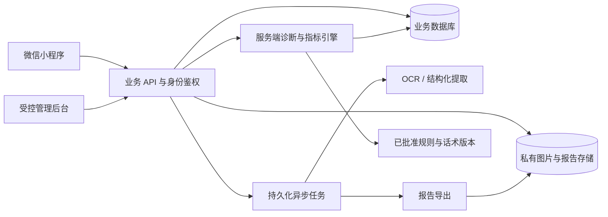

# 酒店收入增长诊断小程序 PRD

> **评审草案 V0.2｜非已批准开发规格**  
> 基于《酒店收入增长诊断小程序需求说明书 V0.1》（2026-11-23，6 页）整理。原文中尚未确定的业务规则，不因本文提供了方案而自动生效。

| 项目 | 内容 |
|---|---|
| 产品定位 | 面向酒店业主的经营数据诊断与行动建议工具 |
| 目标平台 | 原文未定；本文建议一期优先微信小程序，须由产品负责人确认 |
| 本文读者 | 产品负责人、酒店收益管理专家、设计、研发、测试、运营及法务 |
| 文档状态 | 待产品负责人、研发和法务评审 |
| 原文引用 | 下文的 F1～F14、章节和页码均指输入的 V0.1 说明书 |

**标注约定**

- **原文**：输入说明书明确要求；仍需结合待确认规则才能实现的，不代表已具备上线条件。
- **建议**：为形成可评审方案而补充的默认设计、体验或技术方案，须评审后采用。
- **待确认**：业务、技术或合规口径尚无定论，不得当成已批准规则。
- 原文中的 50% 渠道占比、每组 2 家竞品等数字均为讨论或示例，不作为生产环境默认阈值。

---

## 1. 范围基线（Scope Baseline）

### 1.1 背景与目标

酒店业主希望理解客房收入的量价变化、评估定价空间并降低对单一渠道的依赖，但通常缺少统一的数据格式和专业收益管理能力。产品通过分步收集业主提供的数据及截图，在数据得到确认后，提供可追溯、可执行且不承诺收益的诊断。

产品要回答：

1. 在数据足够且业务规则已批准时，哪些日期是否适合小范围试价，可能参考什么价格区间？
2. 如果调整后的**实际平均成交房价**达到某个假设值，出租率至少达到多少才能使客房收入持平？
3. 已确认的渠道占比是否达到已批准的风险条件，哪些降依赖动作可供选择？
4. 数据不足时，当前能计算什么，还需要补充什么？

**不追求**：自动替业主改价、自动抓取平台数据、承诺增长或用缺失数据编造结论。

### 1.2 用户和使用边界

| 角色 | 主要诉求 | 一期定位 |
|---|---|---|
| 酒店业主/经营负责人 | 看懂经营情况、知道是否值得向品牌方申请试价 | 主要用户；面向中端限服型酒店，原文一期重点为加盟店 |
| 品牌方/中央收益管理人员 | 接收门店提交的试价或渠道调整依据 | 建议作为报告中的行动对象；一期不建设品牌方协同工作台 |
| 运营/收益管理专家 | 配置经批准的规则、检查版本和报告话术 | 一期后台用户 |
| 系统管理员 | 管理后台账号、权限和审计 | 一期后台用户，具体职责须分离 |

单体店是原文目标用户之一，但一期规则明确聚焦限服型加盟店；单体店能否直接使用完整提价规则、首批覆盖的城市和钻级，需产品负责人确认。

### 1.3 一期范围与非范围

**P0：一期核心闭环**

- 向导式录入与进度保存；本店和竞品截图上传、识别、逐项确认。
- 本店经营指标、数据充分度分级、竞品可比性检查。
- 在规则和数据条件满足时，执行提价及渠道集中度诊断，并考虑业主实际权限。
- 展示阶段性结果、生成标准化报告，至少支持一种导出格式。
- 服务端规则与话术配置、权限控制、版本和审计；经营数据保护。

**P1：原文标记为后续优先级**

- 收费、权益及其对应的支付模式。
- 面向潜在客户的独立免费预检入口。P0 的阶段性结果不依赖该商业化入口。

**P2：后续版本**

- 历史报告列表、试价后的提醒、回填和复盘。
- 其他 OTA 专项模块、全服务型酒店模块。

**不在一期范围**

- 餐饮、宴会等全服务型酒店收入诊断。
- 自动抓取携程或其他平台数据、接入 PMS 自动同步、自动修改价格或渠道。
- 翻新投资、退出品牌等重大经营决策；系统应提示咨询专业人士。
- 对增长率、收益或试价结果作出承诺。

### 1.4 原文功能清单与覆盖

| 原文编号 | 功能点 | 原优先级 | 本文覆盖 |
|---|---|---|---|
| F1 | 向导式对话、保存进度 | P0 | 第 3.1、5 节 |
| F2 | 多图上传与读图 | P0 | 第 3.2、5.2 节 |
| F3 | 识别结果核对、修改、确认 | P0 | 第 3.2、5.3 节 |
| F4 | 竞品可比性及选择偏差检查 | P0 | 第 3.3、6.3 节 |
| F5 | 数据充分度分级 | P0 | 第 3.4、6.1 节 |
| F6 | 经营指标、收入持平线、渠道与佣金 | P0 | 第 3.5、6.2 节 |
| F7 | 分层提价判断 | P0 | 第 3.6、6.4 节 |
| F8 | 渠道集中度诊断 | P0 | 第 3.7、6.5 节 |
| F9 | 按业主权限调整行动建议 | P0 | 第 3.6、5.5、7 节 |
| F10 | 标准报告及导出 | P0 | 第 3.8、7 节 |
| F11 | 服务端规则库与后台 | P0 | 第 3.9、8 节 |
| F12 | 收费与权益 | P1 | 第 3.11、10 节 |
| F13 | 免费预检 | P1 | 第 3.11、10 节 |
| F14 | 历史报告与复盘 | P2 | 第 3.11、10 节 |

发现方式：逐页阅读原文 6 页，识别全部 14 项功能、业务规则、截图清单和待确认事项；14 项均保留，按原优先级区分阶段。

---

## 2. 用户场景与验收（User Scenarios & Testing）

### 场景 A：开始诊断并中途继续（P0）

**用户故事**：作为非技术背景的酒店业主，我希望系统一次解释并收集一类信息，以便在资料不齐时也能保存进度。

**独立验收**：

- 给定用户已同意必要的数据处理，创建诊断时，系统展示用途、数据来源与首个问题，不要求一次填完所有资料。
- 当用户提交部分信息后退出并重新进入，系统恢复已保存内容，展示当前进度和缺项。
- 当尚无足够经营数据时，系统仅展示草稿状态和缺项，不给出涨价或增长结论。

### 场景 B：上传截图并纠正识别结果（P0）

**用户故事**：作为业主，我希望看到截图与识别值的对应关系，发现错误时能够修改或标记未知。

**独立验收**：

- 给定一张包含本店数据的截图，上传后显示处理状态、识别字段及可查看的原图；无法识别的字段显示为待填写，而不是填入猜测值。
- 当用户修改数值并明确确认后，该确认值进入后续计算；未确认值、标记未知的值不进入计算。
- 当识别失败或用户无法判断字段时，用户可重试、手动填写、标记未知或保存退出；系统说明对诊断的影响。

### 场景 C：选择可比竞品并检查日期（P0）

**用户故事**：作为业主，我希望知道所选酒店、房型和价格是否可比，避免把不同时段或不同房型的报价直接比较。

**独立验收**：

- 给定用户选择 3～5 家竞品，系统引导核对位置、档次、钻级、房型、入住日期及截图时间。
- 当位置或档次的判断依据缺失，系统标记“无法验证”，不能伪装成“可比”；当依据明确表明不可比，提示更换。
- 当截图只有列表页“起价”，系统提示核对同类房型；截图上看不到入住日期或截图时间时，即使用户自行补填，默认也不将其用于正式价格对标。
- 系统只在有证据时提示可能的选样偏差；不能仅凭 3～5 家样本断言用户只挑了最便宜或最熟悉的店。

### 场景 D：按数据等级查看结果（P0）

**用户故事**：作为业主，我希望在资料不足时看到可信的阶段性结果，在条件满足时再查看更深入诊断。

**独立验收**：

- 给定只有经确认的本期基础数据，系统显示 L1、可计算的事实指标和缺项，不输出增长、趋势或提价判断。
- 给定同期数据满足已批准口径但缺少可比竞品，系统可展示 L2 量价变化，不输出可涨幅度或价格带。
- 给定 L3 所需数据已确认但“不能涨价”规则仍未批准，系统不输出“可以涨”或具体试涨价，明确提示规则尚待确认。
- 当数据和已发布规则均满足要求，系统输出有依据、置信度和缺项的诊断；某个日期类型缺数据时，不替该日期编造建议。

### 场景 E：执行或申请行动（P0）

**用户故事**：作为加盟店业主，我希望建议符合我的价格和渠道权限。

**独立验收**：

- 给定业主能够自行调整某类价格，且诊断规则允许试价，报告给出适用日期、试验范围、观察指标及复盘时间。
- 给定相关权限在品牌方或权限未知，报告改为“向品牌方申请/先确认权限”，附可供沟通的数据依据，不要求业主直接操作。

### 场景 F：渠道风险、报告和安全导出（P0）

**用户故事**：作为业主，我希望了解渠道依赖和可能的佣金成本，并安全地保存报告。

**独立验收**：

- 给定渠道占比、统计口径及经批准阈值均已确认，且该数据等级允许渠道提示，系统按同一口径判断是否触发风险；缺少阈值时只展示事实与缺项。
- 缺少渠道收入或合同佣金率时，系统不估算佣金，也不把订单占比当作收入占比。
- 用户可查看并导出报告；报告包含数据等级、结论依据、缺项、最多 3 条行动建议和免责声明。未经用户主动操作，不产生公开分享。

### 场景 G：调整规则但不暴露规则库（P0）

**用户故事**：作为授权运营人员，我希望管理经业务负责人批准的参数、版本及话术，而不需要每次修改参数都发布小程序。

**独立验收**：

- 后台保存未发布版本后，线上结果不变；经过校验、授权审批和发布后，新诊断使用新版本。
- 发布或回滚后，已经生成的报告保留原输入和规则版本；用户编辑数据后应生成新结果。
- 非授权账号无法访问规则配置；小程序接口返回渲染后的结果和数据依据，不返回规则配置、权重或完整模板。

### 主要异常与边界

- 房间数、可售房晚为零；售出房晚为零；售出房晚超过可售房晚；房费收入和房晚不一致。
- 营业期间停房、房量变化或数据周期不同，不能直接套用固定房量乘天数。
- 同期数据的日期、收入范围或渠道统计口径不一致；上期为零时无法计算环比百分比。
- 截图模糊、被遮挡、同一字段多张截图冲突、没有截图时间或没有入住日期。
- 列表起价对应房型、餐食、取消条件或税费不同；价格有会员价、券后价等无法直接比较。
- 竞品样本少、某钻级样本为空、位置未知、节假日价格缺失、竞品近期出租情况不可得。
- 仅有订单占比而无间夜或收入占比；佣金率或合同计费基数未知。
- 用户无调价权、渠道由品牌方统一管理，或用户不清楚权限。
- 阈值、否决条件、试价时长或数据留存规则未获批准。
- 用户撤回同意、删除数据，或报告已被用户自行另存和转发。

---

## 3. 产品需求（Requirements）

以下要求中的“建议”是待评审方案；涉及业务判断的功能即使列为 P0，也须在第 11 节对应门槛满足后才能正式启用。

### 3.1 向导、基本信息与进度

| ID | 优先级 | 可验收要求 | 依据 |
|---|---|---|---|
| REQ-001 | P0 | 在收集经营数据前展示数据用途和必要的隐私告知；未同意时不创建含经营数据的诊断。 | 原文 §9；交互为建议 |
| REQ-002 | P0 | 用户可创建一个独立诊断，记录酒店及诊断周期，后续数据归属于该诊断。 | F1、§4；隔离方式为建议 |
| REQ-003 | P0 | 引导录入品牌、房量、城市/商圈及携程钻级；未知字段可标记未知，不得自动编造。 | §4 |
| REQ-004 | P0 | 分别记录价格和渠道的可控范围，包括可自主、需审批、不可控或未知，并允许补充说明。 | F9、§6.5；选项为建议 |
| REQ-005 | P0 | 向导每步聚焦一类信息，解释用途，并用业主可理解的语言解释专业指标。 | F1、§3、§9 |
| REQ-006 | P0 | 每次明确保存后持久化进度；保存失败时提示用户，不显示成功状态。 | F1；失败处理为建议 |
| REQ-007 | P0 | 同一用户可恢复未完成诊断，查看已保存内容、当前步骤和缺项。 | F1、§4 |
| REQ-008 | P0 | 用户可在任意步骤查看阶段性结果；内容受已确认数据和数据等级约束。 | F1、§4 |

### 3.2 截图、识别和确认

| ID | 优先级 | 可验收要求 | 依据 |
|---|---|---|---|
| REQ-009 | P0 | 按本店后台、搜索列表、竞品详情、本店详情及 PMS/报表说明所需截图和用途。 | F2、§7 |
| REQ-010 | P0 | 支持一次选择多张图片、分批追加和查看上传结果；失败图片可单独重试。 | F2；分批和重试为建议 |
| REQ-011 | P0 | 价格截图应能看到入住日期和截图时间；识别失败时可参照图面补录，图面缺失时默认不用于正式对标，也不以上传时间冒充截图时间。 | F2、§7；缺图处理为建议 |
| REQ-012 | P0 | 识别适用的价格、评分、钻级、日期、房晚、收入等字段，并保留无法识别状态。 | F2、§7 |
| REQ-013 | P0 | 识别进行中、成功、失败均有可见状态；失败时支持重试或人工录入，不得将失败结果当作有效数据。 | F2、F3；状态处理为建议 |
| REQ-014 | P0 | 核对页提供原图查看和字段列表；有定位能力时可定位字段来源，无法定位时不伪造标注。 | F3；对照交互为建议 |
| REQ-015 | P0 | 用户可逐字段修改、标记未知并明确确认；识别值和用户修改值均可追溯。 | F3；追溯为建议 |
| REQ-016 | P0 | 只有用户明确确认的字段进入计算和诊断；未确认、未知及无效字段均不得作为有效输入。 | F3、§3 |
| REQ-017 | P0 | 为确认值保留来源类型、对应截图或人工录入标记、相关日期和确认时间。 | F3、§8；数据结构为建议 |
| REQ-018 | P0 | 已确认字段修改后，相关结论标记为过期；重新确认后生成新结果，不静默覆盖已导出的报告。 | F3；版本处理为建议 |
| REQ-019 | P0 | 对日期、币种、比例、房晚及金额进行格式和一致性校验，异常时指出需核对的字段。 | F3、F6；校验细节为建议 |
| REQ-020 | P0 | 上传前提示遮挡无关住客姓名、联系方式和订单号等信息，避免采集诊断不需要的数据。 | §9；具体提示为建议 |

### 3.3 竞品选择与可比性

| ID | 优先级 | 可验收要求 | 依据 |
|---|---|---|---|
| REQ-021 | P0 | 引导业主选择 3～5 家同商圈、同档次竞品，并为每家分别记录数据。 | F4、§4 |
| REQ-022 | P0 | 记录竞品位置或距离、钻级、装修/开业年份、房间面积、评分、同类房型价格及其日期；不可得项可标未知。 | F4、§6.3、§7、§8 |
| REQ-023 | P0 | 根据已批准的可比性标准检查位置与档次，结果区分可比、不可比和无法验证；不可比时提示替换。 | F4；三态为建议 |
| REQ-024 | P0 | 有足够搜索列表或用户说明时提示可能的低价/熟悉店选样偏差；无证据时标记未验证，不作断言。 | F4；证据限制为建议 |
| REQ-025 | P0 | 对列表“起价”提示用户核对同类房型及价格条件；不满足可比条件的价格不进入正式价格对标。 | §7 |
| REQ-026 | P0 | 引导至少提供一个工作日和一个周末的价格快照；节假日建议仅可使用有对应已确认数据的日期。 | §6.3、§7 |
| REQ-027 | P0 | 对装修年限、房间面积、近期出租情况等缺失项展示“未知”及其对结论的影响。 | §6.2、§7、§8 |
| REQ-028 | P0 | 未提供竞品历史价格或出租情况时，系统不从截图快照推断这些数据。 | §7 |

### 3.4 数据等级、范围与置信度

| ID | 优先级 | 可验收要求 | 依据 |
|---|---|---|---|
| REQ-029 | P0 | 根据已确认数据标记原文 L1、L2、L3；基础数据不足时使用草稿态，不冒充已达到 L1。 | F5、§6.2；草稿态为建议 |
| REQ-030 | P0 | L1 仅展示可计算的事实指标、用户自设情景测算和缺项，不输出增长、趋势或提价判断。 | §3、§6.2 |
| REQ-031 | P0 | 同期数据满足已批准口径时可进入 L2 并判断量价变化；缺竞品时不判断提价空间。 | §6.2；具体同期口径待确认 |
| REQ-032 | P0 | L3 在 L2 基础上要求可比竞品；每个日期类型的具体价格结论还需满足该类型的数据及规则门槛。 | §6.2、§6.3；逐日期门槛为建议 |
| REQ-033 | P0 | 同期比较前核对周期与指标口径；不可比时展示事实和原因，不计算误导性变化率。 | F5、F6；处理方式为建议 |
| REQ-034 | P0 | 对无法判断的内容列出缺失数据、补充入口及可能影响，不把未知等同于零。 | §3、§4、§8 |
| REQ-035 | P0 | 每项诊断结论展示数据依据、置信度和尚缺数据；缺少竞品近期出租情况时降低或标注受限置信度。 | §3、§6.2、§8；分级口径待确认 |

### 3.5 指标和情景测算

| ID | 优先级 | 可验收要求 | 依据 |
|---|---|---|---|
| REQ-036 | P0 | 根据经确认的周期和可售房晚计算房量相关指标；仅有固定房量时说明“房量×天数”的假设。 | F6、§6.1；实际可售口径为建议 |
| REQ-037 | P0 | 按第 6.2 节计算出租率、平均成交房价和每可售房晚收入，缺少分母时不输出该指标。 | F6、§6.1 |
| REQ-038 | P0 | 本期收入和可售房晚形成有效基线且用户提供正数的目标实际平均成交房价时，可计算收入持平所需房晚和出租率，并说明假设。 | F6、§6.1；输入约束与措辞为建议 |
| REQ-039 | P0 | 系统区分实际平均成交房价和截图挂牌价，不将挂牌价自动当作已实现或未来成交均价。 | §6.1、§7；口径保护为建议 |
| REQ-040 | P0 | 分别计算订单、间夜或收入渠道占比，展示采用的分子、分母和周期，不混用口径。 | F6、§6.1；细分为建议 |
| REQ-041 | P0 | 仅在携程渠道房费收入、合同佣金率及适用计费口径已确认时估算佣金，并标明为估算。 | F6、§6.1 |
| REQ-042 | P0 | 除数为零、输入冲突或所需数据未知时显示不可计算及原因，不用零值或默认值替代。 | F6；异常处理为建议 |

### 3.6 提价诊断与可执行性

| ID | 优先级 | 可验收要求 | 依据 |
|---|---|---|---|
| REQ-043 | P0 | 定价判断按“钻级和位置＞装修年限＞点评分”的已确认层级处理；房间面积归属待批准。 | F7、§6.3 |
| REQ-044 | P0 | 在已确认、可比的同一日期或已批准的同类日期样本中，按钻级分别计算挂牌价中位数及样本数量。 | F7、§6.3 |
| REQ-045 | P0 | 以同钻级可比样本形成价格范围；范围算法、各因素微调及样本门槛未经批准时，不生成正式价格建议。 | F7、§6.3；门禁为建议 |
| REQ-046 | P0 | “不能涨价”的否决规则未批准时，不输出“可以试涨”或具体试涨价；已批准规则触发时，展示相应依据。 | §6.6；保守门禁为建议 |
| REQ-047 | P0 | 具备数据和已批准规则时，分别考虑工作日、周末、节假日及已识别活动日；旺日先试、淡日保量需有数据支持。 | §6.3 |
| REQ-048 | P0 | 正式试价建议包括日期类型、试验幅度或价格、观察指标和复盘时间；任一关键项无法确定时不伪造完整方案。 | §6.3 |
| REQ-049 | P0 | 若价格或渠道权限需品牌方审批、不可控或未知，建议改为申请/先确认权限，并附相关依据。 | F9、§6.5 |

### 3.7 渠道集中度与行动

| ID | 优先级 | 可验收要求 | 依据 |
|---|---|---|---|
| REQ-050 | P0 | 在已批准的数据等级允许时，使用同周期、同口径的已确认渠道数据及已批准可配置阈值判断集中度；缺一项时不触发确定性风险结论。 | F8、§6.4；等级边界待确认 |
| REQ-051 | P0 | 触发渠道风险时分别说明可能的佣金成本和平台依赖风险，缺少成本数据时不推断具体金额。 | §6.4 |
| REQ-052 | P0 | 经业务负责人批准后，可按适用性给出品牌会员、企业协议客、老客复购或其他渠道分流等候选行动。 | §6.4；动作及优先级待确认 |
| REQ-053 | P0 | 对尚未定义的“合理佣金”或降佣幅度不设置默认判断，不生成确定的节省金额。 | §6.4、§10 |
| REQ-054 | P0 | 渠道行动须符合业主权限、品牌制度、平台协议和个人信息授权；不提供自动绕过平台的操作。 | F9、§9；合规限制为建议 |

### 3.8 报告与导出

| ID | 优先级 | 可验收要求 | 依据 |
|---|---|---|---|
| REQ-055 | P0 | 报告顶部展示数据等级或草稿态，以及数据确认和生成时间。 | F10、§6.2；时间展示为建议 |
| REQ-056 | P0 | 报告给出一句话结论；数据或规则不足时明确写明目前不能判断及需补充内容。 | F10、§8 |
| REQ-057 | P0 | 对每项诊断结论展示依据、置信度和缺项；无结论时标明置信度不适用。 | §3、§8；无结论处理为建议 |
| REQ-058 | P0 | 报告包含可计算指标；收入持平情景和竞品对标表仅在数据具备时展示，否则说明缺项，未知字段明确显示未知。 | §8；持平措辞及缺项处理为建议 |
| REQ-059 | P0 | 报告的行动建议合计不超过 3 条；有试价建议时包含第 6.4 节要求的试验信息。 | §8 |
| REQ-060 | P0 | 报告说明结果基于用户提供的数据、不构成收益保证；重大决策建议咨询专业人士。 | §3、§8 |
| REQ-061 | P0 | 在小程序内查看报告并至少导出 PDF 或图片之一；仅在用户主动操作时交由用户保存或分享。 | F10；主动分享为建议 |
| REQ-062 | P0 | 报告关联生成时的数据确认版本和规则版本；后续编辑生成新结果，不改变既有报告内容。 | F10、F11；快照为建议，删除权除外 |

### 3.9 规则后台与管理

| ID | 优先级 | 可验收要求 | 依据 |
|---|---|---|---|
| REQ-063 | P0 | 判断逻辑、阈值、规则配置和话术模板保存在服务端；客户端不包含规则库。 | F11、§9 |
| REQ-064 | P0 | 授权人员可在后台管理经批准的阈值、话术和报告模板；未批准的值不可自动启用。 | F11、§9；发布门禁为建议 |
| REQ-065 | P0 | 后台区分编辑与发布权限；需经业务负责人确认的规则不得仅因保存草稿而生效。 | F11；权限及审批为建议 |
| REQ-066 | P0 | 保存规则版本、修改人、修改时间、审批/发布记录及关联报告版本。 | F11；版本审计为建议 |
| REQ-067 | P0 | 发布前校验必填参数和冲突；支持回滚到已批准版本，回滚不覆盖既有报告。 | F11；校验和回滚为建议 |
| REQ-068 | P0 | 用户接口返回可展示的结论、数据依据和已渲染文案，不返回完整规则配置、内部权重或模板。 | §9；渲染边界见第 8.3 节 |

### 3.10 隐私、安全与数据治理

| ID | 优先级 | 可验收要求 | 依据 |
|---|---|---|---|
| REQ-069 | P0 | 用户仅能访问自己有权访问的诊断、截图和报告；后台访问按职责授权并留审计记录。 | §9；具体机制为建议 |
| REQ-070 | P0 | 经营数据和截图在传输及存储时受保护；文件不得通过公开且长期有效的链接访问。 | §9；机制为建议 |
| REQ-071 | P0 | 上线前确定并执行数据留存、访问、删除及备份清理策略，向用户提供相应说明。 | §9；期限待确认 |
| REQ-072 | P0 | 提供删除申请或删除入口，按已批准策略处理源图、识别数据、诊断和可控的报告副本；说明外部副本的限制。 | §9；交互为建议 |
| REQ-073 | P0 | 日志和统计只记录必要信息，不记录完整截图、完整报告、密钥或无关个人信息。 | §9；日志范围为建议 |
| REQ-074 | P0 | 统计识别字段的确认与修正情况；统计口径能区分识别错误、未识别和人工补录。 | §9；口径见第 9 节 |

### 3.11 商业化和后续能力

| ID | 优先级 | 可验收要求 | 依据 |
|---|---|---|---|
| REQ-075 | P1 | 收费模式确定后，按已购买或获授权的权益控制完整报告访问，不影响已明确的免费能力。 | F12；模式待确认 |
| REQ-076 | P1 | 如启用独立免费预检，提供可计算的基础指标、用户自设收入持平情景及缺项；不越过数据等级限制。 | F13 |
| REQ-077 | P1 | 如接入支付，订单、支付回调、权益发放和退款结果可核对；重复回调不重复发放权益。 | F12；支付保障为建议 |
| REQ-078 | P2 | 经用户授权和留存策略允许时，用户可查看历史报告列表及对应生成时间。 | F14 |
| REQ-079 | P2 | 试价后可按用户选择提醒回填结果，用户可关闭提醒。 | F14；控制方式为建议 |
| REQ-080 | P2 | 基于业主回填的已确认数据对比试价前后情况，明确周期与其他影响因素，不直接宣称因果收益。 | F14；分析限制为建议 |

### 3.12 核心业务实体（Key Entities）

| 实体 | 关键内容 | 关系与约束 |
|---|---|---|
| 用户 | 登录标识、必要的同意记录 | 仅访问授权诊断；不默认采集手机号 |
| 酒店 | 品牌、城市/商圈、房量、钻级、权限范围 | 可关联多次诊断；一期是否支持多店待确认 |
| 诊断任务 | 所属用户与酒店、周期、进度、数据等级 | 一个任务可有多次数据确认版本 |
| 经营周期数据 | 日期范围、可售/售出房晚、房费收入、渠道数据 | 本期及同期分别保存；口径不可混用 |
| 竞品 | 位置、档次、钻级、装修、面积、评分和可比性 | 一个任务建议录入 3～5 家；未知项显式记录 |
| 价格快照 | 酒店/房型、入住日期、截图时间、报价、价格条件 | 不等同于实际成交价，也不构成历史序列 |
| 证据与确认值 | 图片引用、识别值、人工修正值、确认状态、来源 | 未确认或未知不参与计算 |
| 规则版本 | 已批准逻辑标识、参数、话术模板、发布状态 | 仅服务端可访问；发布留痕 |
| 报告快照 | 输入版本、规则版本、结论、依据、缺项、生成时间 | 普通编辑不改写快照；依法删除时按策略清除 |
| 审计事件 | 谁在何时对什么资源做了什么操作及结果 | 最小化内容，不记录完整敏感资料 |

---

## 4. 成功标准（Success Criteria）

以下为**建议验收目标**，并非原文承诺；需由产品负责人确认测试样本、环境和目标后纳入交付合同。

| ID | 用户或业务结果 | 建议验收方式 |
|---|---|---|
| SC-001 | 资料已准备好的非技术用户能完成基础信息、上传和确认 | 至少 20 名目标用户参与可用性测试，90% 可在 15 分钟内完成，无需研发人员代操作 |
| SC-002 | 用户不会因未确认数据或缺失规则收到确定性提价结论 | 覆盖第 12 节全部相关验收用例，错误放行次数为 0 |
| SC-003 | 用户能理解报告结论及下一步 | 对至少 20 名测试用户，80% 能正确说出结论适用范围、至少一个依据及下一步操作 |
| SC-004 | 用户收到的信息可追溯且不夸大 | 抽检的全部有结论报告均包含数据等级、依据、置信度、缺项和免责声明，行动建议不超过 3 条 |
| SC-005 | 用户的诊断与报告不会被其他无权限用户读取 | 跨账号、跨酒店、导出文件访问等权限测试全部通过 |
| SC-006 | 识别质量可持续改进 | 能按第 9 节区分并统计字段修正率、未识别率及人工补录率，数据可按截图类型汇总 |

---

## 5. 用户流程与页面设计

### 5.1 主流程

`产品介绍与隐私告知 → 建立诊断 → 基本信息/权限 → 本店数据 → 竞品数据 → 核对确认 → 数据分级 → 规则诊断 → 查看/导出报告`

任意步骤均可：**保存退出 → 下次继续 → 查看当前可展示的事实与缺项**。诊断前还需核验业务规则和数据口径是否已批准。

### 5.2 页面与交互

| 页面 | 主要内容和操作 | 关键反馈/限制 |
|---|---|---|
| 首页/说明 | 说明适用酒店、可解决的问题、数据用途；开始或继续诊断 | 说明非收益保证；收费模式未定前不默认设置付费墙 |
| 同意与建档 | 数据处理说明、酒店与诊断周期 | 未同意前不收集经营数据；允许查看静态介绍 |
| 基本信息 | 品牌、房量、城市/商圈、钻级；价格和渠道权限 | 每次一组问题；未知可跳过并进入缺项 |
| 本店资料 | 引导上传商家后台、PMS/报表、本店详情截图；可手工补录 | 提醒时间范围与遮挡无关信息；不要求与任务无关的住客信息 |
| 竞品选择 | 添加 3～5 家、说明选取依据、录入位置和档次 | 可比性未知或不匹配时说明原因；不自动抓取平台 |
| 竞品价格 | 按工作日、周末及可用的节假日录入同类房型截图 | 截图需能看到入住日期和截图时间；显示房型和价格条件，提示列表起价风险 |
| 数据核对 | 按酒店/日期/字段展示原图与识别值，允许编辑、标未知并确认 | 高风险或冲突字段重点提示；“无法判断”不等于已确认 |
| 阶段性结果 | 当前草稿或 L1/L2/L3、已确认数据、可算指标、缺项 | 不对未达门槛的项目输出增长结论 |
| 报告 | 一句话结论、数据依据、置信度、最多 3 条行动、对标表和声明 | 价格行动遵循业务门禁；无权限时改为申请 |
| 导出 | 选择 PDF 或图片中一期实际支持的格式 | 显示经营数据敏感提示；用户主动决定保存或分享 |

**文案示例，供评审**：

- “请上传近 30 天的房费收入和卖出的房晚。我们用它了解目前每间可售客房带来的收入。”
- “如果图中有入住日期但没有识别出来，请对照图片填写；如果图中没有，请补充截图或先标记未知。”
- “这只是您上传时的挂牌价，不代表对方的实际成交价或出租率。”
- “目前不能判断是否适合涨价。还需要补充可比竞品数据，并完成诊断规则确认。”

### 5.3 识别与确认规则

1. 上传后建立识别任务；展示处理中、待核对、失败或已核对状态。
2. 单张图片可产生多个字段；每个字段保留识别原值、修改值、来源和状态。
3. 用户应能查看原图并逐项确认；对低清晰度、异常值、冲突值和日期缺失做醒目提示。识别模型的置信度不能替代用户确认。
4. 一张截图包含多个酒店或日期时须分别归属；无法归属的条目不得进入对标。
5. 用户可手工补录，但系统应标注“用户填写”，不能伪装成截图识别结果。
6. 用户修改已确认字段后，相关结果失效并待重新确认/计算；历史快照仍按留存策略保留。

**说明**：原文既要求业主核对，也指出业主可能看不出识别错误。并排原图、异常提示和“无法判断”可降低风险，但不能保证人工确认必然正确；重要或存疑字段应允许专家复核，具体服务流程待确认。

### 5.4 进度与数据状态

建议记录以下状态，而不是把所有步骤设计成必须一次完成的长表单：

- 诊断：`草稿 → 数据待核对 → 可计算/可诊断 → 报告已生成`；任何状态均允许按权限保存退出。
- 图片：`上传中 → 识别中 → 待核对 / 失败 → 已核对`。
- 字段：`待识别 / 待填写 → 待确认 → 已确认 / 未知`；编辑后回到待确认。
- 报告：`生成中 → 已生成 / 失败`；依赖的数据被修改后标记“基于旧数据”，重新生成新快照。

不同图片可同时处于不同状态；总体状态不能替代字段级确认。提交冲突时提示刷新或选择版本，避免多设备互相覆盖。

### 5.5 权限驱动的行动文案

| 权限情况 | 建议表达 |
|---|---|
| 可自主调整 | “在符合规则和品牌协议的前提下，按指定日期和试验范围小范围尝试。” |
| 需品牌审批或无权限 | “向品牌方申请在指定日期试价，附本店数据和可比竞品依据。” |
| 不清楚 | “先向品牌方确认价格/渠道调整权限，再决定是否申请试验。” |

---

## 6. 数据与业务规则

### 6.1 数据充分度与结论边界

| 状态 | 已确认数据 | 可展示 | 不可展示 |
|---|---|---|---|
| 草稿态（建议，非原文新增等级） | 本期基础数据尚不满足计算条件 | 进度、已确认事实、缺项 | L1～L3 标签和任何增长/提价结论 |
| L1 | 仅本期本店基础数据 | 可计算的出租率、平均成交房价、每可售房晚收入；用户自设情景的收入持平线；缺项 | 趋势、增长或提价空间判断 |
| L2 | L1 加满足已批准口径的同期数据 | 本店量价变化、可解释的同期趋势及缺项 | 提价空间、具体涨幅或竞品价格带 |
| L3 | L2 加已确认的可比竞品 | 满足相应数据与规则门槛的产品力对标、价格带及试价判断 | 缺少某日期、样本或否决规则时对该部分作确定判断 |

**同期口径的保守建议**：原文写有“同比、环比”，未说明必须同时具备还是有其一即可。在负责人确认前，正式 L2/L3 诊断按两类可比数据均已确认处理；只有其中一类时，可展示已确认事实和缺项，不宣称完整趋势。此为保守建议，不是原文既定规则。

**建议的入级数据清单，须经业务评审后配置**：

- **L1**：已确认本期起止日期、可售房晚、售出房晚和客房收入；可售房晚大于 0，售出房晚为 0 至可售房晚之间的整数，收入不为负。售出为 0 且收入为 0 时可展示出租率和 RevPAR，ADR 不可计算；售出为 0 但收入大于 0 时先核对会计口径，不进入正式计算。
- **L2**：L1 基础上，按已批准的同比/环比要求确认各对照周期的日期、可售/售出房晚及客房收入，且统计口径可比。具体指标或变化率的分母无效时，仅该项显示无法计算。
- **L3**：L2 基础上，按原文引导选择 3～5 家竞品；建议至少 3 家通过已批准的位置、档次等可比性核验，并具有经确认的钻级和合规价格快照。该数量是待评审的入级建议，不替代单个钻级组的最低样本阈值；无已批准可比性标准时不能假定已通过。
- **逐日期输出**：L3 只是总体数据等级；某日期类型还必须具备对应的同类房型、可核验价格和足够样本，且业务规则已生效，才能对该日期输出具体试价判断。

**渠道提示边界的保守建议**：原文 L1 可做事项只列基础指标和缺项，但 F8 要求渠道风险提示，未明确风险提示与 L1 的关系。建议 L1 仅展示已确认的渠道占比事实；是否在 L1 输出风险及降依赖行动，由负责人确认。

**置信度**：原文未定义完整分级模型。暂按“已批准的置信度规则”输出；没有可用规则时标“待评估”，缺竞品近期出租情况及样本不足时明确标注受限或低置信度。没有结论时标“不适用”，不伪造百分比置信度。

### 6.2 计算口径与示例

以下公式只使用**用户已确认、同一酒店、同一周期、口径一致**的数据。金额建议内部使用定点数，计算保留精度，仅展示时按约定舍入。

| 指标 | 公式/规则 | 前提与说明 |
|---|---|---|
| 可售房晚 | 有实际数据时使用确认的实际可售房晚；否则可在房量稳定且全部可售的假设下按房量 × 周期天数估算 | 停房、维修或房量变化时需修正；注明估算来源。日期范围按包含起止日期计算 |
| 出租率 OCC | 售出房晚 ÷ 可售房晚 | 可售房晚须大于 0；售出房晚为 0 可显示 0%；一般不得超过可售房晚 |
| 平均成交房价 ADR | 客房收入 ÷ 售出房晚 | 售出房晚须大于 0；客房收入范围、税费、退款及佣金扣除口径需统一确认 |
| 每可售房晚收入 RevPAR | 客房收入 ÷ 可售房晚；售出房晚大于 0 时也等于 OCC × ADR | 不是总收入除以房间数；售出为 0 时 ADR 无法计算 |
| 收入持平所需房晚 | 向上取整（当前客房收入 ÷ 假设的新实际平均成交房价） | 当前收入须为正且基线有效，目标 ADR 必须大于 0；不把挂牌价自动当目标 ADR |
| 收入持平出租率 | 向上取整（当前客房收入 ÷ 假设的新 ADR）÷ 新周期可售房晚 | 新旧可售房晚相同时，当前 OCC × 当前 ADR ÷ 假设的新 ADR 为未考虑整数房晚的理论值；实际门槛须按整数房晚计算。假设目标 ADR 能实现；展示百分比时保守向上取整，超过 100% 表示无法达到 |
| 渠道订单占比 | 渠道订单数 ÷ 全部订单数 | 同周期同口径；订单数不等于间夜数 |
| 渠道间夜占比 | 渠道售出房晚 ÷ 全部售出房晚 | 同周期同口径 |
| 渠道收入占比 | 渠道房费收入 ÷ 全部客房收入 | 同周期同口径 |
| 携程佣金估算 | 已确认的适用渠道房费收入 × 合同约定佣金率 | 合同计费基数、税费、优惠和退款口径须适用；不设置默认费率 |

**重要区别**：原文称“提价盈亏线”，但该公式仅比较客房收入，不包含人工、清洁、佣金、税费及其他成本。因此产品建议展示为**“客房收入持平线”**，不能表述为“利润不亏”或“必然赚钱”。若成本、渠道结构或可售房晚变化，应另行说明其不在本公式中。

用于某个试价日期类型时，应使用与该日期类型和房型范围相匹配的已确认基线；不能把整月客房收入与仅周末的目标房价直接比较。若当前收入为 0 或基线口径不匹配，建议展示“无有效基线”，而非给出容易误解的 0% 持平线。

**原文案例的脱敏演示，仅用于核验公式**：

- 假设 61 间房、30 天均全部可售，则可售房晚为 1,830；75% 出租率对应约 1,372.5 房晚，实际房晚必须为整数，此处是按比例反推的近似值。
- 假设 30 万元全部为客房收入，则 ADR 约 218.58 元，RevPAR 约 163.93 元；这不是已验证的真实成交均价。
- 若同样可售房晚下，**假设新 ADR 实际达到** 250 元，收入持平至少需要 1,200 房晚，即约 65.58%（按两位百分比向上取整）。原文示例约 65.4% 使用了更粗的中间值；实际以完整精度和确认数据为准。
- 这只是收入情景测算，不构成 250 元挂牌建议，也不保证利润或入住率。

### 6.2.1 同期量价比较建议

以下拆分方法为**待产品负责人批准的分析方案**，不是原文已经确定的行业规则：

- 对可比周期分别展示出租率变化的**百分点**、ADR 变化金额及变化率；基期 ADR 为 0 时不计算 ADR 变化率。将 70% 到 80% 表述为“上升 10 个百分点”，不写成“上升 10%”。
- 在两个周期 ADR 均可计算时，可按对称分解法说明每可售房晚收入的变化：`量的贡献 = (本期 OCC − 基期 OCC) × (基期 ADR + 本期 ADR) ÷ 2`；`价的贡献 = (本期 ADR − 基期 ADR) × (基期 OCC + 本期 OCC) ÷ 2`。两者之和等于本期 RevPAR 减基期 RevPAR，单位均为元/可售房晚。
- 示例：基期 OCC 70%、ADR 200 元，本期 OCC 80%、ADR 220 元，RevPAR 从 140 元变为 176 元；量的贡献为 21 元/可售房晚，价的贡献为 15 元/可售房晚，合计增加 36 元/可售房晚。
- 此分解不直接解释客房总收入变化，也不能证明价格调整导致了增长；周期长短、可售房晚、客群、节假日及渠道结构变化应单独提示。如何将贡献转成“主要问题”等业务结论需另行批准。

### 6.3 竞品、房型和价格数据

1. **选样**：业主选择 3～5 家同商圈、同档次酒店，记录选择理由。可比性标准及最大距离等由负责人定义并配置；缺少位置或档次依据时标“无法验证”。
2. **钻级**：同档次样本可以包含 3 钻与 4 钻，以便比较钻级组；不能仅因钻级不同就自动认定竞品不可比。其他位置、日期、房型和价格条件仍需可比。
3. **房型**：比较同类房型并核对面积、早餐、取消政策、税费、会员价/券后价等可获得条件；条件不明时提示补充，不能默认为一致。
4. **时间**：每条价格必须关联入住日期和截图时间，至少引导采集一个工作日及一个周末；节假日及大型活动日按实际数据单独判断。原文要求两种日期信息在截图中可见：图中可见但识别失败时，可由用户对照图面补录并标注来源；若图中不可见，人工陈述可保存作线索，但默认不进入正式价格对标，是否允许例外待确认。
5. **快照而非实时抓取**：所谓“现算”指基于业主最近提交并确认的截图数据计算，不代表平台实时行情。数据过期判断口径待负责人确认。
6. **选择偏差**：仅有用户选择的少数竞品时，不知道完整市场范围，无法证明其只选最低价或熟悉店。可结合用户提供的搜索列表和选择原因给出有依据的提示。
7. **近期出租**：无法从价格截图可靠获得时展示“未知”，并降低或限制结论置信度，不得用价格或排名推断。

### 6.4 提价漏斗

| 层级 | 因素 | 原文作用 | 本 PRD 的执行约束 |
|---|---|---|---|
| 第一层 | 钻级、位置 | 位置用于选择竞品和确定价格带；钻级为定价硬约束 | 先满足可比性和已批准否决规则 |
| 第二层 | 装修年限；房间面积暂列待确认 | 影响在价格带中的位置 | 缺数据时降低判断能力；面积归属及与钻级的重复计分问题需确认 |
| 第三层 | 携程点评分 | 影响价格带内的微调 | “明显高/低”的标准和调整方式须由负责人批准 |

**钻级组价差**：

1. 对同一入住日期或经批准的同类日期，按可比竞品钻级分组。
2. 分别计算每组已确认挂牌价的中位数，输出样本数量及日期，再计算两组中位数的差额；任一组没有可用价格时，不计算组间差额。
3. 示例：某同类日期，3 钻样本为 200、220 元，中位数为 210 元；4 钻样本为 240、260 元，中位数为 250 元，样本差额为 40 元。该数值只说明这组样本的算术差异，不是通用比例，也不能证明差额完全由钻级造成。
4. 原文提到某钻级少于 2 家时价差仅供参考且置信度低，但最低样本量尚未批准。样本过少可展示明确标注限制的事实或算术差异；未达到已批准门槛时不产生正式试价判断。
5. 同钻级竞品的价格区间如何取值、异常样本如何处理、位置/装修/评分如何微调，均待业务负责人批准；未批准前不以示例算法冒充业务规则。

**输出决策必须区分**：

- **业务上具备试价条件**：L3、该日期数据及所有已发布规则满足条件，且未触发否决条件。有自主权限时可提出小范围试验；需品牌审批或权限未知时只能提出申请或先确认权限，不表示业主可以直接改价。
- **暂不建议涨价**：已发布的明确否决条件被触发，报告展示适当数据依据。
- **目前无法判断**：数据不充分、可比性未知、规则未批准或其他必要条件缺失。不得把“无法判断”写成“不能涨价”或“可以涨价”。

正式试价建议须包含：日期类型与具体适用日期、经批准规则得到的试验价格/幅度、观察的出租率/平均成交房价/客房收入等指标、复盘时间、责任对象和停止或升级处理条件。试价时长、幅度、停止条件均待负责人定义；如任一项缺失，则不生成伪完整的行动建议。优先旺日、淡日保量是原文方向，具体仍须以该日期的可比数据和已批准规则为前提。

### 6.5 渠道规则

- 原文要求识别单一 OTA 集中风险，一期重点为携程。**判断口径、阈值及适用数据等级待批准**，配置中须将订单、间夜或收入占比与阈值绑定。
- 示例中“携程订单约占 60%”只表示订单口径，不能推断渠道收入占比、佣金金额或合同费率。
- 产生风险结论时分别说明：可能的佣金成本，以及平台排名、活动规则变动带来的依赖风险。
- 品牌会员、本地企业协议、老客复购、其他渠道分流仅为原文提出的候选动作，适用条件及排序待确认；应尊重品牌及平台协议和用户授权。
- 合同佣金率、计费基数未知或不适用简化公式时，只显示“无法估算/需核对合同”，不编造“合理佣金率”或节省金额。

### 6.6 建议的最简录入模板

原文建议约 10～15 个关键字段，但未定稿。下表为 **15 类信息**，其中同期数据和价格快照是可展开的数据组，不代表每组只有一个输入框；业主仍通过向导逐步录入。

| # | 信息组 | 必填或处理方式 |
|---|---|---|
| 1 | 品牌及酒店名称 | 建档；品牌关系以实际合同核实 |
| 2 | 城市和商圈 | 竞品筛选所需 |
| 3 | 房间数 | 基础计算；房量变化时补充周期内实际可售房晚 |
| 4 | 携程钻级 | 提价判断需要；未知允许保存 |
| 5 | 价格及渠道权限 | 分别选择可自主/需审批/不可控/未知 |
| 6 | 本期起止日期 | 每个指标均关联明确周期 |
| 7 | 本期可售房晚 | 实际值优先；估算时展示假设 |
| 8 | 本期售出房晚 | 出租率和 ADR 的分子/分母 |
| 9 | 本期客房收入 | 不得默认总营业收入全部为客房收入 |
| 10 | 去年可比周期数据组 | 日期、可售/售出房晚和客房收入等 |
| 11 | 上一可比周期数据组 | 日期、可售/售出房晚和客房收入等 |
| 12 | 携程订单或间夜数据组 | 明确对应的全渠道分母及统计口径 |
| 13 | 携程客房收入 | 计算收入占比、估算佣金所需 |
| 14 | 合同佣金率及计费口径 | 不知道可标未知，不提供默认值 |
| 15 | 本店各日期的同类房型挂牌价快照 | 含入住日期、截图时间和价格条件 |

竞品资料作为独立重复数据组录入，不挤入上述 15 类；房型面积、装修、位置等可由截图识别或人工补充。建议的目标 ADR 情景由用户自行输入，不预填具体涨价目标。

---

## 7. 标准化报告

### 7.1 报告结构

1. **顶部信息**：酒店、报告生成时间、各数据周期、数据等级、数据更新时间/确认状态。
2. **一句话结论**：可试价、暂不建议涨价或目前无法判断；若无完整规则只能输出无法判断。
3. **结论依据**：每个结论对应的关键数据、样本、置信度、缺项和适用日期。
4. **现状指标**：可计算的出租率、平均成交房价、每可售房晚收入、同期量价变化及渠道占比。
5. **对标表**：本店和竞品的位置/距商圈或车站、钻级、装修年限、房间面积、评分、指定日期挂牌价、近期出租情况；不可得标“未知”。
6. **收入持平情景**：用户或已批准规则提供的假设 ADR、对应所需房晚及出租率、计算假设与限制。
7. **行动建议**：合计最多 3 条；试价行动包含日期、价格/幅度、观察指标、复盘时间和执行人或品牌申请对象。
8. **数据缺口与下一步**：逐项列出缺什么、为什么需要、如何补充。
9. **免责声明**：结果基于业主提供的数据，不构成收益保证；翻新投资、退出品牌等事项咨询专业人士。

### 7.2 安全分享

- 一期建议优先实现 PDF；若研发评估图片更合适，也可选图片作为 P0 的唯一导出格式，最终格式需确认。
- 导出内容属于敏感经营数据，默认仅本人可生成及获取；分享必须由用户主动发起。
- 服务端下载需校验权限并采用受控短期访问；不创建永久公开报告链接。
- 用户导出到设备或转发给其他人的副本不再由系统控制，删除说明应明确这一限制。

---

## 8. 推荐开发架构

### 8.1 架构选择

**建议方案，非原文既定技术选型**：

| 层次 | 推荐 | 原因与约束 |
|---|---|---|
| 用户端 | 微信原生小程序 + TypeScript | 一期聚焦单平台，便于拍照、上传和移动端向导；若确认多端需求再评估跨端框架 |
| 管理端 | Web 管理后台，例如 Vue 3 + TypeScript | 支持规则、话术、权限和审计；仅内网或受控身份访问 |
| 业务服务 | Node.js LTS + NestJS，模块化单体 | 前后端语言一致，适合小团队；现有团队更熟悉 Java 时可等价采用 Spring Boot |
| 业务存储 | MySQL 或 PostgreSQL，二选一 | 存放用户、诊断、结构化数据、规则版本和审计 |
| 图片/导出文件 | 私有对象存储 | 与业务数据分开授权、加密、设置留存；不允许公开匿名访问 |
| 图片识别 | 独立 OCR/结构化提取模块，优先评估受控部署 | 识别只负责抽取，不负责定价决策；第三方处理须先完成法务、安全、合同和用户授权评估 |
| 异步任务 | 先用可靠的持久化任务及重试；规模增长后再引入消息队列 | 上传、识别、导出不能长时间阻塞页面；避免一期过度拆分 |
| 部署 | 测试与生产隔离、HTTPS、自动备份、集中监控 | 云厂商、区域、预算及账号体系待确认 |

### 8.2 模块与职责

- **身份和权限**：小程序服务端会话、用户与诊断归属、后台 RBAC；建议先使用微信登录标识，不默认要求手机号。小程序平台最终确定后再确认登录接入方式。
- **向导与数据**：保存诊断进度、酒店资料、周期数据、竞品数据、字段确认和版本。
- **文件与识别**：校验文件类型与大小、私有存储、异步识别、结构化结果、人工修改、可追溯来源。
- **指标与规则**：确定性计算；根据数据等级、可比性、已发布规则和权限输出结构化诊断。禁止模型直接决定是否涨价。
- **报告**：合并已确认事实、诊断结果、限制和已渲染话术，生成与数据版本关联的报告快照。
- **后台**：管理候选规则、阈值、模板、发布/回滚和审计；核心层级变更须经过业务负责人批准。
- **监控与安全**：任务失败、权限异常、导出失败、识别质量和服务告警；监控不包含完整经营数据或原图。

### 8.3 规则与模型隔离

1. 规则执行和阈值判断只在服务端；业务固定层级与可配置参数分离，防止普通参数编辑意外改变判断顺序。
2. 运营可修改允许配置的参数和话术；未知的否决条件、样本阈值及渠道阈值不得预置为已批准值。发布包缺少对应必要条件时，该诊断模块保持关闭。
3. 每次诊断绑定输入版本、规则版本和生成时间。规则更新影响新诊断，不静默改写既有报告；报告删除仍遵循数据删除政策。
4. 识别模块只接收完成业务所需的截图或裁剪区域，返回受约束的字段、来源及识别状态；不向识别模型传入定价规则库。
5. 截图中的文字一律作为待识别数据，不作为模型或系统指令；识别输出需做类型和范围校验，再交由用户确认。
6. 规则、阈值和完整模板不下发客户端。报告必须能被用户阅读，因此服务端会返回**已渲染的结论、数据依据和可见文案**；这不等于下发可执行规则库，也无法阻止用户从报告内容推测部分业务逻辑。
7. 第三方 OCR/模型仅可在供应商的数据用途、存储地域、保留期限、禁止训练、删除及安全措施通过审批后启用，并取得适用授权；未通过时应使用已批准的替代方案或保留人工录入。

### 8.4 建议接口边界

接口仅为研发拆分参考，字段及鉴权细节以技术设计为准：

| 能力 | 示例接口 | 核心约束 |
|---|---|---|
| 创建/恢复诊断 | `POST /diagnoses`、`GET /diagnoses/{id}` | 所有资源按用户授权；保存版本用于冲突检测 |
| 上传和识别 | `POST /diagnoses/{id}/sources`、`GET /recognition-jobs/{id}` | 文件私有；任务状态与错误显式返回 |
| 核对字段 | `PUT /diagnoses/{id}/confirmed-data` | 只保存经用户确认的有效字段及来源；提交版本冲突时拒绝静默覆盖 |
| 生成结果 | `POST /diagnoses/{id}/reports` | 服务端重新核验数据、权限、等级及规则版本；重复提交避免重复任务 |
| 获取/导出报告 | `GET /reports/{id}`、`POST /reports/{id}/exports` | 只返回授权数据和渲染结果；导出不创建永久公开链接 |
| 管理规则 | `GET/PUT /admin/rule-versions/{id}`、发布/回滚操作 | 后台独立授权、校验、审批和审计，不向用户端开放 |
| 删除 | `DELETE /diagnoses/{id}` 或删除申请 | 按最终留存及备份策略执行，反馈处理状态和限制 |

### 8.5 安全、隐私和可运维要求

- 传输使用 HTTPS；存储侧加密，密钥与业务代码分离；对象存储、数据库、备份均采用最小权限。
- 在服务端按用户、酒店和诊断逐项鉴权；不可仅凭前端隐藏按钮或难猜的文件地址保护数据。
- 用户协议、隐私政策、处理目的、共享/委托处理、留存期限、删除与备份清理流程须在上线前由法务确认。涉及中国境内个人信息、经营数据及平台规则的适用要求由法务评估，不以本文替代法律意见。
- 记录同意版本和时间；对截图中的无关住客信息做采集前提示。日志、埋点和模型请求不得无目的复制完整敏感数据。
- 规则修改、发布、回滚、管理员访问和删除操作留审计；审计数据也须有访问控制和留存期限。
- 删除覆盖系统可控的源图、识别结果、诊断和报告副本；备份到期清理及依法必须保留的最小记录按已批准策略处理，并告知用户。
- 监控上传/识别/报告任务失败、队列积压、服务错误和异常访问；对可重试任务限制次数并向用户展示最终失败，不静默丢失。

### 8.6 非功能验收建议

以下数值为规划基线，不是原文要求，需根据设备、网络、识别方案与预算确认：

| 类别 | 建议目标与测量边界 |
|---|---|
| 易用性 | 非技术用户在已准备资料的前提下完成基础流程；专业术语首次出现时解释中文含义，按 SC-001/003 测试 |
| 响应 | 常用页面操作后 3 秒内出现明确反馈；图片上传时持续显示进度，不以反馈时间冒充上传完成时间 |
| 识别 | 对不大于 2 MB 的测试图，上传完成后单图识别结果 P95 不超过 30 秒；需在选定模型、设备和并发环境下复测 |
| 报告 | 已确认数据、规则就绪且不含新图片识别时，报告生成 P95 不超过 10 秒；超时显示任务状态或失败原因 |
| 数据正确性 | 经确认数据与报告计算结果可复算；关键公式、等级门禁和跨用户访问用例全部通过 |
| 上传 | 研发评估后配置单图大小和每批数量上限，并允许分批；限制应在用户上传前提示 |
| 可恢复性 | 应用退出后已成功保存的内容可恢复；备份恢复目标、可用性和并发规模由业务预算确认 |

---

## 9. 数据埋点与运营指标

在用户同意及合规允许的范围内，建议以匿名化或最小化事件统计，不上报截图、房费明细或报告全文。

| 指标 | 定义 | 用途 |
|---|---|---|
| 建档数 | 指定周期内成功创建的诊断任务数 | 衡量入口使用 |
| 基础流程完成率 | 完成本期基础数据确认的任务数 ÷ 创建任务数 | 发现向导流失 |
| 竞品资料完成率 | 完成所需竞品及日期核对的任务数 ÷ 开始竞品步骤的任务数 | 优化资料引导 |
| 各等级占比 | 各等级任务数 ÷ 已形成阶段性结果的任务数 | 了解数据充分度 |
| 报告查看/导出率 | 查看或成功导出的任务数 ÷ 已生成报告任务数 | 衡量结果使用 |
| 识别字段修正率 | 最终确认值与原识别值不一致的字段数 ÷ 有原识别值且最终已确认的字段数 | 按字段、截图类型评估识别质量；一次字段多次编辑仅按最终值计一次 |
| 未识别率 | 应识别但未提取出值的字段数 ÷ 标注为应识别的字段数 | 需要有测试标注或明确字段清单；不得与修正率混算 |
| 人工补录率 | 无原识别值、由用户填写并确认的字段数 ÷ 最终确认字段总数 | 识别覆盖不足及用户负担 |

漏斗按诊断任务去重；各事件记录时间、任务匿名标识、步骤和结果即可。业务效果如试价后的收入变化属于 P2 复盘范畴，不能仅凭前后对比声称由本产品导致。

---

## 10. 推荐开发步骤与里程碑

### 阶段 0：产品与业务规则确认

1. 确认一期平台、目标酒店范围、试点用户和品牌授权边界。
2. 由收益管理负责人补齐“不能涨价”条件、数据等级、竞品样本与可比性、价格带/微调、渠道风险和行动规则。
3. 收集经授权、脱敏的真实案例及不同质量截图，建立带正确答案的核验样本；核实案例中的品牌归属和加盟关系。
4. 法务确认用户协议、隐私政策、第三方识别、存储、留存与删除方案。

**出口**：规则和数据字典评审通过；未完成的模块明确保持关闭，不得用讨论值替代。

### 阶段 1：交互与数据契约

1. 绘制向导、截图引导、字段核对、阶段性结果和报告原型，并与目标业主进行可用性走查。
2. 确认 15 类信息模板、日期与金额口径、字段来源及确认机制。
3. 确定报告导出格式、后台角色及版本审批流程。

**出口**：原型、字段口径、错误状态和 P0 验收案例经产品、研发和测试确认。

### 阶段 2：基础闭环

1. 开发登录、建档、诊断草稿、进度恢复和服务端权限。
2. 实现图片安全上传、识别任务、人工补录、字段核对与确认。
3. 实现 L1 基础计算和缺项提示；确保没有已确认数据时不能计算。

**出口**：用户可从建档走到可信的阶段性结果，识别失败和中断可恢复。

### 阶段 3：诊断、后台与报告

1. 实现同期比较、竞品与价格快照、数据等级及可比性检查。
2. 基于已批准规则实现分层诊断、渠道提示、权限驱动文案；未批准模块继续关闭。
3. 实现后台参数、版本、审批、回滚和审计。
4. 实现报告快照、小程序查看及一种导出格式。

**出口**：脱敏案例可端到端复算；规则未就绪、数据缺失及权限不足的阻断用例全部通过。

### 阶段 4：测试、试点和上线

1. 完成功能、计算、识别、隐私权限、导出、异常恢复和性能测试。
2. 邀请目标业主试用，检查字段理解、报告可执行性和识别修正率。
3. 完成小程序平台审核、运维监控、备份恢复演练及合规评审，再小范围灰度。
4. 根据反馈迭代；P1 收费与免费预检、P2 历史与复盘另行排期。

**粗略排期建议**：若业务规则和合规条件已就绪，按 1 名产品/行业负责人、1 名前端、1 名后端、1 名测试以及兼职设计/运维的投入，P0 从原型到灰度可先按约 8～12 周做规划。识别效果、规则反复确认、平台审核及人员兼职会显著影响周期；该数字不是已核算工期或上线承诺。

---

## 11. 待确认事项与上线门槛

### 11.1 三个优先决策

1. **业务决策门槛**： [NEEDS CLARIFICATION: 产品负责人如何定义“不能涨价”的否决条件、可比性、各因素量化与试价/停止规则，并批准样本和渠道阈值？] 在确认并验证前，不发布自动提价判断；渠道阈值未确认时不输出确定性渠道风险。
2. **隐私与合规门槛**： [NEEDS CLARIFICATION: 酒店经营数据和可能包含的住客个人信息由谁处理、保存多久、如何删除，是否允许委托第三方识别？] 未完成审批前，不上线真实用户敏感数据处理。
3. **数据等级门槛**： [NEEDS CLARIFICATION: L2 的同比和环比是否必须同时具备，以及 L1 是否允许输出独立渠道风险提示？] 评审前按第 6.1 节保守处理。

### 11.2 详细待办

| # | 待确认项 | 建议负责人 | 影响与未确认时处理 |
|---|---|---|---|
| 1 | 涨价否决情形、因素量化和相互关系 | 产品/收益管理负责人 | 无正式可涨/不可涨结论 |
| 2 | 钻级价差最小样本、价格带算法、异常样本与过期标准 | 产品/收益管理负责人 | 只展示有来源的事实或受限算术比较 |
| 3 | 房间面积归层；钻级与装修/硬件是否重复计分 | 产品/收益管理负责人 | 不擅自设置权重或重复计分 |
| 4 | 同期数据选择、周期可比性及 L1 渠道提示边界 | 产品负责人 | 按第 6.1 节保守分级 |
| 5 | 订单/间夜/收入哪一项用于渠道阈值，具体阈值及合理佣金标准 | 产品/收益管理负责人 | 仅展示已确认事实，不触发确定性风险/降佣幅度 |
| 6 | 渠道动作、优先级与品牌/平台允许范围 | 产品、法务及品牌方 | 不自动生成未批准的行动 |
| 7 | 试价幅度、适用日期、观察指标、复盘时间及停止条件 | 产品/收益管理负责人 | 不输出伪完整试价方案 |
| 8 | 首批城市、钻级、单体店及其他酒店类型范围 | 产品负责人 | 超范围酒店提示不适用或待人工评估 |
| 9 | 真实案例完整数据及专家预期结果 | 产品负责人 | 无法充分验证规则，阻塞规则正式发布 |
| 10 | 微信还是其他平台、主体资质与登录方式 | 产品/研发 | 技术方案先按微信假设，不承诺多端 |
| 11 | OCR 自建或委托、识别质量、成本、延迟和可用性 | 研发/安全/法务 | 未获批准使用人工录入或其他已批准方案 |
| 12 | 数据使用授权、存储地域、加密、留存、删除及备份 | 法务/安全/研发 | 阻塞真实敏感数据上线 |
| 13 | 后台配置形态、审批角色及规则版本管理 | 产品/研发/运营 | 未审批版本不能发布 |
| 14 | PDF、图片或两者均提供，以及分享方式 | 产品/研发 | 一期至少确定一种格式 |
| 15 | 收费模式、价格、权益、退款和免费预检边界 | 产品/财务/法务 | P1 不启用收费，不阻塞 P0 阶段性结果 |
| 16 | 置信度分级、数据冲突处理和是否需要专家复核 | 产品/研发 | 标记待评估或受限，不编造置信度 |
| 17 | 价格截图缺少图面日期时，是否允许人工陈述作为例外证据 | 产品/收益管理负责人 | 默认仅保存线索，不进入正式对标 |

---

## 12. 关键验收与测试清单

| 用例 | 输入/条件 | 预期结果 |
|---|---|---|
| AT-01 草稿不足 | 未确认任何经营数据 | 仅显示草稿和缺项，不显示 L1～L3 或增长结论 |
| AT-02 确认门禁 | 已识别收入但用户未确认 | 该收入不进入任何计算和诊断 |
| AT-03 识别修正 | 原识别 30,000，用户改为 300,000 并确认 | 计算使用 300,000，保留原识别值和修改来源 |
| AT-04 无售出 | 可售房晚大于 0、售出房晚为 0、客房收入为 0 | 出租率和 RevPAR 为 0；ADR 显示无法计算 |
| AT-05 数据冲突 | 售出房晚大于实际可售房晚 | 提示核对口径，不输出基于该组数据的诊断 |
| AT-06 持平线 | 可售 1,830 房晚、客房收入 300,000 元、假设新 ADR 为 250 元 | 至少 1,200 房晚，约 65.58%（两位百分比向上取整）；标注非利润保证 |
| AT-07 目标值无效 | 新 ADR 为 0、负数或未知 | 不计算持平线并提示原因 |
| AT-08 只有 L1 | 本期基础数据完整，无同期及竞品 | 仅显示允许的事实指标、情景测算和缺项，不给增长或涨价结论 |
| AT-09 同期不足 | 只有一组同比或环比，业务口径尚未批准 | 按保守方案不宣称完整 L2 趋势，提示缺项 |
| AT-10 无竞品 | 同期口径已满足但无可比竞品 | 可展示 L2 量价分析，不显示价格带或涨价空间 |
| AT-11 规则未就绪 | L3 数据齐全，但否决条件未发布 | 显示无法判断及规则缺口，不输出“可试涨” |
| AT-12 某日期缺失 | 工作日和周末已确认，节假日无数据 | 不输出节假日具体试价；其他日期仍须独立满足门槛 |
| AT-13 房型不匹配 | 竞品为不明条件的列表起价 | 提示核对同类房型；该价格不进入正式对标 |
| AT-14 样本不足 | 某钻级组仅 1 家已确认竞品，另一组至少有 1 家 | 如展示算术差异须注明样本小、置信度低；未达到批准门槛不输出正式试价判断 |
| AT-15 截图时间未知 | 已知入住日期但截图时间无法确认 | 不将上传时间替代截图时间；该价格不作为已确认时点依据 |
| AT-16 平台订单占比 | 仅知携程订单占比 60%，渠道收入及佣金率未知 | 不将 60% 当作收入占比，不估算佣金 |
| AT-17 品牌权限 | 规则允许试价但调价权在品牌方 | 建议改为向品牌方申请，附依据，不要求业主直接改价 |
| AT-18 版本变更 | 已生成报告后修改收入或规则 | 原报告标记基于原版本；新计算生成新快照，不静默改写 |
| AT-19 跨账号 | 用户 A 请求用户 B 的任务、原图或导出文件 | 请求被拒绝，响应不泄露经营数据 |
| AT-20 删除 | 用户请求删除诊断 | 按批准策略处理源图、数据及系统内报告；说明备份和外部副本限制 |
| AT-21 导出 | 未主动分享，仅查看并导出 | 至少一种格式成功生成；文件仅授权获取，不生成永久公开链接 |
| AT-22 规则后台 | 未批准阈值、普通运营账号尝试发布 | 校验或权限拒绝；线上规则不变并留审计 |
| AT-23 报告完整性 | 有正式诊断结论 | 顶部有数据等级；每项结论有依据、置信度、缺项；行动最多 3 条并含免责声明 |
| AT-24 用户中断 | 上传一部分图片后保存退出 | 恢复已保存进度；失败图片与未确认字段状态不丢失 |
| AT-25 日期仅靠人工陈述 | 截图上看不到截图时间，用户单独填写了一个时间 | 默认保留为用户陈述和待补证据，不用于正式价格对标 |
| AT-26 量价分解 | 基期 OCC 70%、ADR 200 元；本期 OCC 80%、ADR 220 元 | 若建议算法获批准，量贡献 21 元、价贡献 15 元/可售房晚，合计 RevPAR 增加 36 元/可售房晚 |
| AT-27 非匹配基线 | 只有整月客房收入和周末目标 ADR | 不直接计算周末试价的收入持平线，提示补充同口径的周末基线 |
| AT-28 整数房晚边界 | 可售 1,830 房晚、客房收入 300,001 元、假设新 ADR 为 250 元 | 至少需要 1,201 房晚，按两位百分比向上取整为 65.63%，不能直接采用未取整的理论比例 |

---

## 13. 评审结论记录

本 PRD 为整理和建议稿，尚未获得业务、研发、法务批准。应先完成第 11 节的关键决策，再将通过评审的范围、规则版本、验收口径及排期作为开发基线。
