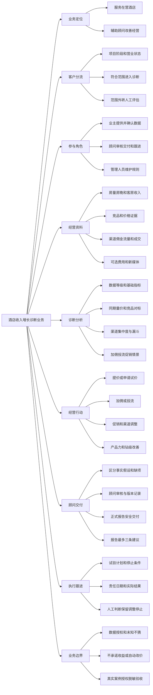

# 酒店收入增长诊断系统：业务思维导图

> 基于 [PRD V0.3.1](./酒店收入增长诊断小程序_PRD_V0.3.1.md) 的评审草案。新增 P0 范围仍待甲方确认，不代表收益承诺。

[查看可缩放的 SVG 导图](./酒店收入增长诊断系统_业务思维导图_V0.3.1.svg)。下方 Mermaid 图为可编辑源内容；修改后需重新导出 SVG。

<!-- mermaid-checked: no \n, no em-dash/en-dash, no {} in labels, subgraphs are id["label"], arrows are -->|"label"|, all subgraphs closed by end, ids unique -->

## 业务主线

客户分流 → 授权与建档 → 资料上传及确认 → 数据分级与诊断 → 顾问审核 → 报告交付 → 试验及其他行动跟进 → 人工复盘。

## 关键口径

- 佣金、投流和促销是分别测算的经营情景；提高佣金可能影响流量，但不保证流量或订单增长。
- 费用和新媒体数据可选；已采集费用不等于总成本、GOP 或净利润，问询不等于成交。
- 当前钻级与目标钻级分开；重大投资、改造和退出决策转人工咨询，不自动生成决策。
- 一期以人工记录和审核为主；自动提醒与完整自动复盘为后续能力。
