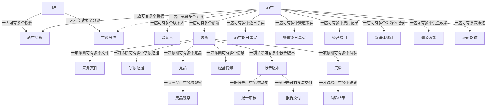

# 酒店收入增长诊断系统：数据库设计与数据字典

> **评审草案 V0.3.1｜不含建表 SQL**  
> 配套 [PRD V0.3.1](./酒店收入增长诊断小程序_PRD_V0.3.1.md)。在 V0.3 基础上补充分诊、可选费用、新媒体事实和一般行动字段；新增范围、字段、规则和留存策略均须甲方、业务、研发及法务确认后才能冻结。

## 1. 设计原则与通用约定

1. 一个顾问可服务多个已授权酒店，一个酒店可有多位授权业主及顾问、多次诊断和多个报告版本；不可用单一 `user_id` 假定一对一关系。
2. 底层数据须能追溯来源、字段级确认、期间、操作者与版本；识别值不等于已确认值，情景假设不等于实际值。
3. 无数据使用 `NULL` 和状态，不把未知、未采集、不适用、尚未核实视为 0。明确确认的 0 可参与允许零值的计算。
4. 数据库、原图、导出文件私有；服务端逐次检查用户、酒店、资源和操作授权。授予角色不自动授予所有酒店数据。
5. 已审核报告和试验方案版本普通修改时不可覆盖；涉及法定删除或留存到期时按批准策略清理，包括受控备份。
6. 金额示例用 `DECIMAL(18,2)` 元，比例用 `DECIMAL(9,6)` 的 0～1 小数，时间 `DATETIME` 按 UTC 存储并在界面按业务时区显示，日期用 `DATE`；业务时区、币种和精度需评审。
7. 表格中的“必填”是创建该实体或形成有效事实的要求，不要求资料不全时禁止保存诊断草稿。
8. 表名和类型为建议设计，不预设具体云厂商。采用外键或等价约束；跨酒店资源必须同时核对所属酒店及有效授权。
9. 首诊可暂不关联酒店，其访问授权独立于酒店授权；关联酒店后不得自动扩大顾问的访问范围。
10. 费用和新媒体字段为可选资料，不是原有数据等级的新增必填项；未经确认的资料、阶段性目标和已实现事实分别保存。

**通用审计字段**：各业务表建议包含 `id`（UUID，必填）、`created_at`、`created_by`、`updated_at`、`updated_by`、`version`；按策略使用删除状态与删除时间。并发修改以版本检查，冲突时不静默覆盖。

## 2. 实体关系

<!-- mermaid-checked: no \n, no em-dash/en-dash, no {} in labels, subgraphs are id["label"], arrows are -->|"label"|, all subgraphs closed by end, ids unique -->

规则版本与诊断/报告通过版本 ID 关联；截图/证据与下表中的事实、竞品和情景通过字段级证据映射关联。分诊可由创建人或明确授权的指定顾问访问，不能以其代替酒店授权；身份归属与业务授权分离，不以报告或文件 URL 代替鉴权。

## 3. 用户、酒店与访问授权

### 3.1 `user` 用户与 `hotel` 酒店

| 表.字段 | 类型 | 必填 | 说明 |
|---|---|---|---|
| user.login_provider | VARCHAR(32) | 是 | 登录提供方；微信接入须在服务端验证 |
| user.provider_subject | VARCHAR(128) | 是 | 提供方用户标识，和 provider 联合唯一；不默认采集手机号 |
| user.status | VARCHAR(16) | 是 | active/disabled；角色由独立权限配置分配 |
| hotel.name | VARCHAR(200) | 是 | 酒店名称，来源及确认状态须可追溯 |
| hotel.brand | VARCHAR(100) | 否 | 品牌名称；所属集团不默认推断 |
| hotel.city / business_area | VARCHAR(100) | 否 | 城市及商圈；未知显式标记 |
| hotel.room_count | INTEGER | 否 | 基础房量，正整数；随日期变化时以逐日可售为准 |
| hotel.diamond_level / diamond_platform | VARCHAR(16) / VARCHAR(32) | 否 | 当前已确认的平台钻级及所属平台；保留来源和确认时间，不能与目标钻级或其他星级混同 |
| hotel.price_authority / channel_authority | VARCHAR(24) | 是 | self/approval/none/unknown，分别记录价格及渠道权限 |

`contact`：`hotel_id`、姓名或称呼、联系方式、用途、取得和使用授权、来源；仅收集必要字段，权限、加密与删除同酒店数据。不得把住客名单作为客户联系人。

### 3.2 `hotel_grant` 酒店授权

| 字段 | 类型 | 必填 | 规则 |
|---|---|---|---|
| hotel_id / grantee_user_id | UUID | 是 | 授权的酒店及被授权用户 |
| role | VARCHAR(24) | 是 | owner/staff/consultant；全局管理员单独配置 |
| permissions | 受控集合 | 是 | 如资料读写、确认、审核、交付、授权管理；按最小权限 |
| status | VARCHAR(16) | 是 | pending/active/revoked/expired |
| granted_by / granted_at | UUID / DATETIME | 启用时是 | 有权授权的人及时间；授权依据受控存储 |
| expires_at / revoked_at | DATETIME | 否 | 到期或撤销后拒绝在线访问；记录操作人和原因 |

建议限制同一酒店、用户、角色的有效授权重复；跨酒店复制、审核和下载须分别检查目标资源权限。历史审计保留与撤权后的数据删除由法务确定。

### 3.3 `service_intake` 首诊分流

创建前须展示信息处理目的并取得必要同意；该记录可以暂不关联 `hotel`，不得要求完整经营数据或住客信息。

| 字段 | 类型 | 必填 | 规则 |
|---|---|---|---|
| creator_id / consent_ref | UUID / 关联 | 是 | 创建人及有效的同意版本和时间；不同意时不创建 |
| project_name / city | VARCHAR(200) / VARCHAR(100) | 是/否 | 项目或酒店称谓；城市可选，不默认要求联系人或手机号 |
| project_stage | VARCHAR(24) | 是 | operating/preparation/renovation/exit_planning/other/unknown；记录用户所述阶段 |
| operating_status | VARCHAR(24) | 是 | open/suspended/not_open/unknown；改造中也可能仍营业，不由阶段推断 |
| primary_objective | TEXT | 是 | 客户希望解决的主要问题；提示不要填写无关个人信息 |
| suitability_status | VARCHAR(24) | 是 | pending/eligible/out_of_scope；项目阶段已确认且符合在营、目标和其他已确认条件才可标 eligible |
| referral_status / referral_at | VARCHAR(24) / DATETIME | 是/否 | pending/recorded/closed；recorded 表示有权人员已实际记录转交，并保留操作者和时间，不等于自动通知或已联系 |
| hotel_id | UUID | 否 | 关联酒店前须校验关联操作权限；空值不代表公开分诊 |
| consultant_user_id / grant_status | UUID / VARCHAR(16) | 否/是 | 可指定被授权顾问，状态 none/pending/active/revoked；active 时须指定顾问，有有效授权才能读取该分诊 |
| grant_by / grant_at / grant_basis_ref | UUID / DATETIME / 关联 | 启用时是 | 记录有权主体、时间与授权依据；分诊授权与 `hotel_grant` 分开撤销 |

项目阶段已确认、仍在营业且目标为在营经营改善时，其他一期适用条件确认后可进入酒店授权与诊断。未开业、暂停营业、项目阶段或营业状态未知或目标超出范围时保留人工评估状态；不擅自创建在营诊断或代替顾问联系客户。

## 4. 诊断、来源和字段确认

### 4.1 `diagnosis`

| 字段 | 类型 | 必填 | 规则 |
|---|---|---|---|
| hotel_id | UUID | 是 | 所属酒店，所有关联记录必须同属该酒店 |
| creator_id | UUID | 是 | 有权建档的业主或顾问 |
| period_start / period_end | DATE | 是 | 起止日均含；结束不得早于开始 |
| status | VARCHAR(24) | 是 | draft/review_data/ready/review_report/approved/delivered 等 |
| data_level | VARCHAR(8) | 否 | L1/L2/L3；草稿可空，具体入级规则待批准 |
| input_revision | INTEGER | 是 | 确认数据变更递增；报告审核绑定该版本 |
| rule_version_id | UUID | 否 | 产生规则判断时记录已发布版本 |

### 4.2 `source_file` 与 `evidence_value`

| 表.字段 | 类型 | 必填 | 说明 |
|---|---|---|---|
| source_file.diagnosis_id / hotel_id | UUID | 是 | 权限及归属；文件以私有对象键保存 |
| source_file.type | VARCHAR(32) | 是 | 本店后台、PMS、搜索列表、竞品详情等 |
| source_file.object_key / checksum | VARCHAR | 是 | 私有路径和校验值，不存公开长期链接 |
| source_file.captured_at | DATETIME | 否 | 截图时间；未知不得用上传时间冒充 |
| evidence_value.entity_type / entity_id / field_key | VARCHAR / UUID / VARCHAR | 是 | 指向具体业务实体和字段；须校验酒店归属 |
| evidence_value.source_type / source_file_id | VARCHAR / UUID | 是/否 | screenshot/manual/import；截图来源需关联文件和可见性 |
| evidence_value.recognized_value / confirmed_value | 类型化值 | 否 | 分别保留识别原值、修改后值；按字段类型校验 |
| evidence_value.verification_status | VARCHAR(20) | 是 | unverified/confirmed/unknown/rejected |
| evidence_value.confirmed_by / confirmed_at | UUID / DATETIME | 确认时是 | 确认人须有对应授权；顾问代确认权限另行明确 |
| evidence_value.correction_reason | TEXT | 否 | 用户或顾问的修正说明；不得覆盖原始识别值 |

正式计算只读取相关字段已确认且口径有效的版本。截图价格的入住日期和截图时间须在图中可见；图面缺失的人工陈述默认不用于正式价格对标。

## 5. 酒店逐日与渠道数据

### 5.1 `hotel_daily` 逐日经营事实

粒度：**酒店 × 经营日期 × 数据版本**，同一版本不得重复。经营日期是入住/房晚日期还是财务结算日期须明确，不能混用。

| 字段 | 类型 | 必填 | 单位/规则 |
|---|---|---|---|
| hotel_id / business_date | UUID / DATE | 是 | 日期归属和业务时区明确 |
| available_room_nights | INTEGER | 否 | 间夜；实际可售优先，须大于 0 才计算出租率 |
| sold_room_nights | INTEGER | 否 | 间夜；0～可售房晚，超出需核对口径 |
| room_revenue | DECIMAL(18,2) | 否 | 元；需注明税费、退款、优惠和佣金扣除口径 |
| revenue_basis | VARCHAR(32) | 否 | before_discount/after_discount 等；基数未确认不得与渠道情景混算 |
| adr / occupancy | 派生值 | 否 | ADR=收入÷售出房晚，出租率=售出÷可售；不覆盖原始事实 |
| quality_status / input_revision | VARCHAR / INTEGER | 是 | 字段确认状态通过证据关联；版本与诊断匹配 |

月数据和日数据分开存储与展示；不得把月总量填成每日事实。日汇总与月总数不一致时提示核对，不自动覆盖。

### 5.2 `channel_daily` 逐日渠道表现

粒度建议为**酒店 × 渠道 × 统计日期 × 口径 × 版本**；曝光/点击按事件日、订单/收入可能按入住日或成交日，若不同则分记录保存，不能强行合并。

| 字段 | 类型 | 必填 | 单位/规则 |
|---|---|---|---|
| hotel_id / channel_code / stat_date | UUID / VARCHAR(32) / DATE | 是 | 平台或渠道，日期和时间口径明确 |
| date_basis / metric_basis | VARCHAR(32) | 是 | 事件日、成交日、入住日、结算日；统计去重和来源 |
| impressions / clicks | BIGINT | 否 | 次；非负，不假设缺失值为 0 |
| orders / sold_room_nights | BIGINT / INTEGER | 否 | 订单数与间夜分别保存，不互换 |
| revenue_before_discount | DECIMAL(18,2) | 否 | 元；优惠前、扣佣前房费 |
| hotel_discount | DECIMAL(18,2) | 否 | 元；酒店承担且已计入该收入的优惠 |
| revenue_after_discount | DECIMAL(18,2) | 否 | 元；相同口径下等于优惠前减酒店承担优惠，补贴、税和退款另行核实 |
| commission_settled / ad_spend | DECIMAL(18,2) | 否 | 元；实际结算佣金、酒店承担的广告费用，来源及周期确认 |
| attributed_orders / attribution_window | INTEGER / VARCHAR(64) | 否 | 归因订单及窗口；不等于新增订单 |
| currency / status | CHAR(3) / VARCHAR(20) | 是 | 币种；草稿/确认/未知，字段级证据仍需分别确认 |

曝光、点击和订单仅在渠道、日期、事件定义与归因窗口一致时计算漏斗；分母为 0 或缺失则不可计算。

## 6. 佣金、促销与竞品

### 6.1 `commission_policy` 佣金政策

| 字段 | 类型 | 必填 | 单位/规则 |
|---|---|---|---|
| hotel_id / channel_code | UUID / VARCHAR(32) | 是 | 对应本店及平台 |
| base_rate / additional_rate | DECIMAL(9,6) | 否 | 比例 0～1；额外费率是否与基础费率相加由合同确认 |
| calculation_basis | VARCHAR(64) | 否 | 费率适用的房费、优惠前后和税费口径 |
| effective_start / effective_end | DATE | 否 | 适用有效期；缺失不擅自沿用 |
| room_type / activity_scope | VARCHAR | 否 | 房型、活动或其他条件；重叠政策需明确优先级 |
| additional_promotion_fee | DECIMAL(18,2) | 否 | 元；确认是否与广告或佣金重复 |
| actual_settlement_amount | DECIMAL(18,2) | 否 | 元；须关联结算周期及来源；优先于估算 |
| contract_source / verification_status | UUID / VARCHAR | 否/是 | 合同或证明文件引用及核实状态 |

### 6.2 `promotion`

| 字段 | 类型 | 必填 | 说明 |
|---|---|---|---|
| hotel_id / channel_code | UUID / VARCHAR | 是 | 酒店、渠道及适用日期 |
| starts_on / ends_on | DATE | 是 | 有效日期 |
| discount_type / discount_value | VARCHAR / DECIMAL | 否 | 固定金额或比例；单位明确，不得混用 |
| payer | VARCHAR(24) | 否 | hotel/platform/shared/unknown；分担金额或比例另列 |
| eligible_scope | TEXT | 否 | 房型、订单及已存在订单是否受影响 |
| source / verification_status | 关联 / VARCHAR | 是 | 来源、核实状态；费用与收入避免重复计入 |

### 6.3 `competitor` 与 `competitor_observation`

竞品档案：`diagnosis_id`、酒店名称、位置/距离、档次、钻级、装修/开业年份、面积、评分、可比状态及依据。候选数量按 PRD 引导 3～5 家，真正可比的最低数量须业务确认。

观察记录粒度：竞品 × 入住日期 × 房型/条件 × 截图时间 × 来源。字段包括挂牌价、币种、餐食/取消/优惠条件、截图时间、近期出租情况；佣金、额外政策、投流、促销、曝光、点击、订单、间夜、成交 ADR 均可空并单独记录周期、计费口径和证据。无合法可靠来源标未知；不得推断竞品经营秘密。

## 7. 情景、试验、报告和交付

### 7.1 `scenario` 情景及财务计算

| 字段 | 类型 | 必填 | 说明 |
|---|---|---|---|
| diagnosis_id / hotel_id | UUID | 是 | 数据及授权归属一致 |
| scenario_type | VARCHAR(20) | 是 | commission/advertising/promotion；涨价可单列其他行动 |
| period_start / period_end / channel_code | DATE / VARCHAR | 是 | 与基线同日期、渠道、房型及统计口径 |
| baseline_revision | INTEGER | 是 | 已确认事实版本 |
| assumptions | 类型化字段/受控结构 | 是 | 目标费率、预算、优惠、假设间夜等，逐项保留来源、确认人 |
| projected_amounts | 类型化金额 | 否 | 收入、优惠、佣金、广告、净收益，区分估算与实际 |
| missing_items / comparability_status | 受控结构 / VARCHAR | 是 | 不完整时不排名、不假设为零 |
| rule_version_id | UUID | 否 | 存在规则判断时绑定已发布版本 |

定义：优惠前房费 `G`、酒店承担优惠 `D`、佣金 `C`、广告 `A`。净收益 `G-D-C-A`；若来源为已扣优惠的收入 `R`，则用 `R-C-A`，不可重复扣 `D`。含税、退款、补贴、佣金基数和结算周期不一致时先标不可比。已知且未重复计入的变动成本可另计算贡献收益。

### 7.2 `experiment` 与 `experiment_result`

| 表.字段 | 类型 | 必填 | 说明 |
|---|---|---|---|
| experiment.diagnosis_id / hotel_id | UUID | 是 | 授权及归属一致 |
| experiment.type / status | VARCHAR | 是 | price/commission/advertising/promotion；draft/planned/running/stopped/completed |
| experiment.baseline / control | 受控结构 | 是 | 对照日期、范围、房型及数据版本；缺失时可保存草稿但不得宣称有效对照 |
| experiment.start_date / end_date | DATE | 是 | 试验日期；具体日期与时间口径明确 |
| experiment.original_value / target_value | 类型化值 | 是 | 原价/目标价、费率或预算及单位 |
| experiment.owner_id / stop_condition | UUID / TEXT | 是 | 责任人和已批准停止条件；无可用条件不形成正式试验建议 |
| experiment_result.business_date | DATE | 是 | 实际执行或经营日期 |
| experiment_result.executed_value / status | 类型化值 / VARCHAR | 否/是 | 实际执行与计划区分；人工记录执行、停止等 |
| experiment_result.metrics | 类型化值或逐日事实关联 | 否 | 出租率、ADR、房费、佣金、投流等；来源与确认状态必需 |
| experiment_result.manual_decision / reason | VARCHAR / TEXT | 否 | retain/adjust/stop/undetermined 及顾问依据；非自动因果判断 |

### 7.3 `report_version`、`report_review`、`report_delivery`

| 表.字段 | 类型 | 必填 | 规则 |
|---|---|---|---|
| report_version.diagnosis_id / revision | UUID / INTEGER | 是 | 同一诊断版本号唯一 |
| report_version.input_revision / rule_version_id | INTEGER / UUID | 是/条件必填 | 绑定确认数据和使用的规则；不足数据报告可注明未启用规则 |
| report_version.status / content_ref | VARCHAR / 关联 | 是 | draft/pending/approved/rejected/delivered；内容及文件私有 |
| report_review.report_version_id / reviewer_id | UUID | 是 | 仅有权限的顾问审核 |
| report_review.decision / reason / reviewed_at | VARCHAR / TEXT / DATETIME | 是 | approve/reject，记录意见及时间 |
| report_review.changes | 受控审计记录 | 否 | 修改字段、前后值、原因；新版本重新审核 |
| report_delivery.report_version_id / recipient_id | UUID | 是 | 已审核版本及授权接收人 |
| report_delivery.method / status / delivered_at | VARCHAR / VARCHAR / DATETIME | 是/条件必填 | 手工或系统交付；区分待交付、成功、失败，不虚报送达 |

`follow_up` 保存酒店/诊断/试验关联、沟通日期、必要记录、负责人、下次行动和客户反馈；访问、留存及联系人处理同酒店授权。P0 只做人工记录，不隐含自动发送或定时提醒。

### 7.4 `follow_up` 一般行动和钻级跟进扩展

复用现有跟进记录；一条行动对应一条记录，普通沟通仍可单独记录。行动与沟通分别授权展示，不自动进入客户报告。

| 字段 | 类型 | 必填 | 规则 |
|---|---|---|---|
| hotel_id / diagnosis_id / experiment_id | UUID | 是/否/否 | 均须属于同一酒店；关联试验时其执行状态和结果以 `experiment` 为准 |
| record_kind / action_type | VARCHAR(24) | 是/否 | communication/action；行动可标 general/diamond_improvement 等，不要求另建自动评级模块 |
| action_description | TEXT | 行动时是 | 说明实际拟做的事情；不把建议描述为已执行 |
| owner_user_id / owner_role | UUID / VARCHAR(100) | 否 | 责任人为已授权用户或必要的角色描述；未确定可空，不默认分配或采集无关联系方式 |
| target_date / action_status | DATE / VARCHAR(24) | 否/行动时是 | 计划日期可未知；状态 pending/planned/in_progress/completed/paused/cancelled |
| tracking_metric / target_value | VARCHAR / 类型化值 | 否 | 指标名称、单位、统计周期及目标；未确认不得推断 |
| actual_result / result_source / recorded_at | 类型化值 / 关联 / DATETIME | 否 | 人工记录实际执行、结果和来源；完成状态需有实际执行记录 |
| baseline_diamond / target_diamond | VARCHAR(16) | 否 | 记录计划采用的当前钻级快照与目标；目标不改写 `hotel.diamond_level` |
| visibility | VARCHAR(16) | 是 | internal 或 approved_for_report；后者还须经过报告审核，不能自动公开跟进全文 |

状态、责任、目标与结果变更使用版本和审计记录留痕。正式报告只收录选中且审核通过的行动，与试验建议合计不超过 3 条；试验相关跟进引用试验状态，不单独保存另一份试验执行状态。

## 8. 规则、数据质量及安全约束

- `rule_version` 保存版本号、可配置参数、模板、审批人、发布时间和状态；仅服务端使用。业务层级、否决条件和其他限制需经过负责人批准，缺失时相应模块关闭。
- `audit_event` 保存操作者、酒店、资源、动作、时间和结果；不记录完整截图、完整报告、密钥或无关个人信息。
- 字段级来源与核实记录必须覆盖佣金、费率、优惠、流量及试验数据；`confirmed_by` 仅能是有权确认者，未知不可转换为确认零值。
- 业务唯一性：有效授权避免重复；逐日同口径事实避免重复；报告版本号在诊断内唯一；情景计算绑定输入及规则版本。
- 金额、率、数量非负约束应结合退款等业务定义，不明口径先退回；费率通常为 0～1，但费率是否可相加由合同决定。日销量超可售、期间重叠或不一致均需人工核验。
- 原始数据修改、授权变更、报告审核/交付和删除均留痕；使用日志脱敏、传输及存储加密、限权下载和可验证备份恢复。
- 外部 OCR/模型的数据使用、训练禁止、存储地域、保留、删除与用户授权均须审批；截图库和规则库不得无授权发送到第三方。

## 9. 数据验收示例

1. **未知竞品佣金**：相关字段 `NULL`，状态 unknown；不得写入 0% 或推导市场佣金。
2. **优惠防重**：优惠前 22,000 元、酒店优惠 2,200 元、佣金 1,980 元、广告 0 元，净收益为 17,820 元；优惠后收入 19,800 元不得再扣 2,200 元。
3. **授权撤销**：顾问对酒店 A 的授权 revoked 后，立即拒绝读取其截图、报告和试验；已导出到外部的副本不能保证撤回。
4. **审核失效**：报告已审核后数据版本从 2 变 3，新报告须重新审核；旧报告按留存策略保持原版本。
5. **日期粒度**：月收入存在、日收入缺失时，日记录保持未知，不能平均分配并标记为已确认。
6. **分诊与酒店授权**：顾问仅获某条分诊授权时，可以查看该分诊，但不得读取随后关联酒店的诊断、截图或报告。
7. **费用不完整**：人工费用 5,000 元已确认、水电未知时，水电保持未知；最多展示明确标注的已采集费用小计，不得称总成本、GOP 或净利润。
8. **钻级目标**：当前 3 钻、目标 4 钻且无平台评定时，当前事实和既有报告保持 3 钻；目标只作为行动计划。
9. **新媒体问询**：浏览和问询存在但成交未知时，成交字段为 `NULL` 且状态为 unknown，不由问询推断订单。

## 10. 待确认事项

- 数据所有权、顾问授权和撤销流程、字段级确认主体与责任。
- 截图和渠道报表的可得性、合规来源、保存周期及第三方识别许可。
- 佣金叠加方式、优惠承担和结算基数，归因窗口及取消/退款处理。
- 同期可比、日维度业务日期、异常值、渠道净收益与贡献收益的业务口径。
- 报告审核责任、交付结果证明、数据留存和删除/备份清理时限。
- 分诊所需同意、指定顾问授权及撤销、在营适用条件和实际人工转交方式。
- 费用类别、来源、统计范围、期间和与渠道成本的重叠；GOP 与净利润如需自动核算须另行确认并扩展范围。
- 新媒体指标的原始定义、周期、数据来源、去重与成交证明；不默认建设平台自动采集。
- 一般行动的可见范围、责任主体、完成依据，以及平台钻级评定来源。
- 真实案例的授权、脱敏、处理主体、业务预期与验收责任。
- 数据库选择、备份恢复目标、字段级索引和最终物理设计。

## 11. V0.3.1 可选经营费用与新媒体事实

### 11.1 `operating_expense` 经营费用

建议粒度：**酒店 × 明确统计期间 × 费用明细 × 版本**。通常按自然月录入；非自然月须保留实际起止日和原因，不与其他期间直接合计。一个类别可以有多条可区分明细；不能只依类别判断不重复。

| 字段 | 类型 | 必填 | 单位/规则 |
|---|---|---|---|
| hotel_id / period_start / period_end | UUID / DATE / DATE | 是 | 酒店和包含起止日的期间，结束不得早于开始 |
| expense_category / description | VARCHAR(32) / VARCHAR(200) | 是/否 | labor/utilities/rent/commission/advertising/other；按实际来源归类 |
| amount / currency | DECIMAL(18,2) / CHAR(3) | 否/是 | 金额单位为对应币种；未知为 `NULL`，普通费用非负，冲回处理规则待确认 |
| expense_scope / channel_code | VARCHAR(24) / VARCHAR(32) | 是/否 | hotel/channel/other/unknown；渠道范围时记录渠道及分摊说明 |
| amount_kind / accounting_basis | VARCHAR(16) / VARCHAR(64) | 是/否 | actual/estimate/unknown；注明可得的结算、税费及统计口径 |
| channel_cost_overlap | VARCHAR(16) | 是 | yes/no/unknown；是否与已计入渠道净收益的佣金或广告重叠，未知不得按 no 处理 |
| source_ref / verification_status | 关联 / VARCHAR(20) | 否/是 | 关联字段级来源及确认记录；可以先保存未确认草稿 |
| confirmed_by / confirmed_at | UUID / DATETIME | 确认时是 | 有权确认者和时间；修改已确认值后重新确认并递增相关输入版本 |

仅在同一期间、币种和范围内，所有纳入小计的明细已确认且能排除相互重叠时，可以显示“已采集费用小计”，并展示组成和缺项；否则只展示单项和核对提示。该小计不是总成本。渠道佣金或广告已扣除时不能重复扣；本版 P0 不使用该表自动计算酒店 GOP、经营利润或税后净利润。

### 11.2 `social_media_period` 新媒体统计

建议粒度：**酒店 × 平台 × 明确期间 × 账号或内容范围 × 来源 × 版本**。账号总体与单篇内容可能重叠，无法核实去重时不汇总。

| 字段 | 类型 | 必填 | 单位/规则 |
|---|---|---|---|
| hotel_id / platform_code | UUID / VARCHAR(32) | 是 | 酒店及平台；手工录入，不自动登录或抓取 |
| period_start / period_end | DATE / DATE | 是 | 明确统计日期及业务时区；不得混用不同事件周期 |
| account_or_content_scope | VARCHAR(200) | 否 | 账号、内容或汇总范围；只记录必要标识 |
| views / impressions / interactions | BIGINT | 否 | 浏览或播放、曝光、互动分别保存；非负，未知为 `NULL` |
| inquiries / confirmed_bookings | BIGINT | 否 | 问询与有可靠来源并经确认的成交订单分别保存；问询不等于订单 |
| metric_definitions / dedup_basis | 受控结构 / VARCHAR | 否 | 平台原始定义、单位、是否去重；未知不可推断一致 |
| booking_source / attribution_window | 关联 / VARCHAR | 否 | 成交证据和可得的归因窗口；无来源时不标已证实成交 |
| source_ref / verification_status | 关联 / VARCHAR(20) | 否/是 | 每个已展示为事实的指标保留字段级来源、确认人及时间 |

本模块不把浏览自动当作 OTA 曝光或点击，不将问询推成订单，不根据这些指标自动计算转化率、ROI 或新增订单。原有 `channel_daily` 中的渠道漏斗仍按自身已批准的口径和确认门槛计算。费用和新媒体资料被报告引用后发生修改时，关联诊断的输入版本须更新，新报告重新审核；历史已交付快照按留存策略保留。
