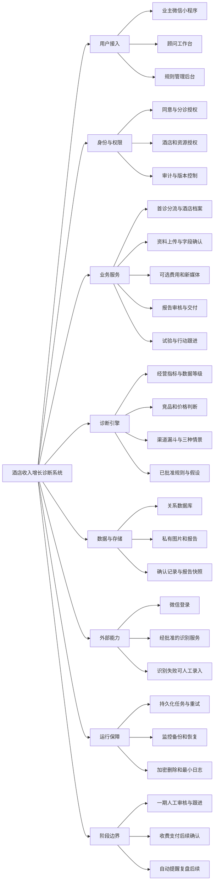

# 酒店收入增长诊断系统：系统架构思维导图

> 基于 [PRD V0.3.1](./酒店收入增长诊断小程序_PRD_V0.3.1.md) 的建议架构；目前尚无已实现的应用，技术选型和新增范围均待确认。

[查看可缩放的 SVG 导图](./酒店收入增长诊断系统_系统架构思维导图_V0.3.1.svg)。下方 Mermaid 图为可编辑源内容；修改后需重新导出 SVG。

<!-- mermaid-checked: no \n, no em-dash/en-dash, no {} in labels, subgraphs are id["label"], arrows are -->|"label"|, all subgraphs closed by end, ids unique -->

## 核心数据流

1. 客户授权后提交资料；截图识别结果必须经有权主体确认，未知不进入计算。
2. 诊断引擎使用已确认输入和已发布规则，生成事实、情景假设、缺项及报告草稿。
3. 顾问审核当前数据和报告版本后交付；数据变更形成新版本并重新审核。
4. 试验与一般行动人工跟进；系统不自动改价、派单、抓取平台或承诺收益。

## 建议技术与约束

- 小程序和 Web 管理端通过业务接口访问模块化单体服务；Node.js、NestJS 和 Vue 为候选方案，最终以甲方与研发确认结果为准。
- MySQL 或 PostgreSQL 二选一；截图和报告使用私有对象存储。文件下载、分诊及酒店访问均须服务端鉴权。
- OCR 或模型只辅助提取与整理，不替代数据确认、已批准规则或顾问审核；第三方处理须先获授权和合规批准。
- 酒店 GOP、经营利润和净利润的自动核算不属于本版一期；费用录入不自动扩展为财务系统。

[查看分层架构与组件关系](./.github/modernize/assessment/engines/facts/architecture-diagram.md)
