# 酒店收入增长诊断系统：业务思维导图 V0.3.2

> 基于 [PRD V0.3.2](../prd/revenue-diagnostic_PRD_V0.3.2.md) 的评审草案。P0 新增及细化范围、业务规则和验收均待确认；示例不构成收益承诺。以下 Mermaid 为可编辑的思维导图。

[查看 SVG 思维导图](./酒店收入增长诊断系统_业务思维导图_V0.3.2.svg)。修改 Mermaid 后需重新导出 SVG。

```mermaid
flowchart LR
    Root["酒店收入增长诊断业务"]
    Root --> Position["定位与对象"]
    Position --> Position1["辅助顾问服务在营酒店"]
    Position --> Position2["业主提供确认资料"]
    Position --> Position3["顾问审核交付和人工跟进"]
    Position --> Position4["品牌方为可能的审批对象"]
    Root --> Intake["首诊分流"]
    Intake --> Intake1["必要告知和同意后采集"]
    Intake --> Intake2["项目阶段和营业状态分别记录"]
    Intake --> Intake3["在营改善且适用条件确认后授权建诊"]
    Intake --> Intake4["范围外或未知待人工评估"]
    Intake --> Intake5["实际转交才记录 不自动通知"]
    Root --> Data["资料与核对"]
    Data --> Data1["本期 同比 环比周期及口径"]
    Data --> Data2["逐日房晚收入与渠道事实"]
    Data --> Data3["本店及竞品房型价格截图"]
    Data --> Data4["佣金 投流 促销和权限"]
    Data --> Data5["费用和新媒体可选"]
    Data --> Data6["逐字段确认 未知不填零"]
    Data --> Data7["周期与逐日独立 缺日不均摊"]
    Root --> Diagnosis["分级与诊断"]
    Diagnosis --> Level0["资料不足 仅草稿与缺项"]
    Diagnosis --> Level1["L1 基础指标和自设持平情景"]
    Diagnosis --> Level2["L2 可比同期量价变化"]
    Diagnosis --> Level3["L3 可比竞品和分日期判断"]
    Diagnosis --> Diagnosis1["挂牌价不等于实际成交价"]
    Diagnosis --> Diagnosis2["规则或数据缺失则无法判断"]
    Diagnosis --> Diagnosis3["收入持平不代表利润持平"]
    Root --> Channel["渠道及情景"]
    Channel --> Channel1["订单 间夜 收入占比分开"]
    Channel --> Channel2["漏斗核对人群 日期与归因窗口"]
    Channel --> Channel3["加佣区分受影响原订单和新增假设"]
    Channel --> Channel4["投流区分预算 预计和实际"]
    Channel --> Channel5["促销区分优惠承担方 避免重复扣减"]
    Channel --> Channel6["同基线且规则齐备才有条件比较"]
    Channel --> Channel7["渠道净收益不等于酒店利润"]
    Root --> Actions["行动与跟进"]
    Actions --> Actions1["按渠道分别确认调价 加佣 投流 促销权限"]
    Actions --> Actions2["需审批则申请 未知先确认"]
    Actions --> Actions3["试验计划含基线 责任 指标及停止条件"]
    Actions --> Actions4["人工回填事实 保留调整停止或无法判断"]
    Actions --> Actions5["钻级目标不改变当前已核实钻级"]
    Actions --> Actions6["一般行动需实际执行依据"]
    Root --> Delivery["审核与交付"]
    Delivery --> Delivery1["事实 假设 缺项和依据分开"]
    Delivery --> Delivery2["当前输入及报告版本审核"]
    Delivery --> Delivery3["审核制度未确认则正式交付门禁关闭"]
    Delivery --> Delivery4["正式报告最多三条行动"]
    Delivery --> Delivery5["线上开放 线下发送 接收 阅读分别记录"]
    Delivery --> Delivery6["修改后新版本重审 历史快照按策略保留"]
    Root --> Boundary["阶段与边界"]
    Boundary --> Boundary1["P0 人工审核交付与跟进"]
    Boundary --> Boundary2["P1 收费权益和独立免费预检"]
    Boundary --> Boundary3["P2 自动提醒 归因及完整复盘"]
    Boundary --> Boundary4["不自动抓取 改价 派单或保证收益"]
    Boundary --> Boundary5["投资退出及重大改造转人工咨询"]
    Boundary --> Boundary6["授权脱敏真实案例为业务验收门槛"]
```

## 业务主线

必要告知和同意 → 首诊分流 → 确认适用性及酒店授权 → 上传或录入并逐项确认 → 分级及计算 → 顾问审核 → 按接收人交付 → 试验及其他行动人工跟进。非在营、阶段或适用性未知时待人工评估；阶段性结果不等于正式报告。

## 关键门槛

- L2 的同比和环比是否均必需、L1 的渠道风险边界仍待确认，评审前按 PRD 第 6.1 节保守处理。L3 和每个日期的试价也分别受数据、可比性及已发布规则约束。
- 价格截图的入住日期和截图时间默认均需图面可见；无可靠依据时不用于正式对标。近期出租和历史价格不能从当前截图推断。
- 贡献收益须确认全部适用变动成本及防重；可选费用小计不是总成本、GOP 或净利润。新媒体问询不等于成交或新增订单。
- 三方案的流量和新增间夜属于假设，平台归因不证明因果。正式行动受分项经营权限、授权、规则和审核共同约束。
