# 酒店收入增长诊断系统：系统架构思维导图 V0.3.2

> 基于 [PRD V0.3.2](../prd/revenue-diagnostic_PRD_V0.3.2.md) 的建议逻辑架构，并非已实现系统或已批准技术选型。字段契约详见[数据库设计与数据字典 V0.3.2](../database/revenue-diagnostic_数据库设计与数据字典_V0.3.2.md)。

[查看 SVG 思维导图](./酒店收入增长诊断系统_系统架构思维导图_V0.3.2.svg)。修改 Mermaid 后需重新导出 SVG。

```mermaid
flowchart LR
    Root["酒店收入增长诊断系统"]
    Root --> Access["用户接入"]
    Access --> Access1["业主小程序 平台待确认"]
    Access --> Access2["顾问 Web 工作台"]
    Access --> Access3["规则与系统管理后台"]
    Root --> Security["身份 同意与授权"]
    Security --> Security1["分诊授权与酒店授权独立"]
    Security --> Security2["资源和操作服务端鉴权"]
    Security --> Security3["用途同意与撤回分别记录"]
    Security --> Security4["经营决策权按行动和渠道记录"]
    Security --> Security5["撤权后再次访问和下载须拒绝"]
    Root --> Service["业务服务"]
    Service --> Service1["首诊 建档 向导和进度恢复"]
    Service --> Service2["上传 识别 人工核对及确认"]
    Service --> Service3["周期 日 渠道 竞品和证据"]
    Service --> Service4["可选费用 新媒体和一般行动"]
    Service --> Service5["审核 版本交付 试验回填"]
    Root --> Engine["指标与规则引擎"]
    Engine --> Engine1["确认和口径校验 数据等级"]
    Engine --> Engine2["出租率 ADR RevPAR 收入持平"]
    Engine --> Engine3["同期量价 竞品可比性和定价"]
    Engine --> Engine4["渠道漏斗及加佣 投流 促销情景"]
    Engine --> Engine5["已批准规则 公式 精度和舍入版本"]
    Engine --> Engine6["缺规则或缺数据时关闭相应判断"]
    Root --> Data["数据与版本"]
    Data --> Data1["关系数据库保存逻辑事实和授权"]
    Data --> Data2["周期与逐日独立 事实版本可追溯"]
    Data --> Data3["渠道按指标日期 状态 人群和归因"]
    Data --> Data4["诊断内修订绑定选用事实和输入快照"]
    Data --> Data5["报告快照 审核与每位接收人交付"]
    Data --> Data6["私有对象存储保存源图及导出"]
    Root --> Jobs["异步任务"]
    Jobs --> Jobs1["识别和导出状态持久化"]
    Jobs --> Jobs2["单项失败 重试 幂等和结果引用"]
    Jobs --> Jobs3["保存冲突和失败显式提示"]
    Root --> External["外部能力"]
    External --> External1["平台登录方案待确认"]
    External --> External2["识别仅提取 不决定经营结论"]
    External --> External3["第三方识别须合规审批和适用同意"]
    External --> External4["识别失败支持人工录入"]
    Root --> Governance["安全和运维"]
    Governance --> Governance1["传输存储加密 最小权限"]
    Governance --> Governance2["访问 审核 交付 下载和删除审计"]
    Governance --> Governance3["线上删除与备份待清理分别记录"]
    Governance --> Governance4["监控失败 备份恢复和隔离环境"]
    Governance --> Governance5["日志不保存原图全文 报告全文或令牌"]
    Root --> Scope["阶段边界"]
    Scope --> Scope1["P0 人工审核和跟进"]
    Scope --> Scope2["P1 支付和独立免费预检待确认"]
    Scope --> Scope3["P2 自动提醒 归因和完整复盘"]
    Scope --> Scope4["不自动抓取平台 改价 派单或计算酒店利润"]
```

## 核心数据流与门禁

1. 在取得适用同意后保存首诊；分诊授权不自动授予酒店资料、代确认或第三方识别权限。
2. 经酒店授权，上传图片或人工录入事实；识别结果必须逐字段由有权主体确认。周期汇总和逐日事实分开，冲突需核对，不能用月数据补造每日事实。
3. 服务端检查口径、等级和已发布规则后计算；每次结果绑定所属诊断、输入修订、选用事实版本及可复核快照，保存使用的规则、公式、精度与结果。
4. 审核重新核验版本及授权。通过审核的版本供有权限顾问受控导出；业主只能在线查看或导出已向本人开放的已批准版本。发送、接收和阅读各自以真实事件为准。
5. 试验结果由有权人员人工回填；修改报告或输入须形成新版并重审。历史快照不能被普通编辑覆盖，但依法删除、撤回后的适用处理和留存到期仍按批准策略清理，包括受控备份。

## 推荐部署与安全边界

- 建议模块化单体：小程序及 Web 端调用业务 API，关系数据库保存结构化数据，私有对象存储保存图片与报告；微信、Node.js/NestJS、Vue、MySQL 或 PostgreSQL 均为候选，最终待确认。
- OCR 或模型只辅助提取和整理，图中文字按数据处理而非系统指令；规则、内部权重和完整模板仅保留在服务端，客户端取得已渲染内容及依据。
- 持久化任务记录状态、失败原因、尝试次数及幂等标识；成功保存后才更新进度，下载时重新鉴权。删除状态应区分线上、备份、失败和完成。
- 合同范围、业务规则、审核制度、隐私留存与第三方处理均须评审；合成数据测试不能替代授权且脱敏的真实案例业务验收。
