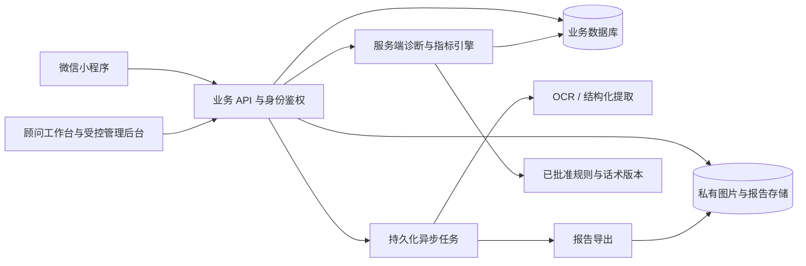

# revenue-diagnostic：酒店收入增长诊断系统 PRD

> **评审草案 V0.3.2｜非已批准开发规格**  
> 以工作区完整的 V0.3.1 为基线，根据双文档交叉审查及用户确认的修订方向，补充周期与渠道事实、历史快照、三方案测算、任务恢复、授权和报告交付契约。第 14～18 节保留 V0.3 规格，第 19～20 节保留 V0.3.1 增量，第 21～22 节为本版细化；如有冲突，以本版明确修订为准。原有及新增拟纳入 P0 的范围仍须甲方确认并重新估算；未批准的规则不得因写入本文而自动生效。

| 项目 | 内容 |
|---|---|
| 项目名称 | revenue-diagnostic |
| 产品定位 | 业主小程序、顾问工作台与诊断引擎组成的酒店收益增长服务系统 |
| 目标平台 | 原文未定；本文建议一期优先微信小程序，须由产品负责人确认 |
| 本文读者 | 产品负责人、酒店收益管理专家、设计、研发、测试、运营及法务 |
| 文档状态 | 待产品负责人、研发和法务评审 |
| 原文引用 | 下文的 F1～F14、章节和页码均指输入的 V0.1 说明书 |
| 本版参考 | 甲方公司介绍第 3、7、10、13～15 页；公司介绍中的案例为公司自述，未独立核实收益或因果关系 |
| 配套数据字典 | [数据库设计与数据字典 V0.3.2](../database/revenue-diagnostic_数据库设计与数据字典_V0.3.2.md) |
| 历史追踪 | [需求追踪与验收矩阵 V0.3.2](../archive/revenue-diagnostic_需求追踪与验收矩阵_V0.3.2.md)，仅供参考 |
| 历史导图 | [业务导图 V0.3.1](../archive/酒店收入增长诊断系统_业务思维导图_V0.3.1.svg)；[系统架构导图 V0.3.1](../archive/酒店收入增长诊断系统_系统架构思维导图_V0.3.1.svg)。两图未同步本版细化，仅供参考 |

**标注约定**

- **原文**：输入说明书明确要求；仍需结合待确认规则才能实现的，不代表已具备上线条件。
- **建议**：为形成可评审方案而补充的默认设计、体验或技术方案，须评审后采用。
- **待确认**：业务、技术或合规口径尚无定论，不得当成已批准规则。
- 原文中的 50% 渠道占比、每组 2 家竞品等数字均为讨论或示例，不作为生产环境默认阈值。
- **用户反馈**：V0.3 新增明确需求；可执行的数值门槛、归因和试验方案仍须负责人确认。
- **V0.3.1 建议**：基于公司介绍和用户确认的产品调整，不代表甲方已签收范围、案例数据已核验或财务口径已批准。
- **V0.3.2 细化**：为现有诊断、测算、审核及交付闭环补充可实现和可验收的数据契约；是否纳入最终合同及具体业务口径仍待甲方确认。

---

## 1. 范围基线（Scope Baseline）

### 1.1 背景与目标

酒店业主希望理解客房收入的量价变化、评估定价空间并降低对单一渠道的依赖，但通常缺少统一的数据格式和专业收益管理能力。产品定位为**辅助酒店收益增长顾问为在营酒店提供经营改善服务**：分步收集并确认资料，形成可追溯、不承诺收益的诊断，并支持顾问审核、交付和跟进。

产品要回答：

1. 在数据足够且业务规则已批准时，哪些日期是否适合小范围试价，可能参考什么价格区间？
2. 如果调整后的**实际平均成交房价**达到某个假设值，出租率至少达到多少才能使客房收入持平？
3. 已确认的渠道占比是否达到已批准的风险条件，哪些降依赖动作可供选择？
4. 数据不足时，当前能计算什么，还需要补充什么？
5. 已授权的顾问如何判断流量与转化缺口，比较加佣、投流和促销的情景，并审核、交付和跟进试验？
6. 客户属于在营诊断范围还是需要人工咨询？已有经营费用、新媒体数据和改善行动有哪些已确认事实与缺项？

**不追求**：自动替业主改价、自动抓取平台数据、承诺增长或用缺失数据编造结论。

### 1.2 用户和使用边界

| 角色 | 主要诉求 | 一期定位 |
|---|---|---|
| 酒店业主/经营负责人 | 看懂经营情况、知道是否值得向品牌方申请试价 | 主要用户；面向中端限服型酒店，原文一期重点为加盟店 |
| 酒店收益增长顾问 | 管理多家已授权酒店、审核诊断、交付报告并跟进试验 | P0 顾问 Web 工作台；权限按酒店和任务授权 |
| 品牌方/中央收益管理人员 | 接收门店提交的试价或渠道调整依据 | 建议作为报告中的行动对象；一期不建设品牌方协同工作台 |
| 运营/收益管理专家 | 配置经批准的规则、检查版本和报告话术 | 一期后台用户 |
| 系统管理员 | 管理后台账号、权限和审计 | 一期后台用户，具体职责须分离 |

单体店是原文目标用户之一，但一期规则明确聚焦限服型加盟店；单体店能否直接使用完整提价规则、首批覆盖的城市和钻级，需产品负责人确认。

### 1.3 一期范围与非范围

**P0：一期核心闭环**

- 客户首诊分流：在取得必要同意后记录项目阶段和主要问题；非在营、阶段未知或适用范围未确认时转人工评估，不套用经营诊断。
- 向导式录入与进度保存；本店和竞品截图上传、识别、逐项确认。
- 本店经营指标、数据充分度分级、竞品可比性检查。
- 在规则和数据条件满足时，执行提价及渠道集中度诊断，并考虑业主实际权限。
- 渠道流量/转化、佣金对标及加佣/投流/促销情景比较；未知数据不推断。
- 顾问多酒店工作台、历史诊断、专家审核、报告交付和人工跟进。
- 可选的月度经营费用和新媒体指标人工记录；数据不全不阻断原有基础诊断，不将已知费用冒充完整利润。
- 在现有跟进中记录一般经营行动及钻级提升目标；仍以已核实的当前钻级开展定价，不把目标当作既成事实。
- 日维度数据录入、试验计划、执行及结果人工回填；完整自动复盘为 P2。
- 周期事实与逐日事实分别确认；报告绑定可复核的输入、计算及规则快照，普通修改不覆盖历史版本。
- 按行动和渠道记录实际经营权限；识别、导出及删除操作的状态可追踪，正式报告的审核和交付状态分别记录。
- 展示阶段性结果；正式报告须专家审核后交付，至少支持一种导出格式。
- 服务端规则与话术配置、权限控制、版本和审计；经营数据保护。

分流、费用、新媒体、一般行动和案例验收，以及本版对现有闭环的细化，均为**拟纳入 P0 的评审范围**，不是甲方已确认的新增合同交付。公司介绍中的投资、建设、改造及退出服务并不自动转化为本项目功能。

**P1：原文标记为后续优先级**

- 收费、权益及其对应的支付模式。
- 面向潜在客户的独立免费预检入口。P0 的阶段性结果不依赖该商业化入口。

**P2：后续版本**

- 自动提醒、自动归因和完整自动复盘；P0 已包含授权历史诊断及基础人工跟进。
- 其他 OTA 专项模块、全服务型酒店模块。

**不在一期范围**

- 餐饮、宴会等全服务型酒店收入诊断。
- 自动抓取携程或其他平台数据、接入 PMS 自动同步、自动修改价格或渠道。
- 翻新投资、退出品牌等重大经营决策；系统应提示咨询专业人士。
- 酒店 GOP、经营利润或税后净利润的自动核算；如需纳入，须另行确认收支范围、财务口径、数据完整性和实施范围。
- 新媒体自动采集、账号代运营，以及自动派单、自动通知或完整项目管理系统。
- Excel/CSV 模板下载、文件列映射、批量导入去重及错误导出未自动纳入；是否需要按甲方实际样例和数据量另行确认、估算。
- 对增长率、收益或试价结果作出承诺。

### 1.4 原文功能清单与覆盖

| 原文编号 | 功能点 | 原优先级 | 本文覆盖 |
|---|---|---|---|
| F1 | 向导式对话、保存进度 | P0 | 第 3.1、5 节 |
| F2 | 多图上传与读图 | P0 | 第 3.2、5.2 节 |
| F3 | 识别结果核对、修改、确认 | P0 | 第 3.2、5.3 节 |
| F4 | 竞品可比性及选择偏差检查 | P0 | 第 3.3、6.3 节 |
| F5 | 数据充分度分级 | P0 | 第 3.4、6.1 节 |
| F6 | 经营指标、收入持平线、渠道与佣金 | P0 | 第 3.5、6.2 节 |
| F7 | 分层提价判断 | P0 | 第 3.6、6.4 节 |
| F8 | 渠道集中度诊断 | P0 | 第 3.7、6.5 节 |
| F9 | 按业主权限调整行动建议 | P0 | 第 3.6、5.5、7 节 |
| F10 | 标准报告及导出 | P0 | 第 3.8、7 节 |
| F11 | 服务端规则库与后台 | P0 | 第 3.9、8 节 |
| F12 | 收费与权益 | P1 | 第 3.11、10 节 |
| F13 | 免费预检 | P1 | 第 3.11、10 节 |
| F14 | 历史报告与复盘 | P2 | V0.3 将授权历史查看和基础人工回填纳入 P0，自动提醒及完整复盘仍为 P2，见第 14～18 节 |

发现方式：逐页阅读原文 6 页，并纳入用户对 V0.2 的评审反馈；原文 14 项功能均保留，F14 的部分能力按用户反馈提升至 P0。

---

## 2. 用户场景与验收（User Scenarios & Testing）

### 场景 A：开始诊断并中途继续（P0）

**用户故事**：作为非技术背景的酒店业主，我希望系统一次解释并收集一类信息，以便在资料不齐时也能保存进度。

**独立验收**：

- 给定用户已同意必要的数据处理，创建诊断时，系统展示用途、数据来源与首个问题，不要求一次填完所有资料。
- 当用户提交部分信息后退出并重新进入，系统恢复已保存内容，展示当前进度和缺项。
- 当尚无足够经营数据时，系统仅展示草稿状态和缺项，不给出涨价或增长结论。

### 场景 B：上传截图并纠正识别结果（P0）

**用户故事**：作为业主，我希望看到截图与识别值的对应关系，发现错误时能够修改或标记未知。

**独立验收**：

- 给定一张包含本店数据的截图，上传后显示处理状态、识别字段及可查看的原图；无法识别的字段显示为待填写，而不是填入猜测值。
- 当用户修改数值并明确确认后，该确认值进入后续计算；未确认值、标记未知的值不进入计算。
- 当识别失败或用户无法判断字段时，用户可重试、手动填写、标记未知或保存退出；系统说明对诊断的影响。

### 场景 C：选择可比竞品并检查日期（P0）

**用户故事**：作为业主，我希望知道所选酒店、房型和价格是否可比，避免把不同时段或不同房型的报价直接比较。

**独立验收**：

- 给定用户选择 3～5 家竞品，系统引导核对位置、档次、钻级、房型、入住日期及截图时间。
- 当位置或档次的判断依据缺失，系统标记“无法验证”，不能伪装成“可比”；当依据明确表明不可比，提示更换。
- 当截图只有列表页“起价”，系统提示核对同类房型；截图上看不到入住日期或截图时间时，即使用户自行补填，默认也不将其用于正式价格对标。
- 系统只在有证据时提示可能的选样偏差；不能仅凭 3～5 家样本断言用户只挑了最便宜或最熟悉的店。

### 场景 D：按数据等级查看结果（P0）

**用户故事**：作为业主，我希望在资料不足时看到可信的阶段性结果，在条件满足时再查看更深入诊断。

**独立验收**：

- 给定只有经确认的本期基础数据，系统显示 L1、可计算的事实指标和缺项，不输出增长、趋势或提价判断。
- 给定同期数据满足已批准口径但缺少可比竞品，系统可展示 L2 量价变化，不输出可涨幅度或价格带。
- 给定 L3 所需数据已确认但“不能涨价”规则仍未批准，系统不输出“可以涨”或具体试涨价，明确提示规则尚待确认。
- 当数据和已发布规则均满足要求，系统输出有依据、置信度和缺项的诊断；某个日期类型缺数据时，不替该日期编造建议。

### 场景 E：执行或申请行动（P0）

**用户故事**：作为加盟店业主，我希望建议符合我的价格和渠道权限。

**独立验收**：

- 给定业主能够自行调整某类价格，且诊断规则允许试价，报告给出适用日期、试验范围、观察指标及复盘时间。
- 给定相关权限在品牌方或权限未知，报告改为“向品牌方申请/先确认权限”，附可供沟通的数据依据，不要求业主直接操作。

### 场景 F：渠道风险、报告和安全导出（P0）

**用户故事**：作为业主，我希望了解渠道依赖和可能的佣金成本，并安全地保存报告。

**独立验收**：

- 给定渠道占比、统计口径及经批准阈值均已确认，且该数据等级允许渠道提示，系统按同一口径判断是否触发风险；缺少阈值时只展示事实与缺项。
- 缺少渠道收入或合同佣金率时，系统不估算佣金，也不把订单占比当作收入占比。
- 顾问审核通过并交付后，授权用户可查看并导出正式报告；报告包含数据等级、结论依据、缺项、最多 3 条行动建议和免责声明。未经授权及主动操作，不产生公开分享。

### 场景 G：调整规则但不暴露规则库（P0）

**用户故事**：作为授权运营人员，我希望管理经业务负责人批准的参数、版本及话术，而不需要每次修改参数都发布小程序。

**独立验收**：

- 后台保存未发布版本后，线上结果不变；经过校验、授权审批和发布后，新诊断使用新版本。
- 发布或回滚后，已经生成的报告保留原输入和规则版本；用户编辑数据后应生成新结果。
- 非授权账号无法访问规则配置；小程序接口返回渲染后的结果和数据依据，不返回规则配置、权重或完整模板。

### 场景 H：识别咨询需求并决定是否进入诊断（P0，拟新增）

**用户故事**：作为客户或顾问，我希望先记录项目阶段和主要问题，避免把筹备或改造项目误当成在营酒店分析。

- 用户了解并同意必要的信息处理后，可保存项目阶段和问题；阶段未知时不被强制猜测。
- 在营且其他一期适用条件已满足时，可按酒店授权流程创建诊断；非在营、阶段未知或适用性未确认时，显示待人工评估，不套用诊断规则。
- 系统只记录实际的人工转交状态；未分配顾问或未确认转交时，不声称已通知或已联系。

### 场景 I：补充成本和新媒体事实（P0，拟新增）

**用户故事**：作为顾问，我希望记录可取得的费用与营销数据，同时让报告区分已知事实、缺项与利润。

- 月度人工费用已确认而水电费用未知时，只展示已知费用及缺项；不得将其称为总成本、GOP 或净利润。
- 新媒体有浏览和问询、但成交未知时，按原口径展示浏览和问询，成交显示未知，不把问询当订单。
- 不录入上述可选资料时，原有诊断仍按其自身的数据与规则门槛继续。

### 场景 J：记录产品力和一般经营行动（P0，拟新增）

**用户故事**：作为顾问，我希望跟进钻级提升、销售培训等行动，不将计划结果误认为已经完成。

- 当前确认钻级为 3 钻、目标为 4 钻时，定价仍使用当前 3 钻；只有实际评定结果取得来源并经确认后才更新当前事实。
- 顾问可记录行动、责任人或责任角色、目标日期、状态及跟踪指标；未知字段显式保留为待确认。
- 报告仍最多展示 3 条正式行动建议；内部沟通记录不会自动对客户公开。

### 主要异常与边界

- 房间数、可售房晚为零；售出房晚为零；售出房晚超过可售房晚；房费收入和房晚不一致。
- 营业期间停房、房量变化或数据周期不同，不能直接套用固定房量乘天数。
- 同期数据的日期、收入范围或渠道统计口径不一致；上期为零时无法计算环比百分比。
- 截图模糊、被遮挡、同一字段多张截图冲突、没有截图时间或没有入住日期。
- 列表起价对应房型、餐食、取消条件或税费不同；价格有会员价、券后价等无法直接比较。
- 竞品样本少、某钻级样本为空、位置未知、节假日价格缺失、竞品近期出租情况不可得。
- 仅有订单占比而无间夜或收入占比；佣金率或合同计费基数未知。
- 用户无调价权、渠道由品牌方统一管理，或用户不清楚权限。
- 阈值、否决条件、试价时长或数据留存规则未获批准。
- 用户撤回同意、删除数据，或报告已被用户自行另存和转发。

---

## 3. 产品需求（Requirements）

以下要求中的“建议”是待评审方案；涉及业务判断的功能即使列为 P0，也须在第 11 节对应门槛满足后才能正式启用。

### 3.1 向导、基本信息与进度

| ID | 优先级 | 可验收要求 | 依据 |
|---|---|---|---|
| REQ-001 | P0 | 在收集经营数据前展示数据用途和必要的隐私告知；未同意时不创建含经营数据的诊断。 | 原文 §9；交互为建议 |
| REQ-002 | P0 | 用户可创建一个独立诊断，记录酒店及诊断周期，后续数据归属于该诊断。 | F1、§4；隔离方式为建议 |
| REQ-003 | P0 | 引导录入品牌、房量、城市/商圈及携程钻级；未知字段可标记未知，不得自动编造。 | §4 |
| REQ-004 | P0 | 分别记录价格和渠道的可控范围，包括可自主、需审批、不可控或未知，并允许补充说明。 | F9、§6.5；选项为建议 |
| REQ-005 | P0 | 向导每步聚焦一类信息，解释用途，并用业主可理解的语言解释专业指标。 | F1、§3、§9 |
| REQ-006 | P0 | 每次明确保存后持久化进度；保存失败时提示用户，不显示成功状态。 | F1；失败处理为建议 |
| REQ-007 | P0 | 同一用户可恢复未完成诊断，查看已保存内容、当前步骤和缺项。 | F1、§4 |
| REQ-008 | P0 | 用户可在任意步骤查看阶段性结果；内容受已确认数据和数据等级约束。 | F1、§4 |

### 3.2 截图、识别和确认

| ID | 优先级 | 可验收要求 | 依据 |
|---|---|---|---|
| REQ-009 | P0 | 按本店后台、搜索列表、竞品详情、本店详情及 PMS/报表说明所需截图和用途。 | F2、§7 |
| REQ-010 | P0 | 支持一次选择多张图片、分批追加和查看上传结果；失败图片可单独重试。 | F2；分批和重试为建议 |
| REQ-011 | P0 | 价格截图应能看到入住日期和截图时间；识别失败时可参照图面补录，图面缺失时默认不用于正式对标，也不以上传时间冒充截图时间。 | F2、§7；缺图处理为建议 |
| REQ-012 | P0 | 识别适用的价格、评分、钻级、日期、房晚、收入等字段，并保留无法识别状态。 | F2、§7 |
| REQ-013 | P0 | 识别进行中、成功、失败均有可见状态；失败时支持重试或人工录入，不得将失败结果当作有效数据。 | F2、F3；状态处理为建议 |
| REQ-014 | P0 | 核对页提供原图查看和字段列表；有定位能力时可定位字段来源，无法定位时不伪造标注。 | F3；对照交互为建议 |
| REQ-015 | P0 | 用户可逐字段修改、标记未知并明确确认；识别值和用户修改值均可追溯。 | F3；追溯为建议 |
| REQ-016 | P0 | 只有用户明确确认的字段进入计算和诊断；未确认、未知及无效字段均不得作为有效输入。 | F3、§3 |
| REQ-017 | P0 | 为确认值保留来源类型、对应截图或人工录入标记、相关日期和确认时间。 | F3、§8；数据结构为建议 |
| REQ-018 | P0 | 已确认字段修改后，相关结论标记为过期；重新确认后生成新结果，不静默覆盖已导出的报告。 | F3；版本处理为建议 |
| REQ-019 | P0 | 对日期、币种、比例、房晚及金额进行格式和一致性校验，异常时指出需核对的字段。 | F3、F6；校验细节为建议 |
| REQ-020 | P0 | 上传前提示遮挡无关住客姓名、联系方式和订单号等信息，避免采集诊断不需要的数据。 | §9；具体提示为建议 |

### 3.3 竞品选择与可比性

| ID | 优先级 | 可验收要求 | 依据 |
|---|---|---|---|
| REQ-021 | P0 | 引导业主选择 3～5 家同商圈、同档次竞品，并为每家分别记录数据。 | F4、§4 |
| REQ-022 | P0 | 记录竞品位置或距离、钻级、装修/开业年份、房间面积、评分、同类房型价格及其日期；不可得项可标未知。 | F4、§6.3、§7、§8 |
| REQ-023 | P0 | 根据已批准的可比性标准检查位置与档次，结果区分可比、不可比和无法验证；不可比时提示替换。 | F4；三态为建议 |
| REQ-024 | P0 | 有足够搜索列表或用户说明时提示可能的低价/熟悉店选样偏差；无证据时标记未验证，不作断言。 | F4；证据限制为建议 |
| REQ-025 | P0 | 对列表“起价”提示用户核对同类房型及价格条件；不满足可比条件的价格不进入正式价格对标。 | §7 |
| REQ-026 | P0 | 引导至少提供一个工作日和一个周末的价格快照；节假日建议仅可使用有对应已确认数据的日期。 | §6.3、§7 |
| REQ-027 | P0 | 对装修年限、房间面积、近期出租情况等缺失项展示“未知”及其对结论的影响。 | §6.2、§7、§8 |
| REQ-028 | P0 | 未提供竞品历史价格或出租情况时，系统不从截图快照推断这些数据。 | §7 |

### 3.4 数据等级、范围与置信度

| ID | 优先级 | 可验收要求 | 依据 |
|---|---|---|---|
| REQ-029 | P0 | 根据已确认数据标记原文 L1、L2、L3；基础数据不足时使用草稿态，不冒充已达到 L1。 | F5、§6.2；草稿态为建议 |
| REQ-030 | P0 | L1 仅展示可计算的事实指标、用户自设情景测算和缺项，不输出增长、趋势或提价判断。 | §3、§6.2 |
| REQ-031 | P0 | 同期数据满足已批准口径时可进入 L2 并判断量价变化；缺竞品时不判断提价空间。 | §6.2；具体同期口径待确认 |
| REQ-032 | P0 | L3 在 L2 基础上要求可比竞品；每个日期类型的具体价格结论还需满足该类型的数据及规则门槛。 | §6.2、§6.3；逐日期门槛为建议 |
| REQ-033 | P0 | 同期比较前核对周期与指标口径；不可比时展示事实和原因，不计算误导性变化率。 | F5、F6；处理方式为建议 |
| REQ-034 | P0 | 对无法判断的内容列出缺失数据、补充入口及可能影响，不把未知等同于零。 | §3、§4、§8 |
| REQ-035 | P0 | 每项诊断结论展示数据依据、置信度和尚缺数据；缺少竞品近期出租情况时降低或标注受限置信度。 | §3、§6.2、§8；分级口径待确认 |

### 3.5 指标和情景测算

| ID | 优先级 | 可验收要求 | 依据 |
|---|---|---|---|
| REQ-036 | P0 | 根据经确认的周期和可售房晚计算房量相关指标；仅有固定房量时说明“房量×天数”的假设。 | F6、§6.1；实际可售口径为建议 |
| REQ-037 | P0 | 按第 6.2 节计算出租率、平均成交房价和每可售房晚收入，缺少分母时不输出该指标。 | F6、§6.1 |
| REQ-038 | P0 | 本期收入和可售房晚形成有效基线且用户提供正数的目标实际平均成交房价时，可计算收入持平所需房晚和出租率，并说明假设。 | F6、§6.1；输入约束与措辞为建议 |
| REQ-039 | P0 | 系统区分实际平均成交房价和截图挂牌价，不将挂牌价自动当作已实现或未来成交均价。 | §6.1、§7；口径保护为建议 |
| REQ-040 | P0 | 分别计算订单、间夜或收入渠道占比，展示采用的分子、分母和周期，不混用口径。 | F6、§6.1；细分为建议 |
| REQ-041 | P0 | 已确认佣金结算金额优先；估算时须确认佣金适用基数、基础及额外费率和有效期，并标明估算。实际数据或口径缺失时不得默认为零。 | F6、§6.1；V0.3 用户反馈 |
| REQ-042 | P0 | 除数为零、输入冲突或所需数据未知时显示不可计算及原因，不用零值或默认值替代。 | F6；异常处理为建议 |

### 3.6 提价诊断与可执行性

| ID | 优先级 | 可验收要求 | 依据 |
|---|---|---|---|
| REQ-043 | P0 | 定价判断按“钻级和位置＞装修年限＞点评分”的已确认层级处理；房间面积归属待批准。 | F7、§6.3 |
| REQ-044 | P0 | 在已确认、可比的同一日期或已批准的同类日期样本中，按钻级分别计算挂牌价中位数及样本数量。 | F7、§6.3 |
| REQ-045 | P0 | 以同钻级可比样本形成价格范围；范围算法、各因素微调及样本门槛未经批准时，不生成正式价格建议。 | F7、§6.3；门禁为建议 |
| REQ-046 | P0 | “不能涨价”的否决规则未批准时，不输出“可以试涨”或具体试涨价；已批准规则触发时，展示相应依据。 | §6.6；保守门禁为建议 |
| REQ-047 | P0 | 具备数据和已批准规则时，分别考虑工作日、周末、节假日及已识别活动日；旺日先试、淡日保量需有数据支持。 | §6.3 |
| REQ-048 | P0 | 正式试价建议包括日期类型、试验幅度或价格、观察指标和复盘时间；任一关键项无法确定时不伪造完整方案。 | §6.3 |
| REQ-049 | P0 | 若价格或渠道权限需品牌方审批、不可控或未知，建议改为申请/先确认权限，并附相关依据。 | F9、§6.5 |

### 3.7 渠道集中度与行动

| ID | 优先级 | 可验收要求 | 依据 |
|---|---|---|---|
| REQ-050 | P0 | 在已批准的数据等级允许时，使用同周期、同口径的已确认渠道数据及已批准可配置阈值判断集中度；缺一项时不触发确定性风险结论。 | F8、§6.4；等级边界待确认 |
| REQ-051 | P0 | 触发渠道风险时分别说明可能的佣金成本和平台依赖风险，缺少成本数据时不推断具体金额。 | §6.4 |
| REQ-052 | P0 | 经业务负责人批准后，可按适用性给出品牌会员、企业协议客、老客复购或其他渠道分流等候选行动。 | §6.4；动作及优先级待确认 |
| REQ-053 | P0 | 对尚未定义的“合理佣金”或降佣幅度不设置默认判断，不生成确定的节省金额。 | §6.4、§10 |
| REQ-054 | P0 | 渠道行动须符合业主权限、品牌制度、平台协议和个人信息授权；不提供自动绕过平台的操作。 | F9、§9；合规限制为建议 |

### 3.8 报告与导出

| ID | 优先级 | 可验收要求 | 依据 |
|---|---|---|---|
| REQ-055 | P0 | 报告顶部展示数据等级或草稿态，以及数据确认和生成时间。 | F10、§6.2；时间展示为建议 |
| REQ-056 | P0 | 报告给出一句话结论；数据或规则不足时明确写明目前不能判断及需补充内容。 | F10、§8 |
| REQ-057 | P0 | 对每项诊断结论展示依据、置信度和缺项；无结论时标明置信度不适用。 | §3、§8；无结论处理为建议 |
| REQ-058 | P0 | 报告包含可计算指标；收入持平情景和竞品对标表仅在数据具备时展示，否则说明缺项，未知字段明确显示未知。 | §8；持平措辞及缺项处理为建议 |
| REQ-059 | P0 | 报告的行动建议合计不超过 3 条；有试价建议时包含第 6.4 节要求的试验信息。 | §8 |
| REQ-060 | P0 | 报告说明结果基于用户提供的数据、不构成收益保证；重大决策建议咨询专业人士。 | §3、§8 |
| REQ-061 | P0 | 小程序可查看已审核交付的正式报告并至少导出 PDF 或图片之一；阶段性结果须标注草稿，不得冒充正式报告。 | F10；V0.3 专家审核 |
| REQ-062 | P0 | 报告关联生成时的数据确认版本和规则版本；后续编辑生成新结果，不改变既有报告内容。 | F10、F11；快照为建议，删除权除外 |

### 3.9 规则后台与管理

| ID | 优先级 | 可验收要求 | 依据 |
|---|---|---|---|
| REQ-063 | P0 | 判断逻辑、阈值、规则配置和话术模板保存在服务端；客户端不包含规则库。 | F11、§9 |
| REQ-064 | P0 | 授权人员可在后台管理经批准的阈值、话术和报告模板；未批准的值不可自动启用。 | F11、§9；发布门禁为建议 |
| REQ-065 | P0 | 后台区分编辑与发布权限；需经业务负责人确认的规则不得仅因保存草稿而生效。 | F11；权限及审批为建议 |
| REQ-066 | P0 | 保存规则版本、修改人、修改时间、审批/发布记录及关联报告版本。 | F11；版本审计为建议 |
| REQ-067 | P0 | 发布前校验必填参数和冲突；支持回滚到已批准版本，回滚不覆盖既有报告。 | F11；校验和回滚为建议 |
| REQ-068 | P0 | 用户接口返回可展示的结论、数据依据和已渲染文案，不返回完整规则配置、内部权重或模板。 | §9；渲染边界见第 8.3 节 |

### 3.10 隐私、安全与数据治理

| ID | 优先级 | 可验收要求 | 依据 |
|---|---|---|---|
| REQ-069 | P0 | 用户仅能访问自己有权访问的诊断、截图和报告；后台访问按职责授权并留审计记录。 | §9；具体机制为建议 |
| REQ-070 | P0 | 经营数据和截图在传输及存储时受保护；文件不得通过公开且长期有效的链接访问。 | §9；机制为建议 |
| REQ-071 | P0 | 上线前确定并执行数据留存、访问、删除及备份清理策略，向用户提供相应说明。 | §9；期限待确认 |
| REQ-072 | P0 | 提供删除申请或删除入口，按已批准策略处理源图、识别数据、诊断和可控的报告副本；说明外部副本的限制。 | §9；交互为建议 |
| REQ-073 | P0 | 日志和统计只记录必要信息，不记录完整截图、完整报告、密钥或无关个人信息。 | §9；日志范围为建议 |
| REQ-074 | P0 | 统计识别字段的确认与修正情况；统计口径能区分识别错误、未识别和人工补录。 | §9；口径见第 9 节 |

### 3.11 商业化和后续能力

| ID | 优先级 | 可验收要求 | 依据 |
|---|---|---|---|
| REQ-075 | P1 | 收费模式确定后，按已购买或获授权的权益控制完整报告访问，不影响已明确的免费能力。 | F12；模式待确认 |
| REQ-076 | P1 | 如启用独立免费预检，提供可计算的基础指标、用户自设收入持平情景及缺项；不越过数据等级限制。 | F13 |
| REQ-077 | P1 | 如接入支付，订单、支付回调、权益发放和退款结果可核对；重复回调不重复发放权益。 | F12；支付保障为建议 |
| REQ-078 | P0 | 经授权且留存策略允许时，顾问可查看所属酒店历史诊断及报告，业主可查看已交付报告及生成时间。 | F14；V0.3 优先级调整 |
| REQ-079 | P2 | 试价后可按用户选择提醒回填结果，用户可关闭提醒。 | F14；控制方式为建议 |
| REQ-080 | P2 | 自动对比业主回填的已确认数据并开展完整复盘，明确周期与其他影响因素，不直接宣称因果收益；P0 的人工回填及判断见 REQ-105～106。 | F14；V0.3 区分人工和自动 |

### 3.12 核心业务实体（Key Entities）

| 实体 | 关键内容 | 关系与约束 |
|---|---|---|
| 用户 | 登录标识、必要的同意记录 | 仅访问授权诊断；不默认采集手机号 |
| 酒店 | 品牌、城市/商圈、房量、钻级、权限范围 | 一家酒店可有多次诊断；顾问管理多家已授权酒店 |
| 诊断任务 | 所属用户与酒店、周期、进度、数据等级 | 一个任务可有多次数据确认版本 |
| 经营周期数据 | 日期范围、可售/售出房晚、房费收入、渠道数据 | 本期及同期分别保存；口径不可混用 |
| 竞品 | 位置、档次、钻级、装修、面积、评分和可比性 | 一个任务建议录入 3～5 家；未知项显式记录 |
| 价格快照 | 酒店/房型、入住日期、截图时间、报价、价格条件 | 不等同于实际成交价，也不构成历史序列 |
| 证据与确认值 | 图片引用、识别值、人工修正值、确认状态、来源 | 未确认或未知不参与计算 |
| 规则版本 | 已批准逻辑标识、参数、话术模板、发布状态 | 仅服务端可访问；发布留痕 |
| 报告快照 | 输入版本、规则版本、结论、依据、缺项、生成时间 | 普通编辑不改写快照；依法删除时按策略清除 |
| 审计事件 | 谁在何时对什么资源做了什么操作及结果 | 最小化内容，不记录完整敏感资料 |
| 咨询分诊 | 项目阶段、主要问题、同意记录及人工流转状态 | 可暂不关联酒店；访问分诊与访问酒店数据分别授权 |
| 月度费用和新媒体事实 | 酒店、期间、指标或费用项、来源、确认状态 | 可选采集；未知不填零，不与不同口径的数据强行汇总 |
| 经营行动 | 行动、责任人或角色、目标日期、状态、跟踪指标 | 复用顾问跟进；试验数据仍以试验记录为准 |

---

## 4. 成功标准（Success Criteria）

以下为**建议验收目标**，并非原文承诺；需由产品负责人确认测试样本、环境和目标后纳入交付合同。

| ID | 用户或业务结果 | 建议验收方式 |
|---|---|---|
| SC-001 | 资料已准备好的非技术用户能完成基础信息、上传和确认 | 至少 20 名目标用户参与可用性测试，90% 可在 15 分钟内完成，无需研发人员代操作 |
| SC-002 | 用户不会因未确认数据或缺失规则收到确定性提价结论 | 覆盖第 12、17、20、22 节全部相关验收用例，错误放行次数为 0 |
| SC-003 | 用户能理解报告结论及下一步 | 对至少 20 名测试用户，80% 能正确说出结论适用范围、至少一个依据及下一步操作 |
| SC-004 | 用户收到的信息可追溯且不夸大 | 抽检的全部有结论报告均包含数据等级、依据、置信度、缺项和免责声明，行动建议不超过 3 条 |
| SC-005 | 用户的诊断与报告不会被其他无权限用户读取 | 跨账号、跨酒店、导出文件访问等权限测试全部通过 |
| SC-006 | 识别质量可持续改进 | 能按第 9 节区分并统计字段修正率、未识别率及人工补录率，数据可按截图类型汇总 |
| SC-007 | 诊断规则经过真实业务核验 | 至少一份经客户授权、脱敏的真实案例及专家预期结果通过复核；无样本时可做合成数据测试，但真实业务验收和规则正式发布保持待完成 |

---

## 5. 用户流程与页面设计

### 5.1 主流程

`必要的信息处理同意 → 首诊分流 → 在营且符合适用范围：酒店授权与建档 → 业主上传并确认 → 规则计算及初稿 → 顾问审核 → 正式报告交付 → 试验及其他行动的人工跟进 → P2 自动复盘`

`非在营、阶段未知或适用范围未确认 → 保存分诊并待人工评估`；不自动通知顾问、不声称已联系，也不直接套用在营诊断。

任意步骤均可：**保存退出 → 下次继续 → 查看当前可展示的事实与缺项**。诊断前还需核验业务规则和数据口径是否已批准。

### 5.2 页面与交互

| 页面 | 主要内容和操作 | 关键反馈/限制 |
|---|---|---|
| 首页/说明 | 说明适用酒店、可解决的问题、数据用途；开始或继续诊断 | 说明非收益保证；收费模式未定前不默认设置付费墙 |
| 首诊分流 | 项目阶段、主要问题、可选城市；查看人工评估状态 | 同意后保存最少信息；阶段或适用性未知时不创建在营诊断，不自动派单 |
| 同意与建档 | 数据处理说明、酒店与诊断周期 | 未同意前不收集经营数据；允许查看静态介绍 |
| 基本信息 | 品牌、房量、城市/商圈、钻级；价格和渠道权限 | 每次一组问题；未知可跳过并进入缺项 |
| 本店资料 | 引导上传商家后台、PMS/报表、本店详情截图；可手工补录 | 提醒时间范围与遮挡无关信息；不要求与任务无关的住客信息 |
| 竞品选择 | 添加 3～5 家、说明选取依据、录入位置和档次 | 可比性未知或不匹配时说明原因；不自动抓取平台 |
| 竞品价格 | 按工作日、周末及可用的节假日录入同类房型截图 | 截图需能看到入住日期和截图时间；显示房型和价格条件，提示列表起价风险 |
| 数据核对 | 按酒店/日期/字段展示原图与识别值，允许编辑、标未知并确认 | 高风险或冲突字段重点提示；“无法判断”不等于已确认 |
| 可选经营资料 | 人工录入月度费用及新媒体平台、周期和可得指标 | 未知允许跳过；不把部分费用称为利润，不将问询当作成交 |
| 阶段性结果 | 当前草稿或 L1/L2/L3、已确认数据、可算指标、缺项 | 不对未达门槛的项目输出增长结论 |
| 报告 | 一句话结论、数据依据、置信度、最多 3 条行动、对标表、渠道情景及声明 | 正式报告须经顾问审核交付；无权限时改为申请 |
| 试验与回填 | 查看已审核试验计划，记录执行与实际数据 | P0 人工保存，自动提醒与完整自动复盘为 P2 |
| 顾问工作台 | 授权分诊、多酒店档案、诊断、审核、交付、历史和行动跟进 | 分诊与酒店资料分别授权；内部记录不自动对业主公开，详见第 15、19 节 |
| 导出 | 选择 PDF 或图片中一期实际支持的格式 | 显示经营数据敏感提示；用户主动决定保存或分享 |

**文案示例，供评审**：

- “请上传近 30 天的房费收入和卖出的房晚。我们用它了解目前每间可售客房带来的收入。”
- “如果图中有入住日期但没有识别出来，请对照图片填写；如果图中没有，请补充截图或先标记未知。”
- “这只是您上传时的挂牌价，不代表对方的实际成交价或出租率。”
- “目前不能判断是否适合涨价。还需要补充可比竞品数据，并完成诊断规则确认。”

### 5.3 识别与确认规则

1. 上传后建立识别任务；展示处理中、待核对、失败或已核对状态。
2. 单张图片可产生多个字段；每个字段保留识别原值、修改值、来源和状态。
3. 用户应能查看原图并逐项确认；对低清晰度、异常值、冲突值和日期缺失做醒目提示。识别模型的置信度不能替代用户确认。
4. 一张截图包含多个酒店或日期时须分别归属；无法归属的条目不得进入对标。
5. 用户可手工补录，但系统应标注“用户填写”，不能伪装成截图识别结果。
6. 用户修改已确认字段后，相关结果失效并待重新确认/计算；历史快照仍按留存策略保留。

**说明**：原文既要求业主核对，也指出业主可能看不出识别错误。并排原图、异常提示和“无法判断”可降低风险，但不能保证人工确认必然正确；重要或存疑字段应允许专家复核，具体服务流程待确认。

### 5.4 进度与数据状态

建议记录以下状态，而不是把所有步骤设计成必须一次完成的长表单：

- 诊断：`草稿 → 数据待核对 → 可计算/可诊断 → 审核与交付阶段`；这是流程摘要，不能推断每位接收人的实际交付或阅读状态。驳回和修改后重审见第 15 节。
- 图片：`上传中 → 识别中 → 待核对 / 失败 → 已核对`。
- 字段：`待识别 / 待填写 → 待确认 → 已确认 / 未知`；编辑后回到待确认。
- 报告审核：`草稿 → 待审核 → 已批准 / 已驳回`；交付状态按报告版本和接收人另行记录，不能由审核状态推断。依赖数据或报告正文变更后须形成新版本并重新审核，已批准历史版本按留存及授权策略保留。

不同图片可同时处于不同状态；总体状态不能替代字段级确认。提交冲突时提示刷新或选择版本，避免多设备互相覆盖。

### 5.5 权限驱动的行动文案

| 权限情况 | 建议表达 |
|---|---|
| 可自主调整 | “在符合规则和品牌协议的前提下，按指定日期和试验范围小范围尝试。” |
| 需品牌审批或无权限 | “向品牌方申请在指定日期试价，附本店数据和可比竞品依据。” |
| 不清楚 | “先向品牌方确认价格/渠道调整权限，再决定是否申请试验。” |

---

## 6. 数据与业务规则

### 6.1 数据充分度与结论边界

| 状态 | 已确认数据 | 可展示 | 不可展示 |
|---|---|---|---|
| 草稿态（建议，非原文新增等级） | 本期基础数据尚不满足计算条件 | 进度、已确认事实、缺项 | L1～L3 标签和任何增长/提价结论 |
| L1 | 仅本期本店基础数据 | 可计算的出租率、平均成交房价、每可售房晚收入；用户自设情景的收入持平线；缺项 | 趋势、增长或提价空间判断 |
| L2 | L1 加满足已批准口径的同期数据 | 本店量价变化、可解释的同期趋势及缺项 | 提价空间、具体涨幅或竞品价格带 |
| L3 | L2 加已确认的可比竞品 | 满足相应数据与规则门槛的产品力对标、价格带及试价判断 | 缺少某日期、样本或否决规则时对该部分作确定判断 |

**同期口径的保守建议**：原文写有“同比、环比”，未说明必须同时具备还是有其一即可。在负责人确认前，正式 L2/L3 诊断按两类可比数据均已确认处理；只有其中一类时，可展示已确认事实和缺项，不宣称完整趋势。此为保守建议，不是原文既定规则。

**建议的入级数据清单，须经业务评审后配置**：

- **L1**：已确认本期起止日期、可售房晚、售出房晚和客房收入；可售房晚大于 0，售出房晚为 0 至可售房晚之间的整数，收入不为负。售出为 0 且收入为 0 时可展示出租率和 RevPAR，ADR 不可计算；售出为 0 但收入大于 0 时先核对会计口径，不进入正式计算。
- **L2**：L1 基础上，按已批准的同比/环比要求确认各对照周期的日期、可售/售出房晚及客房收入，且统计口径可比。具体指标或变化率的分母无效时，仅该项显示无法计算。
- **L3**：L2 基础上，按原文引导选择 3～5 家竞品；建议至少 3 家通过已批准的位置、档次等可比性核验，并具有经确认的钻级和合规价格快照。该数量是待评审的入级建议，不替代单个钻级组的最低样本阈值；无已批准可比性标准时不能假定已通过。
- **逐日期输出**：L3 只是总体数据等级；某日期类型还必须具备对应的同类房型、可核验价格和足够样本，且业务规则已生效，才能对该日期输出具体试价判断。

**渠道提示边界的保守建议**：原文 L1 可做事项只列基础指标和缺项，但 F8 要求渠道风险提示，未明确风险提示与 L1 的关系。建议 L1 仅展示已确认的渠道占比事实；是否在 L1 输出风险及降依赖行动，由负责人确认。

**置信度**：原文未定义完整分级模型。暂按“已批准的置信度规则”输出；没有可用规则时标“待评估”，缺竞品近期出租情况及样本不足时明确标注受限或低置信度。没有结论时标“不适用”，不伪造百分比置信度。

### 6.2 计算口径与示例

以下公式只使用**用户已确认、同一酒店、同一周期、口径一致**的数据。金额建议内部使用定点数，计算保留精度，仅展示时按约定舍入。

| 指标 | 公式/规则 | 前提与说明 |
|---|---|---|
| 可售房晚 | 有实际数据时使用确认的实际可售房晚；否则可在房量稳定且全部可售的假设下按房量 × 周期天数估算 | 停房、维修或房量变化时需修正；注明估算来源。日期范围按包含起止日期计算 |
| 出租率 OCC | 售出房晚 ÷ 可售房晚 | 可售房晚须大于 0；售出房晚为 0 可显示 0%；一般不得超过可售房晚 |
| 平均成交房价 ADR | 客房收入 ÷ 售出房晚 | 售出房晚须大于 0；客房收入范围、税费、退款及佣金扣除口径需统一确认 |
| 每可售房晚收入 RevPAR | 客房收入 ÷ 可售房晚；售出房晚大于 0 时也等于 OCC × ADR | 不是总收入除以房间数；售出为 0 时 ADR 无法计算 |
| 收入持平所需房晚 | 向上取整（当前客房收入 ÷ 假设的新实际平均成交房价） | 当前收入须为正且基线有效，目标 ADR 必须大于 0；不把挂牌价自动当目标 ADR |
| 收入持平出租率 | 向上取整（当前客房收入 ÷ 假设的新 ADR）÷ 新周期可售房晚 | 新旧可售房晚相同时，当前 OCC × 当前 ADR ÷ 假设的新 ADR 为未考虑整数房晚的理论值；实际门槛须按整数房晚计算。假设目标 ADR 能实现；展示百分比时保守向上取整，超过 100% 表示无法达到 |
| 渠道订单占比 | 渠道订单数 ÷ 全部订单数 | 同周期同口径；订单数不等于间夜数 |
| 渠道间夜占比 | 渠道售出房晚 ÷ 全部售出房晚 | 同周期同口径 |
| 渠道收入占比 | 渠道房费收入 ÷ 全部客房收入 | 同周期同口径 |
| 携程佣金 | 已确认实际结算额优先；估算时按合同分别计算适用基数、基础及额外费率 | 不同房型、活动和有效期分别核算；税费、优惠和退款口径须适用，不设置默认费率，详见第 16 节 |

**重要区别**：原文称“提价盈亏线”，但该公式仅比较客房收入，不包含人工、清洁、佣金、税费及其他成本。因此产品建议展示为**“客房收入持平线”**，不能表述为“利润不亏”或“必然赚钱”。若成本、渠道结构或可售房晚变化，应另行说明其不在本公式中。

用于某个试价日期类型时，应使用与该日期类型和房型范围相匹配的已确认基线；不能把整月客房收入与仅周末的目标房价直接比较。若当前收入为 0 或基线口径不匹配，建议展示“无有效基线”，而非给出容易误解的 0% 持平线。

**原文案例的脱敏演示，仅用于核验公式**：

- 假设 61 间房、30 天均全部可售，则可售房晚为 1,830；75% 出租率对应约 1,372.5 房晚，实际房晚必须为整数，此处是按比例反推的近似值。
- 假设 30 万元全部为客房收入，则 ADR 约 218.58 元，RevPAR 约 163.93 元；这不是已验证的真实成交均价。
- 若同样可售房晚下，**假设新 ADR 实际达到** 250 元，收入持平至少需要 1,200 房晚，即约 65.58%（按两位百分比向上取整）。原文示例约 65.4% 使用了更粗的中间值；实际以完整精度和确认数据为准。
- 这只是收入情景测算，不构成 250 元挂牌建议，也不保证利润或入住率。

### 6.2.1 同期量价比较建议

以下拆分方法为**待产品负责人批准的分析方案**，不是原文已经确定的行业规则：

- 对可比周期分别展示出租率变化的**百分点**、ADR 变化金额及变化率；基期 ADR 为 0 时不计算 ADR 变化率。将 70% 到 80% 表述为“上升 10 个百分点”，不写成“上升 10%”。
- 在两个周期 ADR 均可计算时，可按对称分解法说明每可售房晚收入的变化：`量的贡献 = (本期 OCC − 基期 OCC) × (基期 ADR + 本期 ADR) ÷ 2`；`价的贡献 = (本期 ADR − 基期 ADR) × (基期 OCC + 本期 OCC) ÷ 2`。两者之和等于本期 RevPAR 减基期 RevPAR，单位均为元/可售房晚。
- 示例：基期 OCC 70%、ADR 200 元，本期 OCC 80%、ADR 220 元，RevPAR 从 140 元变为 176 元；量的贡献为 21 元/可售房晚，价的贡献为 15 元/可售房晚，合计增加 36 元/可售房晚。
- 此分解不直接解释客房总收入变化，也不能证明价格调整导致了增长；周期长短、可售房晚、客群、节假日及渠道结构变化应单独提示。如何将贡献转成“主要问题”等业务结论需另行批准。

### 6.3 竞品、房型和价格数据

1. **选样**：业主选择 3～5 家同商圈、同档次酒店，记录选择理由。可比性标准及最大距离等由负责人定义并配置；缺少位置或档次依据时标“无法验证”。
2. **钻级**：同档次样本可以包含 3 钻与 4 钻，以便比较钻级组；不能仅因钻级不同就自动认定竞品不可比。其他位置、日期、房型和价格条件仍需可比。
3. **房型**：比较同类房型并核对面积、早餐、取消政策、税费、会员价/券后价等可获得条件；条件不明时提示补充，不能默认为一致。
4. **时间**：每条价格必须关联入住日期和截图时间，至少引导采集一个工作日及一个周末；节假日及大型活动日按实际数据单独判断。原文要求两种日期信息在截图中可见：图中可见但识别失败时，可由用户对照图面补录并标注来源；若图中不可见，人工陈述可保存作线索，但默认不进入正式价格对标，是否允许例外待确认。
5. **快照而非实时抓取**：所谓“现算”指基于业主最近提交并确认的截图数据计算，不代表平台实时行情。数据过期判断口径待负责人确认。
6. **选择偏差**：仅有用户选择的少数竞品时，不知道完整市场范围，无法证明其只选最低价或熟悉店。可结合用户提供的搜索列表和选择原因给出有依据的提示。
7. **近期出租**：无法从价格截图可靠获得时展示“未知”，并降低或限制结论置信度，不得用价格或排名推断。

### 6.4 提价漏斗

| 层级 | 因素 | 原文作用 | 本 PRD 的执行约束 |
|---|---|---|---|
| 第一层 | 钻级、位置 | 位置用于选择竞品和确定价格带；钻级为定价硬约束 | 先满足可比性和已批准否决规则 |
| 第二层 | 装修年限；房间面积暂列待确认 | 影响在价格带中的位置 | 缺数据时降低判断能力；面积归属及与钻级的重复计分问题需确认 |
| 第三层 | 携程点评分 | 影响价格带内的微调 | “明显高/低”的标准和调整方式须由负责人批准 |

当前经核实的钻级是本次定价输入，不意味着钻级永远不能改善。顾问可将提升钻级记录为中期行动，但目标钻级、申请状态和整改计划不是平台已评定结果；重大改造投资仍不在一期自动决策范围。

**钻级组价差**：

1. 对同一入住日期或经批准的同类日期，按可比竞品钻级分组。
2. 分别计算每组已确认挂牌价的中位数，输出样本数量及日期，再计算两组中位数的差额；任一组没有可用价格时，不计算组间差额。
3. 示例：某同类日期，3 钻样本为 200、220 元，中位数为 210 元；4 钻样本为 240、260 元，中位数为 250 元，样本差额为 40 元。该数值只说明这组样本的算术差异，不是通用比例，也不能证明差额完全由钻级造成。
4. 原文提到某钻级少于 2 家时价差仅供参考且置信度低，但最低样本量尚未批准。样本过少可展示明确标注限制的事实或算术差异；未达到已批准门槛时不产生正式试价判断。
5. 同钻级竞品的价格区间如何取值、异常样本如何处理、位置/装修/评分如何微调，均待业务负责人批准；未批准前不以示例算法冒充业务规则。

**输出决策必须区分**：

- **业务上具备试价条件**：L3、该日期数据及所有已发布规则满足条件，且未触发否决条件。有自主权限时可提出小范围试验；需品牌审批或权限未知时只能提出申请或先确认权限，不表示业主可以直接改价。
- **暂不建议涨价**：已发布的明确否决条件被触发，报告展示适当数据依据。
- **目前无法判断**：数据不充分、可比性未知、规则未批准或其他必要条件缺失。不得把“无法判断”写成“不能涨价”或“可以涨价”。

正式试价建议须包含：日期类型与具体适用日期、经批准规则得到的试验价格/幅度、观察的出租率/平均成交房价/客房收入等指标、复盘时间、责任对象和停止或升级处理条件。试价时长、幅度、停止条件均待负责人定义；如任一项缺失，则不生成伪完整的行动建议。优先旺日、淡日保量是原文方向，具体仍须以该日期的可比数据和已批准规则为前提。

### 6.5 渠道规则

- 原文要求识别单一 OTA 集中风险，一期重点为携程。**判断口径、阈值及适用数据等级待批准**，配置中须将订单、间夜或收入占比与阈值绑定。
- 示例中“携程订单约占 60%”只表示订单口径，不能推断渠道收入占比、佣金金额或合同费率。
- 产生风险结论时分别说明：可能的佣金成本，以及平台排名、活动规则变动带来的依赖风险。
- 品牌会员、本地企业协议、老客复购、其他渠道分流仅为原文提出的候选动作，适用条件及排序待确认；应尊重品牌及平台协议和用户授权。
- 合同佣金率、计费基数未知或不适用简化公式时，只显示“无法估算/需核对合同”，不编造“合理佣金率”或节省金额。

### 6.6 建议的最简录入模板

原文建议约 10～15 个关键字段，但未定稿。下表为 **15 类信息**，其中同期数据和价格快照是可展开的数据组，不代表每组只有一个输入框；业主仍通过向导逐步录入。

| # | 信息组 | 必填或处理方式 |
|---|---|---|
| 1 | 品牌及酒店名称 | 建档；品牌关系以实际合同核实 |
| 2 | 城市和商圈 | 竞品筛选所需 |
| 3 | 房间数 | 基础计算；房量变化时补充周期内实际可售房晚 |
| 4 | 携程钻级 | 提价判断需要；未知允许保存 |
| 5 | 价格及渠道权限 | 分别选择可自主/需审批/不可控/未知 |
| 6 | 本期起止日期 | 每个指标均关联明确周期 |
| 7 | 本期可售房晚 | 实际值优先；估算时展示假设 |
| 8 | 本期售出房晚 | 出租率和 ADR 的分子/分母 |
| 9 | 本期客房收入 | 不得默认总营业收入全部为客房收入 |
| 10 | 去年可比周期数据组 | 日期、可售/售出房晚和客房收入等 |
| 11 | 上一可比周期数据组 | 日期、可售/售出房晚和客房收入等 |
| 12 | 携程订单或间夜数据组 | 明确对应的全渠道分母及统计口径 |
| 13 | 携程客房收入 | 计算收入占比、估算佣金所需 |
| 14 | 合同佣金率及计费口径 | 不知道可标未知，不提供默认值 |
| 15 | 本店各日期的同类房型挂牌价快照 | 含入住日期、截图时间和价格条件 |

竞品资料作为独立重复数据组录入，不挤入上述 15 类；房型面积、装修、位置等可由截图识别或人工补充。首诊阶段及目标、可选月度费用和新媒体指标也独立于这 15 类，不变成基础诊断的新增强制字段。建议的目标 ADR 情景由用户自行输入，不预填具体涨价目标。

---

## 7. 标准化报告

### 7.1 报告结构

1. **顶部信息**：酒店、报告生成时间、各数据周期、数据等级、数据更新时间/确认状态。
2. **一句话结论**：可试价、暂不建议涨价或目前无法判断；若无完整规则只能输出无法判断。
3. **结论依据**：每个结论对应的关键数据、样本、置信度、缺项和适用日期。
4. **现状指标**：可计算的出租率、平均成交房价、每可售房晚收入、同期量价变化及渠道占比；如纳入已确认的可选费用或新媒体数据，标注期间、口径、来源和缺项，不称为酒店利润。
5. **对标表**：本店和竞品的位置/距商圈或车站、钻级、装修年限、房间面积、评分、指定日期挂牌价、近期出租情况；不可得标“未知”。
6. **收入持平情景**：用户或已批准规则提供的假设 ADR、对应所需房晚及出租率、计算假设与限制。
7. **行动建议**：合计最多 3 条；试价行动包含日期、价格/幅度、观察指标、复盘时间和执行人或品牌申请对象。其他行动可列责任人或角色、目标日期及跟踪指标，尚未确定的内容应标明待确认；内部跟进记录不自动进入客户报告。
8. **数据缺口与下一步**：逐项列出缺什么、为什么需要、如何补充。
9. **免责声明**：结果基于业主提供的数据，不构成收益保证；翻新投资、退出品牌等事项咨询专业人士。
10. **渠道与试验**：渠道漏斗、佣金对标和三种行动情景按可用数据展示；记录假设、试验责任人、停止条件与专家审核信息。

### 7.2 安全分享

- 一期建议优先实现 PDF；若研发评估图片更合适，也可选图片作为 P0 的唯一导出格式，最终格式需确认。
- 导出内容属于敏感经营数据。有权顾问可在审核通过后、向客户交付之前导出该版本用于受控交付；业主只有在已审核版本向其开放交付后才能查看或导出，分享必须由有权用户主动发起。
- 小程序向特定授权业主开放版本、顾问线下发送、客户确认接收和实际阅读是不同事件；具体记录与可见性以第 21.7 节为准，不把“已生成”或“已审核”当作已送达。
- 服务端下载需校验权限并采用受控短期访问；不创建永久公开报告链接。
- 用户导出到设备或转发给其他人的副本不再由系统控制，删除说明应明确这一限制。

---

## 8. 推荐开发架构

### 8.1 架构选择

**建议方案，非原文既定技术选型**：

| 层次 | 推荐 | 原因与约束 |
|---|---|---|
| 用户端 | 微信原生小程序 + TypeScript | 一期聚焦单平台，便于拍照、上传和移动端向导；若确认多端需求再评估跨端框架 |
| 管理端 | Web 顾问工作台与规则管理后台，例如 Vue 3 + TypeScript | 支持授权多酒店、审核交付、跟进和规则管理；受控身份访问 |
| 业务服务 | Node.js LTS + NestJS，模块化单体 | 前后端语言一致，适合小团队；现有团队更熟悉 Java 时可等价采用 Spring Boot |
| 业务存储 | MySQL 或 PostgreSQL，二选一 | 存放用户、诊断、结构化数据、规则版本和审计 |
| 图片/导出文件 | 私有对象存储 | 与业务数据分开授权、加密、设置留存；不允许公开匿名访问 |
| 图片识别 | 独立 OCR/结构化提取模块，优先评估受控部署 | 识别只负责抽取，不负责定价决策；第三方处理须先完成法务、安全、合同和用户授权评估 |
| 异步任务 | 先用可靠的持久化任务及重试；规模增长后再引入消息队列 | 上传、识别、导出不能长时间阻塞页面；避免一期过度拆分 |
| 部署 | 测试与生产隔离、HTTPS、自动备份、集中监控 | 云厂商、区域、预算及账号体系待确认 |

<!-- mermaid-checked: no \n, no em-dash/en-dash, no {} in labels, subgraphs are id["label"], arrows are -->|"label"|, all subgraphs closed by end, ids unique -->

### 8.2 模块与职责

- **身份和权限**：小程序服务端会话、用户与诊断归属、后台 RBAC；建议先使用微信登录标识，不默认要求手机号。小程序平台最终确定后再确认登录接入方式。
- **向导与数据**：保存诊断进度、酒店资料、周期数据、竞品数据、字段确认和版本。
- **文件与识别**：校验文件类型与大小、私有存储、异步识别、结构化结果、人工修改、可追溯来源。
- **指标与规则**：确定性计算；根据数据等级、可比性、已发布规则和权限输出结构化诊断。禁止模型直接决定是否涨价。
- **报告**：合并已确认事实、诊断结果、限制和已渲染话术，生成与数据版本关联的报告快照。
- **后台**：管理候选规则、阈值、模板、发布/回滚和审计；核心层级变更须经过业务负责人批准。
- **顾问工作台**：按授权管理客户与多酒店、审核报告、记录交付和人工试验跟进；不自动获得全部酒店数据。
- **分诊与经营跟进**：保存经同意的最小首诊信息；分别校验分诊授权和酒店授权；在既有跟进中记录一般行动，不建设自动派单。
- **可选费用与新媒体数据**：保存期间、来源、确认状态及原始指标，不自动核算酒店利润、不自动抓取或推断成交。
- **渠道与试验**：记录逐日事实、费率和情景假设，确定性计算；试验结果回填与自动归因严格区分。
- **监控与安全**：任务失败、权限异常、导出失败、识别质量和服务告警；监控不包含完整经营数据或原图。

### 8.3 规则与模型隔离

1. 规则执行和阈值判断只在服务端；业务固定层级与可配置参数分离，防止普通参数编辑意外改变判断顺序。
2. 运营可修改允许配置的参数和话术；未知的否决条件、样本阈值及渠道阈值不得预置为已批准值。发布包缺少对应必要条件时，该诊断模块保持关闭。
3. 每次诊断绑定输入版本、规则版本和生成时间。规则更新影响新诊断，不静默改写既有报告；报告删除仍遵循数据删除政策。
4. 识别模块只接收完成业务所需的截图或裁剪区域，返回受约束的字段、来源及识别状态；不向识别模型传入定价规则库。
5. 截图中的文字一律作为待识别数据，不作为模型或系统指令；识别输出需做类型和范围校验，再交由用户确认。
6. 规则、阈值和完整模板不下发客户端。报告必须能被用户阅读，因此服务端会返回**已渲染的结论、数据依据和可见文案**；这不等于下发可执行规则库，也无法阻止用户从报告内容推测部分业务逻辑。
7. 第三方 OCR/模型仅可在供应商的数据用途、存储地域、保留期限、禁止训练、删除及安全措施通过审批后启用，并取得适用授权；未通过时应使用已批准的替代方案或保留人工录入。

### 8.4 建议接口边界

接口仅为研发拆分参考，字段及鉴权细节以技术设计为准：

| 能力 | 示例接口 | 核心约束 |
|---|---|---|
| 首诊分流 | `POST /intakes`、`GET /intakes/{id}` | 保存前取得必要同意；分诊可无酒店，单独授权；不自动通知或授予酒店访问权 |
| 创建/恢复诊断 | `POST /diagnoses`、`GET /diagnoses/{id}` | 所有资源按用户授权；保存版本用于冲突检测 |
| 上传和识别 | `POST /diagnoses/{id}/sources`、`GET /recognition-jobs/{id}` | 文件私有；任务状态与错误显式返回 |
| 核对字段 | `PUT /diagnoses/{id}/confirmed-data` | 只保存经用户确认的有效字段及来源；提交版本冲突时拒绝静默覆盖 |
| 生成结果 | `POST /diagnoses/{id}/reports` | 生成待审核草稿；服务端核验数据、权限、等级及规则版本，重复提交避免重复任务 |
| 获取/导出报告 | `GET /reports/{id}`、`POST /reports/{id}/exports` | 按角色和版本状态授权；面向业主的正式报告须审核交付，导出不创建永久公开链接 |
| 顾问审核/交付 | `POST /reports/{id}/reviews`、`POST /reports/{id}/deliveries` | 仅授权审核人可批准；校验当前版本与输入版本，明确交付状态 |
| 酒店授权与试验 | `POST /hotels/{id}/grants`、`POST /diagnoses/{id}/experiments` | 操作酒店授权和试验计划均须校验权限并留痕 |
| 可选资料与跟进 | `POST /hotels/{id}/expenses`、`POST /hotels/{id}/social-metrics`、`POST /hotels/{id}/follow-ups` | 按酒店及操作授权；确认来源和期间；涉及报告的变更生成新输入版本 |
| 管理规则 | `GET/PUT /admin/rule-versions/{id}`、发布/回滚操作 | 后台独立授权、校验、审批和审计，不向用户端开放 |
| 删除 | `DELETE /diagnoses/{id}` 或删除申请 | 按最终留存及备份策略执行，反馈处理状态和限制 |

### 8.5 安全、隐私和可运维要求

- 传输使用 HTTPS；存储侧加密，密钥与业务代码分离；对象存储、数据库、备份均采用最小权限。
- 在服务端按用户、酒店和诊断逐项鉴权；不可仅凭前端隐藏按钮或难猜的文件地址保护数据。
- 用户协议、隐私政策、处理目的、共享/委托处理、留存期限、删除与备份清理流程须在上线前由法务确认。涉及中国境内个人信息、经营数据及平台规则的适用要求由法务评估，不以本文替代法律意见。
- 记录同意版本和时间；对截图中的无关住客信息做采集前提示。日志、埋点和模型请求不得无目的复制完整敏感数据。
- 规则修改、发布、回滚、管理员访问和删除操作留审计；审计数据也须有访问控制和留存期限。
- 删除覆盖系统可控的源图、识别结果、诊断和报告副本；备份到期清理及依法必须保留的最小记录按已批准策略处理，并告知用户。
- 监控上传/识别/报告任务失败、队列积压、服务错误和异常访问；对可重试任务限制次数并向用户展示最终失败，不静默丢失。

### 8.6 非功能验收建议

以下数值为规划基线，不是原文要求，需根据设备、网络、识别方案与预算确认：

| 类别 | 建议目标与测量边界 |
|---|---|
| 易用性 | 非技术用户在已准备资料的前提下完成基础流程；专业术语首次出现时解释中文含义，按 SC-001/003 测试 |
| 响应 | 常用页面操作后 3 秒内出现明确反馈；图片上传时持续显示进度，不以反馈时间冒充上传完成时间 |
| 识别 | 对不大于 2 MB 的测试图，上传完成后单图识别结果 P95 不超过 30 秒；需在选定模型、设备和并发环境下复测 |
| 报告 | 已确认数据、规则就绪且不含新图片识别时，报告生成 P95 不超过 10 秒；超时显示任务状态或失败原因 |
| 数据正确性 | 经确认数据与报告计算结果可复算；关键公式、等级门禁和跨用户访问用例全部通过 |
| 上传 | 研发评估后配置单图大小和每批数量上限，并允许分批；限制应在用户上传前提示 |
| 可恢复性 | 应用退出后已成功保存的内容可恢复；备份恢复目标、可用性和并发规模由业务预算确认 |

---

## 9. 数据埋点与运营指标

在用户同意及合规允许的范围内，建议以匿名化或最小化事件统计，不上报截图、房费明细或报告全文。

| 指标 | 定义 | 用途 |
|---|---|---|
| 建档数 | 指定周期内成功创建的诊断任务数 | 衡量入口使用 |
| 基础流程完成率 | 完成本期基础数据确认的任务数 ÷ 创建任务数 | 发现向导流失 |
| 竞品资料完成率 | 完成所需竞品及日期核对的任务数 ÷ 开始竞品步骤的任务数 | 优化资料引导 |
| 各等级占比 | 各等级任务数 ÷ 已形成阶段性结果的任务数 | 了解数据充分度 |
| 报告查看/导出率 | 查看或成功导出的任务数 ÷ 已生成报告任务数 | 衡量结果使用 |
| 识别字段修正率 | 最终确认值与原识别值不一致的字段数 ÷ 有原识别值且最终已确认的字段数 | 按字段、截图类型评估识别质量；一次字段多次编辑仅按最终值计一次 |
| 未识别率 | 应识别但未提取出值的字段数 ÷ 标注为应识别的字段数 | 需要有测试标注或明确字段清单；不得与修正率混算 |
| 人工补录率 | 无原识别值、由用户填写并确认的字段数 ÷ 最终确认字段总数 | 识别覆盖不足及用户负担 |

产品使用漏斗按诊断任务去重。酒店经营流量漏斗是独立的业务数据，详见第 16 节。P0 可人工记录试验事实和初步结论；自动归因及完整复盘属于 P2，不能仅凭前后对比声称由本产品导致。

---

## 10. 推荐开发步骤与里程碑

### 阶段 0：产品与业务规则确认

1. 确认一期平台、目标酒店范围、试点用户、顾问权限及品牌授权边界。
2. 由收益管理负责人补齐“不能涨价”条件、数据等级、竞品样本与可比性、价格带/微调、渠道风险和行动规则。
3. 收集至少一份经授权、脱敏的真实案例及不同质量截图，记录期间、来源、预期结论和专家复核；核实品牌归属和加盟关系。公司介绍中的宣传案例不能替代原始样本和业务验收。
4. 法务确认用户协议、隐私政策、第三方识别、存储、留存与删除方案。
5. 确认本版新增分流、费用、新媒体、一般行动的合同范围和授权方式；GOP 等财务自动核算不因费用录入自动纳入。

**出口**：规则和数据字典评审通过；未完成的模块明确保持关闭，不得用讨论值替代。

### 阶段 1：交互与数据契约

1. 绘制向导、截图引导、字段核对、阶段性结果和报告原型，并与目标业主进行可用性走查。
2. 确认数据字典、日维度与渠道字段、可选费用和新媒体字段、日期和金额口径、字段来源及确认机制。
3. 确定报告导出格式、后台角色及版本审批流程。

**出口**：原型、字段口径、错误状态和 P0 验收案例经产品、研发和测试确认。

### 阶段 2：基础闭环

1. 开发登录、首诊分流、多酒店授权建档、顾问工作台、诊断草稿、进度恢复和服务端权限；分诊与酒店访问分别授权。
2. 实现图片安全上传、识别任务、人工补录、字段核对与确认。
3. 实现 L1 基础计算和缺项提示；确保没有已确认数据时不能计算。

**出口**：用户可从建档走到可信的阶段性结果，识别失败和中断可恢复。

### 阶段 3：诊断、后台与报告

1. 实现同期比较、竞品与价格快照、数据等级及可比性检查。
2. 基于已批准规则实现分层诊断、渠道漏斗及三种情景测算、权限驱动文案；未批准模块继续关闭。
3. 实现后台参数、版本、审批、回滚和审计。
4. 实现报告版本、专家审核和交付、试验及一般行动的人工跟进、小程序查看及一种导出格式；增加可选费用和新媒体事实录入，不自动核算酒店利润。

**出口**：脱敏案例可端到端复算；规则未就绪、数据缺失及权限不足的阻断用例全部通过。

### 阶段 4：测试、试点和上线

1. 完成功能、计算、识别、隐私权限、导出、异常恢复和性能测试。
2. 邀请目标业主试用，检查字段理解、报告可执行性和识别修正率。
3. 完成小程序平台审核、运维监控、备份恢复演练及合规评审，再小范围灰度。
4. 根据反馈迭代；P1 收费与免费预检、P2 自动提醒与完整自动复盘另行排期。

**排期说明**：V0.3.1 拟增加分诊、可选数据和一般行动；V0.3.2 进一步细化快照、测算和交付契约，此前排期及报价均不直接适用。个人结合 AI 的实际工时应在范围、规则确认和原型验证后重新估算，不以本文承诺固定周期。

---

## 11. 待确认事项与上线门槛

### 11.1 三个优先决策

1. **业务决策门槛**： [NEEDS CLARIFICATION: 产品负责人如何定义“不能涨价”的否决条件、可比性、各因素量化与试价/停止规则，并批准样本和渠道阈值？] 在确认并验证前，不发布自动提价判断；渠道阈值未确认时不输出确定性渠道风险。
2. **隐私与合规门槛**： [NEEDS CLARIFICATION: 酒店经营数据和可能包含的住客个人信息由谁处理、保存多久、如何删除，是否允许委托第三方识别？] 未完成审批前，不上线真实用户敏感数据处理。
3. **数据等级门槛**： [NEEDS CLARIFICATION: L2 的同比和环比是否必须同时具备，以及 L1 是否允许输出独立渠道风险提示？] 评审前按第 6.1 节保守处理。

### 11.2 详细待办

| # | 待确认项 | 建议负责人 | 影响与未确认时处理 |
|---|---|---|---|
| 1 | 涨价否决情形、因素量化和相互关系 | 产品/收益管理负责人 | 无正式可涨/不可涨结论 |
| 2 | 钻级价差最小样本、价格带算法、异常样本与过期标准 | 产品/收益管理负责人 | 只展示有来源的事实或受限算术比较 |
| 3 | 房间面积归层；钻级与装修/硬件是否重复计分 | 产品/收益管理负责人 | 不擅自设置权重或重复计分 |
| 4 | 同期数据选择、周期可比性及 L1 渠道提示边界 | 产品负责人 | 按第 6.1 节保守分级 |
| 5 | 订单/间夜/收入哪一项用于渠道阈值，具体阈值及合理佣金标准 | 产品/收益管理负责人 | 仅展示已确认事实，不触发确定性风险/降佣幅度 |
| 6 | 渠道动作、优先级与品牌/平台允许范围 | 产品、法务及品牌方 | 不自动生成未批准的行动 |
| 7 | 试价幅度、适用日期、观察指标、复盘时间及停止条件 | 产品/收益管理负责人 | 不输出伪完整试价方案 |
| 8 | 首批城市、钻级、单体店及其他酒店类型范围 | 产品负责人 | 超范围酒店提示不适用或待人工评估 |
| 9 | 真实案例完整数据及专家预期结果 | 产品负责人 | 无法充分验证规则，阻塞规则正式发布 |
| 10 | 微信还是其他平台、主体资质与登录方式 | 产品/研发 | 技术方案先按微信假设，不承诺多端 |
| 11 | OCR 自建或委托、识别质量、成本、延迟和可用性 | 研发/安全/法务 | 未获批准使用人工录入或其他已批准方案 |
| 12 | 数据使用授权、存储地域、加密、留存、删除及备份 | 法务/安全/研发 | 阻塞真实敏感数据上线 |
| 13 | 后台配置形态、审批角色及规则版本管理 | 产品/研发/运营 | 未审批版本不能发布 |
| 14 | PDF、图片或两者均提供，以及分享方式 | 产品/研发 | 一期至少确定一种格式 |
| 15 | 收费模式、价格、权益、退款和免费预检边界 | 产品/财务/法务 | P1 不启用收费，不阻塞 P0 阶段性结果 |
| 16 | 置信度分级、数据冲突处理和是否需要专家复核 | 产品/研发 | 标记待评估或受限，不编造置信度 |
| 17 | 价格截图缺少图面日期时，是否允许人工陈述作为例外证据 | 产品/收益管理负责人 | 默认仅保存线索，不进入正式对标 |
| 18 | 漏斗口径、竞品可靠来源、佣金和活动实际结算依据及三方案比较标准 | 收益管理负责人 | 未批准时只显示已确认事实与情景，不能断言因果或排名 |
| 19 | 顾问授权、报告审核/撤回、交付通知与试验停止的责任边界 | 产品/法务/顾问 | 未获授权或未审核不能交付正式报告 |
| 20 | 首批适用酒店、客户自助或顾问主导、项目阶段及人工转交方式 | 甲方/产品/顾问 | 未确认适用性时待人工评估；未实际转交不标已联系 |
| 21 | 费用类别、来源、统计周期、渠道费用重叠和财务指标口径 | 甲方财务/顾问 | 只展示可确认的费用事实；本版 P0 不自动核算 GOP 或净利润 |
| 22 | 新媒体平台、指标定义、时间范围和成交证据的可获得性 | 甲方/顾问 | 未提供则显示缺项；不推断订单、转化或 ROI |
| 23 | 一般行动和钻级目标的责任、共享范围、平台评定来源 | 甲方/顾问 | 未确认责任或结果时保持待确认；目标不改写当前钻级 |
| 24 | 真实案例的授权、脱敏范围、原始依据、专家预期与验收人员 | 甲方/法务/收益管理负责人 | 合成数据可用于开发测试，但不能替代真实业务验收或规则正式发布门槛 |
| 25 | V0.3.1 增量是否全部纳入一期及费用、工期变更 | 甲方/项目负责人 | 本版仅为拟定范围；确认后按个人 AI 协同方式重估，不沿用旧报价 |
| 26 | 周期数据、订单状态、退款、税费、渠道事件日期及漏斗归因口径 | 甲方/收益管理负责人 | 来源或口径不匹配时不得混算；不把月总量拆成日事实 |
| 27 | 佣金生效依据、受影响订单范围、优惠承担及独立推广费归属 | 甲方/顾问/财务 | 不明确时对应金额无法计算或比较；不默认所有原订单均受影响 |
| 28 | 三方案基线、剩余可售房量、情景假设来源及比较和取整规则 | 甲方/收益管理负责人 | 不以假设冒充实际；规则或关键输入缺失时不输出确定性最佳方案 |
| 29 | 日数据来源、现有文件样例及是否需要 Excel/CSV 导入 | 甲方/产品/研发 | 当前只要求人工录入或上传资料后确认，不默认承诺批量表格导入 |
| 30 | 加佣、投流、促销和调价的分项决策权及有效证明 | 甲方/酒店/品牌方 | 权限未知时先确认，不能推断业主可直接执行 |
| 31 | 审核人与起草人是否可为同一人、审核责任及线上/线下交付证据 | 甲方/顾问/法务 | 未确认时正式交付门禁保持待确认；不预设必须由两人完成 |
| 32 | 输入快照的留存、撤回同意、删除、备份清理及最小审计期限 | 甲方/法务/安全 | 先处理合规策略，再启用真实资料；不得以不可变快照规避删除要求 |
| 33 | V0.3.2 细化项及追踪表中的待补验收是否纳入合同和试点 | 甲方/项目负责人 | 按最终范围重新估算个人 AI 协同工时与服务成本 |

---

## 12. 关键验收与测试清单

| 用例 | 输入/条件 | 预期结果 |
|---|---|---|
| AT-01 草稿不足 | 未确认任何经营数据 | 仅显示草稿和缺项，不显示 L1～L3 或增长结论 |
| AT-02 确认门禁 | 已识别收入但用户未确认 | 该收入不进入任何计算和诊断 |
| AT-03 识别修正 | 原识别 30,000，用户改为 300,000 并确认 | 计算使用 300,000，保留原识别值和修改来源 |
| AT-04 无售出 | 可售房晚大于 0、售出房晚为 0、客房收入为 0 | 出租率和 RevPAR 为 0；ADR 显示无法计算 |
| AT-05 数据冲突 | 售出房晚大于实际可售房晚 | 提示核对口径，不输出基于该组数据的诊断 |
| AT-06 持平线 | 可售 1,830 房晚、客房收入 300,000 元、假设新 ADR 为 250 元 | 至少 1,200 房晚，约 65.58%（两位百分比向上取整）；标注非利润保证 |
| AT-07 目标值无效 | 新 ADR 为 0、负数或未知 | 不计算持平线并提示原因 |
| AT-08 只有 L1 | 本期基础数据完整，无同期及竞品 | 仅显示允许的事实指标、情景测算和缺项，不给增长或涨价结论 |
| AT-09 同期不足 | 只有一组同比或环比，业务口径尚未批准 | 按保守方案不宣称完整 L2 趋势，提示缺项 |
| AT-10 无竞品 | 同期口径已满足但无可比竞品 | 可展示 L2 量价分析，不显示价格带或涨价空间 |
| AT-11 规则未就绪 | L3 数据齐全，但否决条件未发布 | 显示无法判断及规则缺口，不输出“可试涨” |
| AT-12 某日期缺失 | 工作日和周末已确认，节假日无数据 | 不输出节假日具体试价；其他日期仍须独立满足门槛 |
| AT-13 房型不匹配 | 竞品为不明条件的列表起价 | 提示核对同类房型；该价格不进入正式对标 |
| AT-14 样本不足 | 某钻级组仅 1 家已确认竞品，另一组至少有 1 家 | 如展示算术差异须注明样本小、置信度低；未达到批准门槛不输出正式试价判断 |
| AT-15 截图时间未知 | 已知入住日期但截图时间无法确认 | 不将上传时间替代截图时间；该价格不作为已确认时点依据 |
| AT-16 平台订单占比 | 仅知携程订单占比 60%，渠道收入及佣金率未知 | 不将 60% 当作收入占比，不估算佣金 |
| AT-17 品牌权限 | 规则允许试价但调价权在品牌方 | 建议改为向品牌方申请，附依据，不要求业主直接改价 |
| AT-18 版本变更 | 已生成报告后修改收入或规则 | 原报告标记基于原版本；新计算生成新快照，不静默改写 |
| AT-19 跨账号 | 用户 A 请求用户 B 的任务、原图或导出文件 | 请求被拒绝，响应不泄露经营数据 |
| AT-20 删除 | 用户请求删除诊断 | 按批准策略处理源图、数据及系统内报告；说明备份和外部副本限制 |
| AT-21 导出 | 正式报告已审核并向授权业主开放交付，业主查看并导出，未主动分享 | 至少一种格式成功生成；文件仅授权获取，不生成永久公开链接；未开放交付时业主不能查看或导出 |
| AT-22 规则后台 | 未批准阈值、普通运营账号尝试发布 | 校验或权限拒绝；线上规则不变并留审计 |
| AT-23 报告完整性 | 有正式诊断结论且顾问已审核 | 顶部有数据等级；每项结论有依据、置信度、缺项；行动最多 3 条并含免责声明 |
| AT-24 用户中断 | 上传一部分图片后保存退出 | 恢复已保存进度；失败图片与未确认字段状态不丢失 |
| AT-25 日期仅靠人工陈述 | 截图上看不到截图时间，用户单独填写了一个时间 | 默认保留为用户陈述和待补证据，不用于正式价格对标 |
| AT-26 量价分解 | 基期 OCC 70%、ADR 200 元；本期 OCC 80%、ADR 220 元 | 若建议算法获批准，量贡献 21 元、价贡献 15 元/可售房晚，合计 RevPAR 增加 36 元/可售房晚 |
| AT-27 非匹配基线 | 只有整月客房收入和周末目标 ADR | 不直接计算周末试价的收入持平线，提示补充同口径的周末基线 |
| AT-28 整数房晚边界 | 可售 1,830 房晚、客房收入 300,001 元、假设新 ADR 为 250 元 | 至少需要 1,201 房晚，按两位百分比向上取整为 65.63%，不能直接采用未取整的理论比例 |

---

## 13. 评审结论记录

本 PRD 仍为评审草案。第 14～18 节保留 V0.3 新增内容，第 19～20 节保留 V0.3.1 内容，第 21～22 节为 V0.3.2 细化；应完成范围、关键决策、配套数据字典及需求追踪表评审后，才能冻结开发基线。

---

## 14. V0.3 新增需求与优先级

以下需求承接原 REQ-001～080，依据为用户本轮反馈；相关数据、规则与阈值不全时允许保存草稿，但不能产生确定性判断。

| ID | 优先级 | 可验收要求 |
|---|---|---|
| REQ-081 | P0 | 按酒店和渠道采集基础佣金率、额外佣金或推广政策及生效周期；未知时显示缺项，不阻断保存草稿。 |
| REQ-082 | P0 | 采集本店投流金额、促销活动、优惠承担方、实际结算佣金，以及成交间夜和实际成交均价；未知不得填零。 |
| REQ-083 | P0 | 尽可能采集可比竞品佣金、推广、促销、漏斗及成交数据；无可靠、合法来源时显示未知，不以模型或挂牌价推断。 |
| REQ-084 | P0 | 记录曝光、点击、订单、间夜、金额的时间范围、渠道、统计口径、来源和核实状态，支持日维度数据。 |
| REQ-085 | P0 | 分别计算有有效分母和同口径数据的点击率、订单转化率和单归因订单广告成本；缺失或零分母时显示不可计算。 |
| REQ-086 | P0 | 仅在同口径基线和已批准判断规则充足时区分流量与转化问题；否则显示无法判断、数据缺项和下一步。 |
| REQ-087 | P0 | 在经授权且可比的竞品费率存在时，显示费率、适用基数、日期、样本数量及来源；不可比或未核实不得用于确定性对标。 |
| REQ-088 | P0 | 提供加佣情景，分别记录已有订单及新增订单受影响的佣金、假设间夜和其他已知成本；缺少条件时不输出确定收益。 |
| REQ-089 | P0 | 提供投流情景，记录预算、曝光、点击、归因订单、归因窗口及收益假设；归因订单不等同增量订单。 |
| REQ-090 | P0 | 提供促销情景，记录折扣、活动承担方、适用范围、基线及假设订单/间夜，避免重复扣减优惠。 |
| REQ-091 | P0 | 按第 16 节计算可计算的渠道净收益和贡献收益，区分已实现与情景、费用归属及计算口径。 |
| REQ-092 | P0 | 在可比口径和经确认假设齐备时并列展示三方案及基线；无法比较时逐方案说明缺项，不强制排序。 |
| REQ-093 | P0 | 每项建议标记事实、情景假设、数据依据、置信度与缺项；佣金增加影响流量只能作为待验证假设。 |
| REQ-094 | P0 | 顾问可管理多家已授权酒店；每家可创建多次诊断，用户/顾问与酒店通过授权关系关联。 |
| REQ-095 | P0 | 顾问工作台支持酒店、必要联系人、诊断进度、授权历史报告和沟通记录的创建、查看及更新。 |
| REQ-096 | P0 | 业主和顾问仅能访问有权访问的酒店、诊断、截图、报告和试验；授权变更立即影响服务端访问。 |
| REQ-097 | P0 | 可记录酒店对顾问的授权范围、状态和时间；撤销后顾问不能继续读取或交付该酒店资料。 |
| REQ-098 | P0 | 确认数据并计算后生成仅供授权顾问查看的报告草稿；草稿不作为已审核正式报告交付。 |
| REQ-099 | P0 | 顾问可审核并修改说明或行动建议；修改记录包含原值、新值、原因、审核人及时间。 |
| REQ-100 | P0 | 顾问审核不能把未知或未确认数据变成已确认事实，也不能绕过数据等级、已批准规则或业务否决门禁。 |
| REQ-101 | P0 | 有权顾问审核通过当前输入与报告版本后，授权顾问可导出该已批准版本用于受控交付；业主须在该版本向其开放交付后才能查看或导出。生成、审核、交付与送达分别记录。 |
| REQ-102 | P0 | 报告或关联输入修改后生成新版本并重新审核；既有交付快照按留存策略保存。 |
| REQ-103 | P0 | 交付记录包含报告版本、接收对象、方式、时间及状态；“已生成”不等于“已送达”，失败需显示。 |
| REQ-104 | P0 | 建立试验计划，记录行动类型、日期、原值/目标值、基线、对照条件、指标、负责人和明确停止条件。 |
| REQ-105 | P0 | 顾问和有权业主可手工记录试验执行、逐日实际出租率、成交均价、客房收入、佣金、投流及其他可用结果。 |
| REQ-106 | P0 | 顾问可记录基于可用事实的“保留、调整、停止或无法判断”人工意见及依据；不自动宣称因果收益。 |
| REQ-107 | P0 | 实际情况偏离计划或发生停止条件时，展示已记录状态并允许责任人标记停止；不自动改价或代执行。 |
| REQ-108 | P0 | 小程序提供已交付报告、试验计划和结果回填入口；顾问可查看已授权酒店的历史任务及跟进。 |
| REQ-109 | P2 | 自动提醒、自动归因和完整自动试验复盘需另行定义归因方法、授权和验收，不属于 P0。 |
| REQ-110 | P0 | 正式开发前评审独立数据字典，确认字段、单位、时间、来源、核实状态、空值及财务口径。 |

### 14.1 独立验收场景

- **顾问多酒店（P0）**：给定顾问已获 A、B 酒店授权，能分别查看两店档案和各自多次诊断；撤销 A 授权后不得读取 A 的报告或原图，B 不受影响。
- **审核交付（P0）**：给定已确认数据和报告草稿，顾问可附理由修改、审核并交付；审核前业主只能看标识为草稿的阶段事实，不得下载冒充正式报告。
- **渠道比较（P0）**：给定同口径的基线和三种行动假设，可逐项展示成本、净收益与缺项；任何方案缺关键值时不得伪造结果或强行排名。
- **人工试验（P0）**：给定试价计划，业主可回填实际日数据，顾问记录保留/调整/停止或无法判断及依据；不自动调整渠道价格。

## 15. 顾问服务、授权与交付

### 15.1 角色及权限

| 操作 | 酒店业主/授权员工 | 已授权顾问 | 规则运营/管理员 |
|---|---|---|---|
| 酒店资料及原图 | 本店授权范围内上传、核对 | 授权范围内读取、协助录入；不能代替业主确认原始经营数据，除非另获明确授权 | 无默认经营数据访问权；必要运维访问须单独授权与审计 |
| 诊断及报告 | 查看阶段事实和已交付版本 | 创建任务、查看草稿、审核与交付 | 管理规则和账号，不自动拥有报告审核权 |
| 试验及跟进 | 查看计划、填写实际结果 | 创建/维护计划、记录沟通和人工判断 | 按明确授权操作 |
| 酒店授权 | 具备管理权的业主授予或撤销 | 接受授权，不可自行扩大权限 | 按审批流程处理，不绕过业主授权 |

一个顾问可有多家酒店，一个酒店可有多位授权用户/顾问；必须按酒店、资源和操作检查权限，角色本身不等于跨酒店授权。联系人信息最小化，获取和使用须符合告知与授权。撤权阻断未来在线访问，已被合法导出的外部副本无法自动收回。

### 15.2 状态及审核

1. **收集/确认**：业主上传或手填；每项数据经有权主体确认。缺项可以保存。
2. **初稿**：系统基于已确认数据和已发布规则计算，事实、假设及缺项分开。AI 只做识别或辅助整理，不拥有决定权。
3. **待审核**：顾问检查竞品可比性、价格、佣金、渠道及建议；可退回补资料或附理由修改文本。
4. **已批准**：审核制度经甲方确认后，提交时重新核验数据版本、授权、结论门槛和规则版本；未经批准的否决规则、缺失字段不因专家签字而变为已确认。有权顾问可导出已批准版本准备手工交付，起草和审核能否同人为待确认事项。
5. **交付**：按具体版本及接收人分别记录线上开放、线下发送、确认接收和阅读；业主仅能查看或导出已向其线上开放的已批准版本。人工发送不自动证明送达，线下发送也不自动赋予小程序访问权限。
6. **跟进**：记录沟通、执行状态、实际结果和人工意见。任何需要改变正式报告结论的修改必须新建版本并重新审核。

P0 支持手工登记交付和跟进，不默认实现短信、微信订阅消息或自动触达。正式报告和外发文件必须绑定已审核版本；历史版本与修改留痕受删除/留存政策约束。

## 16. 渠道流量、佣金与行动情景

### 16.1 数据及漏斗

| 数据 | 本店 | 竞品 | 约束 |
|---|---|---|---|
| 基础佣金、额外佣金、计费基数、有效期 | 必须引导采集；未知可保存并列为缺项 | 尽可能采集 | 仅合法且可核实来源；合同可能分房型、活动和日期 |
| 投流费用、额外推广政策 | 采集 | 尽可能采集 | 实际、计划和假设分别标识 |
| 促销活动、折扣及承担方 | 采集 | 尽可能采集 | 区分酒店、平台和其他方承担 |
| 曝光、点击、订单、归因窗口 | 有则采集 | 有则采集 | 平台统计口径和周期需匹配，不自动视为增量 |
| 成交间夜、实际 ADR、客房收入 | 引导采集，缺失阻断对应测算 | 有则采集 | 订单不等于间夜；挂牌价不等于成交 ADR |

点击率 = 同口径点击 ÷ 曝光；订单转化率 = 同口径订单 ÷ 点击；每归因订单广告成本 = 同口径实际广告费 ÷ 归因订单。每项须同时具备有效分母及匹配的渠道、期间、事件定义、目标人群、去重和归因窗口；相同日历日期不自动表示同一人群。日期或归因口径不匹配时显示不可计算。曝光不足或转化不足需与可比基线及经批准标准比较；只有单期绝对数值不能断言问题或原因，详见第 21.3 节。

### 16.2 收益口径

- `G`：同一酒店、渠道、周期内，**优惠前**且尚未扣佣金的酒店房费收入；`D`：酒店承担且尚未从 `G` 扣除的优惠；`C`：该口径下佣金实际结算额或标注假设的估算额；`A`：酒店承担且未计入 `C` 或 `D` 的广告及独立推广费用。
- `渠道净收益 = G − D − C − A`。若输入收入 `R` **已扣 D**，则 `R = G − D`，使用 `R − C − A`，不得再扣一次优惠。平台承担的折扣不应直接扣作酒店成本；退款、税费、补贴、结算周期和佣金基数必须确认。
- 已确认的实际佣金优先于按费率估算。合同若按不同房型、日期或活动计算，必须分别核算；广告费、额外推广费和佣金若重叠，只能计一次。
- 贡献收益 = 渠道净收益 − 已确认、口径匹配且未重复扣减的全部适用变动成本；无法确认是否完整或清洁、耗材等必要项不齐时标“无法计算”。渠道净收益不是 GOP、净利润或最终经营利润。
- 示例：优惠前房费 22,000 元，酒店承担优惠 2,200 元，优惠后收入 19,800 元，佣金 1,980 元、无投流，则渠道净收益 17,820 元。已用 19,800 元作为收入时不能再次扣 2,200 元。

### 16.3 三方案及比较门槛

| 方案 | 测算内容 | 禁止的推断 |
|---|---|---|
| A 加佣 | 合同适用范围、原佣金、目标佣金、已有和新增订单的佣金及预估新增间夜 | 不假定加佣必然增加流量、点击或订单 |
| B 投流 | 预算、曝光/点击、归因口径、订单及单位成本，基于明确假设计算收益 | 不把归因订单当作真实增量，也不把收入/广告费的 ROAS 当利润 |
| C 促销 | 优惠前后价格、承担方、已有订单受影响范围、假设新增间夜、佣金和净收益 | 不把订单增多直接等同利润增加 |

三方案必须统一酒店、渠道、日期、可售房量、房型、收入及费用口径；预计增加的流量、成交及成本属于用户/顾问确认的**情景假设**，不是已实现数据。已批准的选择规则和可比数据均齐备时才可给出有条件的优先测试建议；否则并列结果及缺项，不伪造最佳方案。涨价、改善产品力也是候选行动，须分别满足价格/范围门槛；行动总数仍不超过 3 条。

**加佣算术示例，不代表预测**：在相同酒店、渠道、房型和周期内，基线 100 间夜、ADR 200 元、佣金 10%，已确认无优惠、广告、独立推广费及固定佣金，净收益 18,000 元。假设合同按入住日期生效并适用全部订单，佣金上调到 12%，原有订单多付 400 元；假设有足够可售房量且新增 3 间夜、每间夜同为 200 元，则新增收入 600 元、佣金 72 元，新净收益为 18,128 元，较基线增加 128 元。新增 3 间夜是待验证假设；未提供变动成本时不是利润结论。

### 16.4 日维度与试验

P0 支持手工录入或上传资料后确认每日可售/售出房晚、客房收入、实际 ADR（可计算时）、渠道、佣金及投流；缺某日不能按月均值填补。上传资料不自动意味着一期提供 Excel/CSV 批量导入、模板或列映射。计划记录原价、试验价、试验与对照日期、基线、负责人、实际执行、停止条件；顾问人工核对执行数据并记录保留、调整、停止或无法判断。

对照日期需记录节假日、活动、天气、房量、渠道结构等可获得的干扰因素；前后对比不自动证明因果。P2 才建设自动提醒、归因及完整复盘。

## 17. V0.3 新增验收用例

| 用例 | 输入/条件 | 预期 |
|---|---|---|
| AT-29 竞品佣金未知 | 本店有佣金，竞品无可靠来源 | 竞品标未知，不臆测数值或排名 |
| AT-30 漏斗缺数据 | 曝光未知、点击 100、订单 10 | 点击率不可算；不能判断缺流量 |
| AT-31 零分母 | 已确认曝光 0、点击 0 | 点击率不可计算，不输出 0% |
| AT-32 口径不一致 | 点击按月、订单归因跨周期 | 不直接计算订单转化率，提示口径不一致 |
| AT-33 加佣测算 | 第 16.3 节示例，假设增加 3 间夜 | 原订单佣金增加 400 元，新净收益 18,128 元；假设不显示为事实 |
| AT-34 投流归因 | 广告有 20 个归因订单、增量未知 | 可展示归因订单成本，不断言新增 20 单 |
| AT-35 优惠防重 | 优惠前 22,000、优惠 2,200、佣金 1,980、广告 0 | 净收益 17,820；用优惠后收入时不再重复扣优惠 |
| AT-36 无法排序 | 一方案佣金基数未知 | 标注缺项；三方案不输出确定性最佳排名 |
| AT-37 多酒店 | 顾问获 A、B 酒店授权，各有多次诊断 | 可分别查看；不得串用数据 |
| AT-38 撤销授权 | 撤销顾问对 A 酒店的授权 | 顾问不能继续查看 A 截图、报告和试验；B 权限不受影响 |
| AT-39 审核门禁 | 报告草稿尚未审核 | 不能作为正式报告交付或导出 |
| AT-40 版本变更 | 顾问审核后输入数据或报告正文变化 | 原批准不适用于新版本，新版须重新审核 |
| AT-41 无权审核 | 未授权顾问请求批准报告 | 服务端拒绝并审计 |
| AT-42 缺失规则 | 顾问试图在否决规则未发布时批准明确可涨结论 | 拒绝该结论或退回补充；可批准如实标注不足的报告 |
| AT-43 日数据缺失 | 只有月数据但需周末试验 | 不用月均值生成逐日事实，提示补充 |
| AT-44 人工试验 | 有计划、实际数据和停止条件 | 顾问可记录保留/调整/停止/无法判断及依据，不自动改价 |
| AT-45 实际佣金缺失 | 费率已知但计费基数未知 | 佣金不可估算，不默认为零 |
| AT-46 交付状态 | 报告已生成但尚未交给客户 | 状态仍为未交付；线上开放、人工发送、确认接收及实际阅读分别记录，不虚报送达 |
| AT-47 优惠导致净收益下降 | 基线 100 间夜×200 元，促销 110 间夜×180 元；180 元已扣酒店承担优惠，佣金按实际收入的 10% 计算，确认无广告 | 基线净收益 18,000 元，促销 17,820 元；间夜增长不代表净收益增加，不重复扣除已计入成交价的优惠 |

## 18. 数据设计与发布条件

字段、数据类型、粒度、核实状态、实体关系及约束另见[数据库设计与数据字典 V0.3.2](../database/revenue-diagnostic_数据库设计与数据字典_V0.3.2.md)。该文档是评审草案，不代表数据库已经实现。

发布正式渠道建议前需确认漏斗定义、可靠来源、佣金合同与活动成本、各方案情景假设、对照口径及业务规则；审核人不得将数据缺失伪装成结论。V0.3.1 增量见第 19～20 节，V0.3.2 细化及其验收见第 21～22 节；个人 AI 协同开发的范围、成本和工期需重新评估。

---

## 19. V0.3.1 新增需求与业务规则

### 19.1 需求清单及来源

下列要求承接 REQ-001～110。**P0（拟）**表示建议放入一期，须经甲方确认范围、预算和交付条件，不表示甲方已签收。公司介绍第 7 页的钻级和经营案例、第 10 页的新媒体案例、第 14～15 页的服务交付和初访信息仅用于识别需求方向，其结果未经本项目独立核实。

| ID | 优先级 | 可验收要求 |
|---|---|---|
| REQ-111 | P0（拟） | 在收集首诊信息前展示处理目的并取得必要同意；只收集分流需要的项目称谓、阶段、营业状态和主要问题，城市等信息可选。 |
| REQ-112 | P0（拟） | 分别记录项目阶段和是否正在营业，均允许选择未知；仅当项目阶段已确认、酒店正在营业、需求属于在营经营改善且其他一期适用条件已确认时，进入酒店授权与诊断流程。 |
| REQ-113 | P0（拟） | 非在营、阶段或适用性未知、以及投资或退出等范围外需求显示待人工评估；可记录实际转交状态，不自动派单，也不虚报已通知或已联系。 |
| REQ-114 | P0（拟） | 分诊未关联酒店时仍可由创建人及明确获授权的顾问访问；关联酒店后继续分别检查分诊、酒店和诊断授权，不因访问分诊而自动开放酒店经营数据。 |
| REQ-115 | P0（拟） | 支持按酒店和统计期间可选录入人工、水电、租金及其他经营费用；记录费用类别、金额、币种、期间、范围、来源和确认状态，缺项允许标未知。 |
| REQ-116 | P0（拟） | 费用事实与估算分别标识，只有已确认且口径有效的数值可作为已确认事实；不同期间、币种或范围的费用不强行汇总，不把未知填成零。 |
| REQ-117 | P0（拟） | 如展示已确认费用小计，须限定同一期间、币种与范围，确认明细不重叠并标注“已采集费用小计”；无法核实重叠时不汇总，也不重复扣减已计入渠道净收益的佣金或广告。 |
| REQ-118 | P0（拟） | 将渠道净收益、部分费用小计与酒店整体利润明确区分；本版一期不自动核算或生成 GOP、经营利润和税后净利润，不能以缺失费用为零生成利润结论。 |
| REQ-119 | P0（拟） | 在顾问跟进中可记录当前钻级依据、目标钻级、提升行动、责任人或角色及进展；涉及改造投资等范围外决策时标记需人工咨询。 |
| REQ-120 | P0（拟） | 目标钻级和申请进度不得覆盖当前已核实钻级；只有取得实际平台评定来源并由有权主体确认后，才能更新当前钻级并重新计算相关诊断。 |
| REQ-121 | P0（拟） | 支持按酒店、新媒体平台及统计期间手工记录可取得的浏览或播放、曝光、互动、问询和已证实成交，保留各指标原始定义、来源和确认状态。 |
| REQ-122 | P0（拟） | 新媒体浏览、曝光、互动、问询和成交分别保存；未知成交不填零，问询不视为订单，浏览或播放不自动等同平台曝光或点击。 |
| REQ-123 | P0（拟） | 新媒体模块不自动把不同周期、平台、去重或归因口径的数据构造成漏斗，也不推断新增订单、转化率或 ROI；原第 16 节渠道漏斗仍按其自身门槛执行。 |
| REQ-124 | P0（拟） | 复用顾问跟进记录一般经营行动，包括行动内容、责任人或角色、目标日期、状态及跟踪指标；尚不明确的责任、日期或指标可标待确认。 |
| REQ-125 | P0（拟） | 行动状态、实际执行和结果由有权用户手工记录并留痕；计划、目标与已确认结果分开，未发生或未核实的事项不显示为已完成。 |
| REQ-126 | P0（拟） | 一般行动可关联现有试验，试验执行状态以试验记录为准；正式报告中的全部行动建议仍合计不超过 3 条，不能以新增模块绕过原限制。 |
| REQ-127 | P0（拟） | 分诊、费用、新媒体和跟进按资源及操作授权访问；客户只看到经授权展示的资料和已审核交付的报告，顾问内部沟通记录不自动对客户公开。 |
| REQ-128 | P0（拟） | 业务验收使用至少一份取得客户授权并经脱敏的真实酒店案例，保留数据期间、来源、已确认输入及专家预期；未经许可不对外公开或交第三方处理。 |
| REQ-129 | P0（拟） | 缺少合格真实案例时可用合成数据进行功能和计算测试，但不得声称真实业务验收通过，原有业务规则正式发布门槛保持关闭。 |

### 19.2 首诊分流

**采集与授权**

1. 在保存分诊信息之前，向客户说明用途、访问范围和删除方式，取得适用的必要同意；未同意时仅展示静态介绍，不保存分诊或经营数据。
2. 最少记录项目或酒店称谓、项目阶段、营业状态及主要问题。阶段可选在营经营、筹备建设、改造中、退出筹划、其他或未知；营业状态可选营业中、暂停营业、尚未开业或未知。城市及其他说明可选，不默认要求住客信息、手机号或完整财务数据。
3. 阶段与营业状态分开：酒店可能**改造中但仍营业**。数据由用户或有权顾问提供，未知不得由系统猜测；阶段选择本身不证明酒店满足品牌、城市等其他诊断条件。
4. 分诊可暂时没有酒店档案。创建人及被明确授权的指定顾问可在授权范围内访问；该授权不授予酒店资料、截图、诊断或报告的访问权限。关联已有酒店或创建诊断前，仍须取得相应酒店授权。

**流转**

| 已确认情况 | 系统处理 |
|---|---|
| 项目阶段已确认、营业中、目标属于在营经营改善，且其他一期适用条件已确认 | 引导酒店授权、建档和诊断；是否由客户自助或顾问协助按实际权限执行 |
| 营业中但目标为投资、重大改造、退出等范围外问题 | 记录需求并待顾问人工评估，不生成该事项的自动决策 |
| 暂停营业、尚未开业、项目阶段或营业状态未知，或适用条件未确认 | 保存资料并提示待人工评估；不创建或套用在营经营诊断 |

转交状态区分待评估、已由有权人员手工记录转交、已关闭等实际状态，并记录操作人和时间。没有已获授权的顾问或没有转交事实时，不显示“已派单”“已联系”或“已送达”；P0 不要求自动发送消息。

### 19.3 月度费用与利润边界

1. 在获得酒店授权后，可按自然月或明确的实际统计起止日期录入人工、水电、租金及其他经营费用；说明类别、酒店或渠道范围、币种、金额、来源、确认状态以及适用的税费和统计口径。数据可逐项补充，不要求业主一次填齐。
2. 费用可为已发生事实或明确标注的估算；未提供、未核实和不适用不等于零。存在退款、冲回或负数调整时，先确认财务处理方式，不能直接混入普通费用。
3. 仅当已确认记录属于**同一期间、币种、范围和金额类型**且可以确认互不重叠时，才可展示“已采集费用小计”，并标明属于实际还是估算、列出组成项及尚未提供的类别；实际和估算不得混成已发生金额，这也不是完整成本。类别、统计期间或与佣金/广告的关系有重叠或不明时，仅列明细和待核对项，不做误导性汇总。
4. 渠道净收益仍按第 16.2 节计算。费用资料中若再次出现已扣除的佣金或广告，不得从渠道净收益重复扣除。渠道净收益及费用小计均不等于酒店总利润、GOP 或税后净利润。
5. 本版 P0 **只记录和展示费用事实，不自动核算酒店 GOP、经营利润或税后净利润**。若甲方后续要求自动计算，须另行确认收入和费用覆盖范围、财务定义、税费及期间口径、完整性和防重规则，再评估新增范围；不能仅因录入几个费用字段就启用利润计算。
6. 费用与原有 L1～L3 数据要求独立：没有费用资料不阻断原有基础诊断；被引用的已确认费用变更后，相关报告须按既有输入版本和审核规则更新。

### 19.4 钻级改善和范围外事项

- 记录当前平台和已核实钻级、目标钻级、已知条件、跟进状态及对应来源。目标、申请和计划均为未来事项，不代表平台已批准。
- 定价分析继续使用相应诊断版本中**已确认的当前钻级**。平台实际评定变化后，须有可靠来源并经有权主体确认，方可更新当前事实；既有报告保留原快照，新结果重新审核。
- 不预设平台评定标准、改造金额或升级后收入；不承诺成功。若目标依赖重大装修或投资决策，仅记录待顾问咨询，不自动计算投资回报或形成施工方案。
- 钻级改善通过第 19.6 节的一般行动跟进，不单独建设自动评级或升级模块。

### 19.5 新媒体事实与渠道数据

| 字段组 | 录入与展示要求 |
|---|---|
| 对象和范围 | 酒店、平台、统计起止日期，以及能取得的账号或内容范围；不要求录入住客名单 |
| 原始指标 | 浏览/播放、曝光、互动、问询和已证实成交分别记录；每项保留平台定义、单位、来源及确认状态 |
| 成交依据 | 只有有可靠来源且有权主体确认的成交才显示为已证实；缺少来源或归因信息时保持未知或待核实 |
| 缺项和重叠 | 允许只录入部分指标；跨平台、跨周期、账号与单篇内容可能重叠，未核实去重前不汇总 |

新媒体浏览量不自动等于 OTA 曝光或点击；问询可能重复或未成交，不能直接视为订单。P0 只展示来源明确的事实和缺项，不根据这些指标自动推断成交转化、广告 ROI 或增量收益；不自动抓取或登录第三方平台。原有渠道情景和漏斗继续适用第 16 节的数据、日期及归因门槛。

### 19.6 一般经营行动与跟进

1. 在既有顾问跟进中记录一般行动，例如资料完善、销售培训或钻级提升；每项记录行动内容、责任人或角色、目标日期、状态、跟踪指标和必要的来源。责任人、日期或目标未确定时标待确认，不擅自分配。
2. 状态可记录待计划、已计划、进行中、已完成、暂停或取消；实际执行时间、结果与来源由有权用户手工补充。状态修改和相关原因留痕；“已完成”须有实际执行记录，不能由计划日期或模型自动推断。
3. 行动可关联既有试验。试验的日期、结果和执行状态以试验记录为唯一事实来源，跟进记录只引用，不维护一份相互冲突的试验状态。自动提醒、自动改价和自动归因不属于 P0。
4. 工作台可保留多条内部跟进；客户正式报告只收录顾问选择、审核并授权展示的建议，且试验及其他建议**合计最多 3 条**。内部沟通、联系人和未授权记录不会自动出现在客户报告。

### 19.7 真实案例与验收资料

至少选择一份适用一期范围的真实酒店案例，并取得客户对**用途、脱敏、处理主体和验收范围**的授权。验收材料建议包括：

- 酒店类型、经营周期、可售/售出房晚、客房收入及已获授权的渠道和竞品资料；费用及新媒体数据仅在实际提供时纳入。
- 各字段来源、统计口径、确认人、缺项及必要的截图；脱敏时删除与验证无关的住客身份、联系方式和订单标识。
- 顾问预先记录的事实核对、可计算指标、预期的可判断/不可判断结果、推荐行动及其依据；由收益管理负责人审核这些预期。
- 测试结果与预期的差异、修正和最终验收记录。历史业绩前后变化不自动证明是某个动作或本系统导致，也不写成对未来收益的保证。

公司介绍中的宣传数据不能单独作为完整原始样本、专家预期或因果证据。未经许可不得公开样本，也不得将其发送给外部识别或模型服务；第三方处理仍须通过原有合规审批。若案例暂不可用，可继续使用合成数据测试公式、权限与异常，但真实业务验收保持未通过，业务规则不得正式发布。

### 19.8 优先级与后续边界

| 范围 | 本版处理 |
|---|---|
| 拟纳入 P0 | 首诊分流、可选费用和新媒体人工记录、钻级目标及一般行动跟进、真实案例业务验收 |
| 保持 V0.3 | 渠道三方案、顾问审核交付、试验计划及人工回填；自动提醒与完整自动复盘仍为 P2 |
| 本版不承诺 | 投资/改造/退出决策引擎、酒店利润自动核算、新媒体自动采集或代运营、自动派单和自动通知 |

新增 P0 范围、适用酒店、数据可得性及客户服务方式仍须甲方确认；如需超出上述边界，应另行评估个人 AI 协同开发工时、云服务成本和合同变更。

## 20. V0.3.1 新增验收用例

| 用例 | 关联需求 | 输入/条件 | 预期结果 |
|---|---|---|---|
| AT-48 分诊同意 | REQ-111 | 用户未同意必要信息处理 | 可看静态介绍；不保存项目称谓、目标或经营资料 |
| AT-49 非在营分流 | REQ-112～113 | 尚未开业，或项目阶段、营业状态未知，已保存咨询 | 显示待人工评估，不进入在营诊断；未转交时不显示已通知 |
| AT-50 在营建诊 | REQ-112、114 | 项目阶段已确认、营业中、需求和酒店范围符合要求，业主已授权酒店 | 可创建诊断；仅获分诊授权的顾问不能读取酒店经营数据 |
| AT-51 费用缺项 | REQ-115～116、118 | 已确认某月人工 5,000 元，水电未知 | 展示人工及水电缺项；可按条件标识部分小计，不称总成本、GOP 或净利润 |
| AT-52 费用防重 | REQ-117～118 | 渠道净收益已扣佣金，费用明细中又列出相同佣金 | 保留来源及重叠提示，不从渠道净收益再次扣除，不把结果称酒店利润 |
| AT-53 利润未纳入 | REQ-118 | 输入多项费用，但未建立并签收完整财务核算范围 | 本版不自动生成 GOP、经营利润或税后净利润 |
| AT-54 钻级计划 | REQ-119～120 | 当前已确认 3 钻、目标 4 钻，尚无实际评定 | 诊断仍用 3 钻；目标显示为计划。后续取得并确认真实评定后更新输入版本，旧报告不变 |
| AT-55 问询非成交 | REQ-121～122 | 某平台浏览 10,000 次、问询 100 次，成交未知 | 按原口径显示浏览和问询，成交显示未知；不推断曝光、100 个订单或 ROI |
| AT-56 新媒体口径不一致 | REQ-121、123 | 不同平台或期间的浏览、问询和成交口径不一致 | 分别展示来源和期间，不拼接漏斗或推算转化率 |
| AT-57 一般行动跟进 | REQ-124～125 | 顾问记录销售培训行动、责任角色、目标日期和指标，并手工更新进度 | 保存计划、实际状态及操作记录；不自动通知或声称客户已执行 |
| AT-58 试验关联 | REQ-126 | 一条行动关联已有试价试验，试验被手工停止 | 行动展示试验记录的实际状态，不出现另一份冲突的试验状态 |
| AT-59 报告上限与隐私 | REQ-126～127 | 工作台有 4 条候选行动及内部沟通，顾问准备交付 | 正式报告只含经选择审核的最多 3 条行动；内部沟通不自动公开 |
| AT-60 真实案例授权 | REQ-128 | 甲方提供真实案例，但未授权指定用途或第三方处理 | 不将案例用于超出授权范围的验收或外部处理；补齐授权并脱敏后才可按许可使用 |
| AT-61 缺少真实案例 | REQ-129 | 合成数据用例通过，但尚无合格真实案例 | 可记录功能测试通过；真实业务验收及业务规则正式发布仍未通过 |
| AT-62 分诊与酒店授权 | REQ-114、127 | 顾问可访问一条未关联酒店的分诊，之后该分诊关联酒店但未授予酒店权限 | 顾问仍只能访问被授权的分诊，不能访问酒店截图、诊断或报告 |
| AT-63 可选资料缺失 | REQ-115、121 | 原有 L1 必需资料已确认，但未录入费用或新媒体数据 | 不因可选资料缺失阻断原有 L1 计算；对应资料显示未提供 |
| AT-64 营业中改造 | REQ-112～113、119 | 酒店改造中但仍营业，目标是符合范围的客房经营改善；另有重大改造投资问题 | 在其他一期条件满足时可进行在营诊断；投资问题转人工，不自动给投资决策 |
| AT-65 资料变更 | REQ-116、125、127 | 已交付报告引用的费用或行动结果后来变更 | 已交付快照不变；新内容形成新输入或报告版本并按既有规则重审 |
| AT-66 费用范围不匹配 | REQ-116～117 | 两条费用的期间、币种不同或无法排除重复 | 分别展示并提示核对，不合并为同一费用小计 |
| AT-67 已证实成交 | REQ-121～123 | 问询 100 次，有来源且已确认成交 5 单，其他归因未知 | 分别展示问询和已证实成交，不推断 5 单均由新媒体新增或计算 ROI |

---

## 21. V0.3.2 需求修订与业务契约

### 21.1 新增需求与适用范围

以下要求承接 REQ-001～129，细化已有 P0 闭环；标注 **P0（细化）** 不代表甲方已经批准新增合同范围。数据字典中的实体和字段是逻辑设计，不要求逐项建立物理表。

| ID | 优先级 | 可验收要求 |
|---|---|---|
| REQ-130 | P0（细化） | 分别记录本期及各对照周期的起止日期、可售/售出房晚、客房收入、币种、统计口径、来源和确认状态；支持明确起止日期的非自然月周期。 |
| REQ-131 | P0（细化） | 周期汇总与逐日事实分别保存；不将周期总量均摊为已确认日事实，存在重叠或冲突时提示核对，不静默覆盖或重复计入。 |
| REQ-132 | P0（细化） | 渠道事实分别记录指标、渠道、事件或业务日期依据、订单状态、范围、来源和数据版本；不同日期依据或状态不得伪装成同一口径。 |
| REQ-133 | P0（细化） | 漏斗只在分子分母具有匹配的目标人群、事件定义、期间、去重和归因窗口且分母有效时计算；口径未知或不匹配时说明不可计算。 |
| REQ-134 | P0（细化） | 结果和报告版本绑定诊断内唯一的输入修订及可复核快照，明确实际选用的事实版本、值、未知状态、来源、期间与情景假设；不同诊断的同号修订不能串用。 |
| REQ-135 | P0（细化） | 快照保留适用的规则、公式或计算实现版本、精度与舍入约定及计算结果；缺少必要版本信息时不得声称可复算。 |
| REQ-136 | P0（细化） | 输入或报告正文变化时生成新版本并重新审核；普通编辑不得改变已审核历史快照。依法删除、留存到期和备份清理依已批准策略执行，不以快照不可变为由拒绝删除。 |
| REQ-137 | P0（细化） | 情景记录同一酒店、渠道、适用日期、房型、币种、基线、可售房量、原订单受影响范围和假设增量；事实、预算、预测与实际执行分开，关键输入未知时不填零。 |
| REQ-138 | P0（细化） | 加佣按已确认的生效日期依据、适用范围及受影响订单分组计算；已存在订单与假设新增订单分别计算，适用条件不明时不输出完整收益。 |
| REQ-139 | P0（细化） | 投流区分计划预算、预计花费、实际支出和平台归因结果；仅在口径匹配时计算归因单成本，不把归因订单视为因果新增订单。 |
| REQ-140 | P0（细化） | 促销分别记录酒店、平台和其他方的优惠承担及适用范围；使用已扣酒店优惠的收入时不得重复扣减，也不能把平台承担部分自动视为酒店成本。 |
| REQ-141 | P0（细化） | 贡献收益只在同周期、币种、范围内全部适用变动成本已确认、分摊依据明确且未与佣金、推广费或优惠重复时计算；不完整时显示无法计算。 |
| REQ-142 | P0（细化） | 三方案仅在同一可比基线及必要数据、假设和已批准比较规则齐备时作有条件比较或排序；某方案缺项时保留缺项及可单独计算的结果，不伪造整体最佳方案。 |
| REQ-143 | P0（细化） | 识别和导出任务持久化状态、关联资源、失败原因、尝试次数及结果；失败可受控重试，重复提交不得产生未说明的重复有效结果。 |
| REQ-144 | P0（细化） | 保存诊断的最近成功步骤与字段状态；保存失败明确提示且不宣称成功，重新进入时恢复已成功保存的内容并检查并发冲突。 |
| REQ-145 | P0（细化） | 删除申请及执行状态可核验，区分在线数据处理、受控备份待清理、完成和失败；授权下载及拒绝等操作留最小必要审计，不泄露文件令牌或报告全文。 |
| REQ-146 | P0（细化） | 分别记录调价、加佣、投流、促销在对应渠道的经营决策权、审批要求、依据及有效期；权限未知时先确认，不能由一般渠道权限直接推断全部行动可执行。 |
| REQ-147 | P0（细化） | 按处理目的记录必要同意的版本、主体、时间及撤回；首诊、酒店访问授权和第三方识别许可分别检查，一项授权不自动替代另一项。 |
| REQ-148 | P0（细化） | 报告审核保留审核主体、决定、时间和修改依据；起草人是否可审核自己的报告由甲方确认，不预设必须两人，也不能在政策未确认时声称已满足正式交付门禁。 |
| REQ-149 | P0（细化） | 有权顾问可在审核通过后导出该版报告用于受控交付；业主只能在线查看或导出已向本人开放的已批准版本，生成及批准不自动开放给业主。 |
| REQ-150 | P0（细化） | 对每次报告交付分别记录版本、接收对象、方式、操作人、时间及实际状态；线上开放、线下发送、确认接收和阅读不得互相冒充，失败及撤回应可见。 |

### 21.2 周期经营数据与逐日事实

1. 每条周期事实记录酒店、周期起止日、业务日期依据、币种、可售房晚、售出房晚和客房收入，以及来源、字段确认状态、税费/优惠/退款/佣金口径和修订版本；允许字段未知并保存草稿。周期起止日均包含，业务日期使用酒店确认的业务时区。
2. 诊断将本期、同比、环比或其他对照的**具体周期事实**及其角色绑定到输入快照；同一个酒店事实可以供多次获授权诊断引用，但不能仅凭各诊断内的 `input_revision` 数值识别事实版本。
3. 逐日记录代表实际日期及可核验来源；自然月、非自然月或任意已定义周期的汇总不能平均拆成每天。由日数据计算周期汇总时，须确认所需日期与口径完整并标明派生来源；缺失日不按零补齐。
4. 同一周期若同时存在来源汇总与逐日汇总，分别展示并核对，不相加。存在差异或期间、税费、退款及房晚口径不一致时，对受影响指标提示冲突；须由有权主体核对选择来源及理由，不能静默覆盖或继续输出受影响的确定性结论。
5. 已确认收入及房晚能计算 ADR 时按第 6.2 节计算；来源报告单独提供 ADR 时保留其来源，若与计算值冲突则核对其收入、房晚和舍入口径，不静默替换。

### 21.3 渠道日期、订单状态与漏斗

- 曝光和点击通常按事件发生日统计；下单、入住、取消、退款及结算可能分别使用下单日、入住日、退款日或结算日。实际以可核验的平台定义为准，不能把这些日期混写为一个未说明的“渠道日数据”。
- 逐项记录指标名称、统计日期或期间、日期依据、渠道、范围、来源、去重方式和适用的订单状态。下单、有效、取消、入住与退款可以是不同事件或统计集合，不假设彼此互斥，也不将取消或退款自动计作有效成交。
- 对同一渠道同一天，只有共享同一日期依据和明确口径的字段才能放在同一逻辑记录；不同依据、状态或人群须拆分或对每个指标单独保存口径。可用汇总记录实现，不要求收集住客姓名或逐笔订单号。
- 转化率的分子必须对应分母所定义的人群和归因窗口。相同日历日期或同一个月本身不足以证明点击与后续订单属于同一人群；若平台明确提供可关联的跨日人群和窗口，可按已批准定义计算，否则显示无法计算。曝光/点击及订单的分母为零或未知时，不显示 0%。
- 订单数、间夜、金额和退款的状态及统计周期分别确认；若缺少取消、退款或佣金的适用口径，则受影响的净收入和收益比较保持不可计算。

### 21.4 输入快照与历史报告

每次生成可供审核的结果时，应同时固化或引用**不可被普通编辑覆盖的事实版本**，使报告关联到明确的诊断、输入修订和快照。实现可以是快照副本或不可变事实版本加成员关系，但仅保存一个递增数字不足以复原历史。

快照至少包括：

1. 已选周期、逐日和渠道数据的记录标识、版本、具体值、单位、统计口径、确认状态、来源及未知/不适用状态；包括实际使用的佣金政策、促销、竞品、费用和必要授权依据。
2. 各情景的基线、受影响范围、预测假设和缺项，明确哪些是事实、估算或待验证假设；不得在复算时使用后来修改的默认值。
3. 适用规则及发布版本、计算公式或实现版本、币种、精度、舍入方式、计算结果和生成时间；某报告不使用规则时记录“不适用”，不能捏造规则版本。
4. 报告内容版本、审核人及时间、审核决定和变更记录。审核提交时重新校验所依赖的输入与授权，若版本已变化则提示重新生成/审核，不得批准混合版本。

两个诊断即使都为输入修订 `1`，其快照也必须分别绑定各自诊断及事实版本。之后更改原始数据或发布新规则，不改变已审核历史报告；新内容形成新快照并重新审核。历史报告应标明当时的资料和规则，不冒充当前状态；在线访问仍受实时授权控制。

快照只在批准的留存范围内保持业务不可变。发生依法删除、授权撤回后的适用处理或留存到期时，源数据、快照、系统内报告及受控备份按批准策略清理；无法继续复算时如实提示，不从日志或外部副本重建已删除数据。

### 21.5 三方案测算契约

**共同输入和比较单位**

- 明确酒店、渠道、同一组房型/订单范围、起止日期、业务日期依据、币种、可售房晚、基线成交间夜和房费，以及原有佣金、广告/独立推广费、优惠和已知退款口径。
- 逐项标识来源、确认状态、实际值或情景假设。目标佣金、预计新增间夜、促销价格及预计广告支出均是可调整的**假设**，不是已实现结果；预算不是实际花费，平台归因订单不是因果增量。
- 对已有订单按适用政策和是否受影响分组，对假设新增订单单列收入、间夜和费用。可售房量、房型或期间不匹配、假设新增间夜超出可售容量时，提示调整或补充条件，不能自动截断并声称已满足假设。
- 三方案的比较范围、基线、币种、期间和计算口径应一致；各方案的行动价格、费率或预算可以不同，但须分别明示。必要输入或经批准排序规则缺失时可展示单项可算事实，不输出整体确定性排名。

**共同收益口径**

`渠道净收益 = G − D − C − A`：`G` 为优惠前酒店房费收入，`D` 为酒店承担且尚未从 `G` 中扣除的优惠，`C` 为同口径佣金，`A` 为酒店承担且未计入 `C` 或 `D` 的广告及独立推广费。该名称沿用 V0.3；如甲方采用“渠道扣费后收入”作为展示名称，应保持公式和范围一致。

如果提供的是已扣酒店优惠的收入 `R`，则用 `R − C − A`，不反推不存在的优惠额，也不再扣一次 `D`。已确认 `R`、`C`、`A` 且口径完整时可以计算该收入；优惠金额未知仍须在优惠分析中列为缺项。平台或其他方承担、不会减少酒店应收的优惠不得当作酒店优惠再次扣除。实际佣金和广告费用优先使用与相同期间及范围相匹配的已确认结算数据；独立推广费若已计入佣金或广告，不重复扣减。税费、退款、补贴、费用归属或币种不可比时，相关结果显示不可计算。

**计算步骤**：先按不重叠的原订单未受影响组、原订单受影响组及假设新增组确定范围。若各组预计间夜 `Qk` 和酒店优惠后实际成交 ADR 假设 `Pk` 可得，则情景优惠后收入 `R情景 = Σ(Qk × Pk)`；`Pk` 不是挂牌价，且不得再扣一次已计入其中的优惠。若实际提供的是优惠前收入，则分别计算 `G情景 − D情景`，不强制反推缺失值。按合同对各组的**费率适用基数**和费率计算 `C情景 = Σ(适用基数k × 费率k) + 已确认且未重复的固定佣金费用`；阶梯、封顶等合同条件应按已确认条款处理，不能假装简单费率适用。预计广告及独立推广费为 `A情景` 时，`情景渠道净收益 = R情景 − C情景 − A情景`，`相对基线变化 = 情景渠道净收益 − 基线渠道净收益`。只要某项必要输入、订单分组或合同条款未知，受影响的总额和变化即不可计算；“无固定费用”必须有确认依据。各组间夜及替代/取消影响由用户或顾问明确输入，不由平台归因自动推算。

**A. 加佣**：记录原/目标费率、基础与额外费率的合同关系、计费基数、适用日期依据、房型及活动范围、原订单中受影响的基数和假设新增间夜。原订单各组佣金按其适用基数与费率计算，新订单按对应假设费率单独计算；不假设所有历史订单自动追溯加佣，也不假设加佣一定带来流量。

**算术示例，不代表预测**：在相同酒店、渠道、房型和周期内，基线 100 间夜、ADR 200 元，优惠、广告、独立推广费及固定佣金均经确认无发生，全部订单佣金 10%，则渠道净收益为 18,000 元。假设合同按入住日期生效，其中 10,000 元原订单收入受 12% 新费率影响，其余 10,000 元仍按 10% 计算，原订单佣金仅增加 `10,000 × 2% = 200 元`；再假设有足够可售房量且新增 5 间夜、ADR 200 元，新订单佣金为 120 元。新总收入 21,000 元、佣金 2,320 元、渠道净收益 18,680 元，比基线多 680 元。新增间夜只是待验证假设，变动成本未知时不能称为利润增加。

**B. 投流**：分别记录预算、预计支出和已发生支出；可得时记录同一渠道、期间、人群及归因窗口的曝光、点击、归因订单及归因收入。`每归因订单广告成本 = 对应实际广告费用 ÷ 归因订单数`；符合口径时可展示 `归因 ROAS = 归因收入 ÷ 对应实际广告费用`，并明确它不是利润或因果增量。预计新增间夜须单独输入并标为假设；不能用预算冒充已支出。

**C. 促销**：记录原价、预计或实际成交价、活动日期、适用订单及原订单受影响范围，分别记录酒店、平台及其他方承担的优惠金额或比例、佣金基数和独立费用。使用优惠前收入时扣酒店承担部分；使用已扣优惠收入时不再重复扣减。促销增加的预订、间夜或归因结果不自动证明是新增，也不保证渠道净收益上升。

**可选贡献收益**：仅当清洁、耗材等与该酒店、渠道、期间和房晚范围匹配的**全部适用变动成本**均已确认，分摊依据明确，并已排除与 `D`、`C`、`A` 的重叠时，计算 `贡献收益 = 渠道净收益 − 适用变动成本`。适用成本经确认确为零时可用零；未知或无法确认完整时显示无法计算。一般固定费用、部分费用小计、GOP 和净利润不能冒充贡献收益。

### 21.6 任务、进度、删除与审计

- 识别和导出共用或等价实现可靠的持久化任务状态：待处理、处理中、成功、失败或取消；记录关联诊断/版本、操作者、尝试次数、可展示的失败原因、开始/结束时间及受控结果引用。模型无法识别字段时仍须保留字段级未知状态。
- 单张文件失败可单独重试；重复请求使用可追踪的幂等标识或等价机制，不静默产生重复有效结果。用户主动发起新尝试时应能区分新的尝试；后台受控重试耗尽后显示失败。
- 每次保存成功才更新最近步骤和已保存版本；失败时保留此前成功保存的数据并提示未保存。重新进入按有权用户和酒店恢复状态，多设备并发冲突时提示而不静默覆盖。
- 删除申请记录申请人、范围、时间、处理状态和结果；在线数据已清理但备份仍待到期时应分别说明，不能把未清理的部分标为全部完成。下载、拒绝、审核、交付和删除仅记录必要资源标识、操作者、时间和结果，不写入完整报告、截图、访问令牌或无关个人信息。

### 21.7 行动权限、同意及报告交付

**行动权限**：酒店内的系统操作授权与现实经营决策权是两回事。分别按调价、加佣、投流、促销及对应渠道记录可自主、需审批、不可控或未知、审批方、依据和有效期；一般“渠道可控”不自动证明每个行动均可执行。缺少明确授权时显示先确认或申请，不指示直接改价、加佣或投放。

**同意与访问**：首诊资料处理、酒店数据访问、顾问代确认及第三方识别等用途分别保留适用的同意/授权记录、版本和撤回情况。仅获首诊授权不等于获得酒店资料访问权；撤销某用途后阻止不再获准的新处理，删除与已委托第三方的数据清理按已批准政策和实际能力执行，不虚报已撤回外部副本。

**审核与交付的建议流程，须甲方确认**：

1. 系统产生标记为草稿的阶段结果或报告；有权顾问检查数据、规则与授权并审核。审核人是否可以是起草人由甲方确定，未确定时不能声称已满足正式交付制度；确认允许同人且其具备审核权限时，不额外强制增加第二人。
2. 审核通过的**特定报告版本**可由有导出权限的顾问下载，用于受控的人工交付；该下载本身不表示客户已收到。未审核草稿不得作为正式报告导出或交付。
3. 顾问向特定已授权业主在线开放该版本后，业主才可在小程序查看或导出；线上“已开放”表示该账号已获访问，不表示客户已阅读。阅读或下载须有相应实际事件，不能根据开放状态推断。
4. 线下/人工发送应记录获授权的接收对象、方式、操作者、时间和可核验依据；接收对象可为已授权用户或按最小化原则记录的客户联系人，不要求其必然注册。发送不等于对方确认接收；没有确认依据时保持待确认。线下发送不自动授予小程序访问权限。
5. 新输入或报告正文需要新版本及重新审核；历史已交付版本保留原始状态及日期，是否继续可见由有效授权和撤回记录决定。不得把旧版批准或交付状态套给新版。

### 21.8 与现有范围的关系

本版细化不新增自动采集平台数据、自动归因、自动复盘、自动派单、财务利润核算或投资决策。Excel/CSV 模板下载、列映射、导入去重及错误文件导出是否需要，应先取得甲方样例并确认数据量，再单独确认范围和估算。经营判断阈值、审核制度、财务口径及真实案例授权未获批准前，受影响的正式结论或发布门禁保持关闭；基础界面及合成数据测试可以继续。

---

## 22. V0.3.2 新增验收用例

以下用例验证本版细化，不代替第 12、17、20 节及需求追踪表中的其他验收；真实酒店业务验收仍需经授权、脱敏的真实案例。

| 用例 | 关联需求 | 输入/条件 | 预期结果 |
|---|---|---|---|
| AT-68 周期事实 | REQ-130 | 确认本期为 6 月 6 日至 7 月 5 日，可售 3,000 房晚、售出 2,100 房晚、客房收入 420,000 元；另有独立同期记录 | 按含起止日的明确周期保存事实及来源；本期出租率 70%、ADR 200 元、RevPAR 140 元，各对照周期不串用 |
| AT-69 月日冲突 | REQ-131 | 已确认月收入 300,000 元；日数据不完整，现有日合计与月汇总不一致 | 不将差额均摊到缺失日，不把月总与日总相加；提示冲突及缺项，受影响的确定性结论待核对 |
| AT-70 事件日期 | REQ-132 | 同一渠道同一日历日有已确认曝光事件日数据和待核实的入住日订单，分别有事实版本 | 分别保存日期依据、来源、确认状态及事实版本；不能仅因日历日期相同而拼成漏斗 |
| AT-71 订单状态 | REQ-132 | 报表分别提供下单、取消、入住及退款统计，但未确认集合关系和退款归属 | 分别展示状态与口径，不将它们相加为有效订单或伪造成同一收入；缺失口径提示核对 |
| AT-72 漏斗人群 | REQ-133 | 某月有 1,000 次点击和 100 个按入住日统计的订单，未知这些订单是否来自该点击人群 | 不计算 10% 的点击转订单率；待确认人群及归因窗口后按获批准的口径计算 |
| AT-73 修订号隔离 | REQ-134～135 | 酒店同一时间有两个诊断，输入修订均为 1，分别引用 10,000 元和 20,000 元收入 | 各自快照绑定正确的诊断、数据值、来源和规则；两个同号修订不能串用 |
| AT-74 历史快照 | REQ-134～136 | 已审核报告使用收入、佣金政策和计算规则版本 A；之后其中一项修改为版本 B | 历史报告仍显示 A 的值、依据及结果；使用 B 时生成新快照和待审核版本，不沿用旧批准 |
| AT-75 快照删除 | REQ-136、145 | 合法删除申请覆盖源数据及报告快照；在线副本已清理，受控备份尚待按策略到期 | 在线副本不可再访问；状态明确备份待清理，不声称全部完成，也不从其他记录重建被删除数据 |
| AT-76 部分订单加佣 | REQ-137～138 | 按第 21.5 节示例：原订单收入 20,000 元，其中 10,000 元从 10% 调至 12%；假设新增 5 间夜、ADR 200 元 | 原订单多付佣金 200 元，新订单佣金 120 元；新渠道净收益 18,680 元，较基线多 680 元；新增间夜标为假设，不能称为利润 |
| AT-77 佣金范围未知 | REQ-137～138 | 目标费率已填，但生效日依据或原订单受影响金额未知 | 保留已知假设并列出缺项，不按全部原订单或零金额计算，不输出完整增量收益 |
| AT-78 预算和归因 | REQ-139 | 预算 1,000 元、预计花费 500 元、已确认实际花费 300 元、同口径归因订单 3 单，真实增量未知 | 三种金额分别保存；每归因订单实际广告成本 100 元，不使用预算或预计花费算实际成本，也不宣称新增 3 单 |
| AT-79 优惠承担方 | REQ-140 | 酒店优惠前应收 1,000 元，酒店承担优惠 200 元，平台另承担并补足 100 元，佣金 80 元、广告已确认无发生 | 酒店优惠后收入 800 元，渠道净收益 720 元；平台承担的 100 元不再作为酒店成本扣除 |
| AT-80 已扣优惠收入 | REQ-140 | 已确认优惠后收入 19,800 元、佣金 1,980 元、广告为 0；优惠金额未另提供 | 渠道净收益 17,820 元，不把未知优惠填零或再次扣减；优惠金额及其分析仍列缺项 |
| AT-81 变动成本不全 | REQ-141 | 已知清洁成本，但其他适用变动成本是否完整未知；广告费用已经计入渠道净收益 | 展示渠道净收益和成本缺项，不计算贡献收益，也不重复扣广告 |
| AT-82 无法整体排名 | REQ-142 | 三方案基线一致，但促销方案关键佣金基数未知 | 可展示其他方案中可算的结果及促销缺项；不输出三方案确定性最佳排名 |
| AT-83 可售房量 | REQ-137、142 | 基线可售 100 间夜、已售 98 间夜，某方案假设新增 10 间夜且无额外房量依据 | 标记容量冲突并要求调整或补充依据，不自动截为 2 间夜后声称假设成立 |
| AT-84 异步任务 | REQ-143 | 三张图片中一张识别失败；用户单独重试并重复提交同一请求 | 其他图片结果保留；失败、重试次数和最终状态可见，同一请求不产生重复有效结果 |
| AT-85 保存失败 | REQ-144 | 已成功保存第一步；第二步保存时服务端失败，用户重新进入 | 明确提示第二步未保存，不显示保存成功；恢复第一步已保存内容，未成功内容不得冒充已保存 |
| AT-86 删除与下载审计 | REQ-145 | 未授权用户尝试下载；获授权用户随后申请删除，后台清理失败 | 拒绝下载并记录最小审计；删除显示失败及处理状态，不记录报告全文或下载令牌，也不显示删除完成 |
| AT-87 行动权限 | REQ-146 | 一般渠道权限为可控，携程促销有有效依据表明需品牌审批、加佣权限未知；另一渠道没有相应授权依据 | 携程促销显示申请审批并保存依据及有效期，加佣及另一渠道的促销显示先确认；不得从一般渠道权限推断均可直接执行 |
| AT-88 分项授权撤回 | REQ-147 | 顾问的首诊授权仍有效而酒店授权被撤销；另撤回第三方 OCR 用途同意 | 顾问仍只能查看获授权首诊，不能访问酒店经营数据；不得继续新发起该用途的第三方识别 |
| AT-89 自审规则 | REQ-148 | 报告起草人与审核人为同一人；甲方尚未确认自审政策 | 正式交付制度显示待确认，不声称已满足审核门禁；甲方确认允许自审且此人具备审核权限后，不强制增加第二人 |
| AT-90 审核后预导出 | REQ-149 | 已按甲方确认的审核制度批准报告，但尚未交付；顾问有导出权限，业主尚未获该版本线上开放 | 顾问可导出批准版本准备人工交付；业主不能在线查看或导出，生成和下载不显示为客户已收到 |
| AT-91 线上开放与阅读 | REQ-149～150 | 已批准版本向某授权业主线上开放，但其尚未打开报告 | 可显示对该账号已开放，不能显示已阅读；用户实际打开后才记录对应阅读事件 |
| AT-92 人工发送 | REQ-150 | 顾问向获授权联系人手工发送已批准报告，尚无接收确认 | 保存发送方式、对象、操作人、时间和证据；状态为已发送/待确认，不冒充已确认接收，也不自动开放小程序访问 |
| AT-93 新版交付 | REQ-136、149～150 | 已交付版本 A 后顾问修改正文生成版本 B，B 尚未审核或开放 | A 按有效授权和留存策略作为历史版本显示；B 不继承 A 的审核或交付状态，不得作为正式版向业主展示 |
| AT-94 公式与精度 | REQ-135、140 | 优惠前收入 100 元、酒店优惠 5 元；合同确认佣金仅按优惠后收入的 10% 计、无固定佣金，广告费 2 元；约定最终金额保留两位 | 佣金为 9.50 元、渠道净收益为 83.50 元；快照记录相应公式和精度，相同历史输入可按记录复核 |
| AT-95 历史公式不可用 | REQ-134～135 | 已保存的历史报告含已知及未知输入、规则和公式版本；后续计算引擎不再提供当时的实现 | 仍按权限展示已保存的历史结果及未知状态；复算显示历史实现不可用，不静默使用当前公式冒充原结果 |
| AT-96 可比漏斗 | REQ-133 | 经批准的同人群口径下，曝光 1,000 次、点击 100 次，7 日窗口内有 10 个归因有效订单，实际广告费 300 元 | 点击率 10%、点击转订单率 10%、每归因订单广告成本 30 元；结果标注窗口和归因，不声称因果增量 |
| AT-97 完整变动成本 | REQ-141 | 同期同范围收入 10,000 元、佣金 1,000 元、广告 500 元，优惠已确认无发生；清洁 500 元和耗材 200 元为全部已确认适用变动成本，租金为固定费用 | 渠道净收益 8,500 元、贡献收益 7,800 元；不重复扣广告，不将固定租金或该贡献收益称为酒店净利润 |
| AT-98 有条件比较 | REQ-142 | 三方案范围一致且全部必要假设、成本和比较规则已批准；A、B、C 的情景渠道净收益分别为 18,680、19,000、17,820 元 | 可按已批准的净收益口径展示 B、A、C 的有条件比较；各结果标为假设，不承诺实际增量或利润 |
| AT-99 导出任务重试 | REQ-143、149 | 已批准报告的导出首次写入失败，顾问发起重试，随后撤销其酒店授权 | 首次显示失败和原因；重试成功后保存新的尝试状态，授权撤销后再次下载时被拒绝，重复请求不产生重复有效结果 |
| AT-100 并发保存 | REQ-144 | 两台设备读取同一修订；设备 A 先保存，设备 B 使用旧修订提交不同修改 | A 的成功保存保留；B 收到版本冲突及刷新提示，不能静默覆盖 A，也不能显示 B 已保存成功 |
| AT-101 撤回和发送失败 | REQ-150 | 某业主的在线报告开放被撤回；另一笔人工发送实际失败 | 前者不能继续在线访问并记录撤回；后者显示发送失败，不标为已发送、已送达或已阅读 |
| AT-102 方案口径不可比 | REQ-137、142 | 三方案分别采用不同币种、渠道或房型范围，尚无已批准的转换与可比性依据 | 展示各方案的范围及缺项；不直接计算它们的净收益差额或给出最佳排序 |
| AT-103 删除全部完成 | REQ-136、145 | 合法删除范围内的在线数据、快照和受控备份均已按批准策略清理并取得处理记录 | 分别记录各位置结果后才显示全部完成；已删除数据不能在线访问或通过日志恢复 |
| AT-104 同意记录 | REQ-147 | 首诊和第三方识别分别获得同意并记录用途、版本和时间；客户后来撤回第三方识别同意 | 保留各用途独立的同意及撤回记录；停止不再获准的新识别处理，首诊授权不因另一用途撤回而自动失效 |
| AT-105 审核修改留痕 | REQ-099、148 | 有权顾问将草稿行动文案从“先调价”改为“向品牌方申请”，填写理由并审核；数据和规则门槛均已满足 | 新版本记录原文、新文、修改人、理由、审核人及时间；审核只适用于该版本，不改变已确认事实或绕过门槛 |
| AT-106 已采集费用小计 | REQ-116～117 | 同一酒店、期间和币种的人工费用 5,000 元、水电费用 2,000 元均已确认且互不重叠；其他费用未知 | 显示“已采集费用小计 7,000 元”、组成及缺项；不称为总成本、GOP 或净利润 |
| AT-107 规则不下发 | REQ-063、068 | 授权业主查看已交付报告，检查小程序资源及服务端返回 | 可获得已渲染结论、依据和可见文案；不返回完整规则配置、内部权重或完整模板 |
| AT-108 规则发布与回滚 | REQ-064～067 | 已批准规则 V1 生效；仅有编辑权者保存 V2 草稿并尝试发布；冲突参数先未通过校验，修正并经批准后由有权发布者发布，随后回滚 V1 | 无发布权及校验失败均不改变线上规则；记录编辑、审批、发布/回滚人、时间及版本；V2 期间已生成报告保持原规则快照，不被回滚覆盖 |
| AT-109 竞品三态 | REQ-023 | 测试环境有已批准可比性标准；竞品 A 证据满足标准，B 的证据明确不满足，C 缺少必要位置依据 | 分别显示可比、不可比及无法验证；提示 B 替换，C 补充证据，不能把未知当可比 |
| AT-110 钻级中位数 | REQ-044 | 同一日期、条件可比的 3 钻竞品挂牌价分别为 200、220、240 元；4 钻竞品分别为 240、260 元 | 分别显示 3 钻中位数 220 元和样本数 3、4 钻中位数 250 元和样本数 2；是否生成试价仍依已批准门槛 |
| AT-111 未知竞品事实 | REQ-027～028 | 只有竞品当前价格截图，装修、房间面积、近期出租率和历史价格均不可得 | 展示已有快照及对应未知/受限提示，不从当前价格推断装修、历史价格或出租率 |
| AT-112 行动完成依据 | REQ-124～125 | 一般行动已到目标日期但没有实际执行记录；顾问随后补充实际执行时间及来源 | 仅日期到达时不自动显示已完成；有权顾问补齐执行事实后可手工标完成并留痕 |
| AT-113 测试价格带 | REQ-045 | 仅在测试环境临时批准按同钻级样本最小至最大值形成价格范围；可比样本为 200、220、240 元，其他必要条件满足 | 显示该测试规则下的 200～240 元范围及依据；该示例不作为生产默认规则，正式试价仍需全部门禁 |
| AT-114 启动授权与隔离 | REQ-001～003、111 | 客户已同意首诊并填写项目称谓、阶段、营业状态和目标，但尚未同意酒店经营数据处理；酒店 A、B 授权分别管理 | 只保存经同意的最小首诊资料，不创建含经营数据的诊断；取得酒店 A 的必要同意和授权后，可创建指定周期的 A 诊断，品牌/房量/城市/钻级按实际保存，未知保持未知；不能把 A 的资料挂到 B |
| AT-115 向导与截图引导 | REQ-005、008～010、014、020 | 用户依次浏览所有向导步骤，先选择两张图片再追加一张，识别服务不支持字段定位 | 各步骤说明用途及术语，提供本店后台、搜索列表、竞品详情、本店详情和 PMS/报表的截图说明；上传前提示遮挡无关住客信息；支持分批追加及原图对照，不伪造定位；每一步均可查看受数据门槛约束的阶段结果 |
| AT-116 识别、修正与异常 | REQ-012～015、017、019 | 测试识别返回价格 200 元、评分 4.5、3 钻及图面可见日期；另一张图片失败。用户将价格改为 210 元并确认、将评分标未知；再输入无效日期或售出房晚大于可售房晚 | 可查看原图、识别值、人工修正和来源时间；失败图可手工录入，未知字段不进入计算；无效日期或房晚冲突指出需核对的字段且不生成相关结论 |
| AT-117 竞品记录与选样 | REQ-021～022、024、026 | 在相同日期和房型条件下，用户提供一份含 5 家候选店及价格的搜索列表，选择其中最低价的 3 家；分别填写各店资料、工作日和周末快照，部分面积未知 | 引导选择 3～5 家，各店位置、钻级、装修、面积、评分和价格分别保存，未知不猜；有足够证据时只提示该搜索列表可能存在低价选样偏差，未提供列表时显示未验证，不断言完整市场情况 |
| AT-118 L3 和同期口径 | REQ-029、032～035、047 | 在仅用于测试的已批准规则下，本期、同比、环比均可比，3 家竞品有工作日合规快照但无周末数据；竞品近期出租情况未知。随后将同比收入改为含餐饮且不可比 | 可按测试规则标 L3；只对数据和已批准规则齐备的日期判断，周末不生成具体试价，近期出租显示未知及受限/待评估；同比口径变更后不计算误导性同比，也不冒充满足完整入级条件 |
| AT-119 房量及挂牌价 | REQ-036、039 | 某周期 61 间房、30 天，实际有一天停房 10 间；另一截图显示挂牌价 250 元，已确认实际 ADR 为 200 元 | 优先使用经确认的实际可售 1,820 间夜；仅在全部可售假设成立时才显示 1,830 间夜估算。挂牌价 250 元不自动写入实际或目标 ADR |
| AT-120 占比与结算佣金 | REQ-040～041、081～082 | 同期全渠道/携程分别为 100/40 单、200/70 间夜、40,000/20,000 元；适用基础佣金 10%、额外费率和固定佣金均确认无发生，合同估算为 2,000 元；实际结算 1,800 元及 200 元调整依据已核实 | 分别显示订单占比 40%、间夜占比 35%、收入占比 50%；实际结算额 1,800 元优先并保留估算和调整依据，未提供的其他渠道费用显示未知 |
| AT-121 行动权限与试价计划 | REQ-004、048、054、146 | 调价权为自主、加佣不可控、投流未知、促销需品牌审批；测试计划将周末价格从 250 调至 270 元，已填基线和负责人但缺停止条件 | 缺停止条件时不生成正式试价行动；经测试负责人批准并补齐观察指标、复盘时间和停止条件后，可显示符合权限的试验计划。加佣不要求直接执行、投流先确认、促销先申请，不绕过品牌或个人信息授权 |
| AT-122 渠道风险与候选行动 | REQ-050～052、054 | 仅在测试环境批准“渠道收入占比超过 50% 提示风险”；已确认总客房收入 100,000 元、该渠道收入 60,000 元及佣金 6,000 元，测试规则允许当前数据等级 | 显示 60% 和已触发的测试风险，分别说明已知佣金成本及平台依赖风险；只有候选行动、品牌/平台协议和个人信息用途均获批准时才显示适用行动，测试阈值不作为生产默认 |
| AT-123 渠道诊断与竞品佣金 | REQ-083、086～087、093 | 合成测试中，同口径曝光 10,000 次、点击 500 次、7 日内有效归因订单 10 单；测试规则暂定点击率不低于 5% 且转化率低于 3% 时提示可能转化不足。同口径本店佣金 12%，两家竞品经合法来源确认分别为 10% 和 11% | 显示点击率 5%、转化率 2% 及“按测试规则可能转化不足”；竞品费率按来源、期间、基数和样本数 2 展示，不推断合理佣金、因果增量或加佣必然有效；测试规则不自动进入生产 |
| AT-124 正式报告内容 | REQ-055～060 | 分别准备一份满足测试业务规则的报告和一份关键规则缺失的报告，均通过适用审核制度并向业主开放 | 报告显示数据等级、确认和生成时间、可计算指标、依据、缺项及最多 3 条审核行动；条件满足时显示有条件结论，规则缺失时显示无法判断且置信度不适用；包含不保证收益及重大决策咨询提示 |
| AT-125 安全配置与日志 | REQ-064、070～071、073 | 在已批准的测试环境核查话术/模板配置审批、HTTPS、数据库与对象存储加密、私有下载、留存及模拟删除日志 | 未审批模板不生效；受控下载须鉴权且链接非永久公开；日志不含完整截图、报告、模拟密钥或无关个人信息；真实环境期限和备份策略仍须甲方法务确认 |
| AT-126 识别质量统计 | REQ-074 | 5 个应识别字段中：A 识别并原值确认；B 有识别值、用户修改两次后确认；C 未识别后人工补录并确认；D 未识别且未知；E 有识别值但未确认 | 修正率为 1/2=50%，未识别率为 2/5=40%，人工补录率为 1/3，展示约 33.33%；B 只按最终值计一次，E 不进入修正率分母 |
| AT-127 工作台与草稿隔离 | REQ-095、097～098、147 | 酒店 A 业主授予顾问读取和编辑权限并记录依据与时间，但未授予代确认；该顾问未获酒店 B 授权 | 顾问可管理 A 的必要联系人、诊断进度和沟通并查看 A 草稿，不能读取 B 或代确认 A 原始事实；业主只看授权阶段事实和已交付报告，不直接读取顾问报告草稿；撤权后不得继续访问 A |
| AT-128 试验计划与人工停止 | REQ-104～105、107～108 | 已审核试价计划包含 250 元原价、270 元试验价、试验/对照周末、负责人、指标及仅用于测试的“出租率低于 50% 时由负责人停止”条件；试验日可售 60、售出 20 间夜、收入 5,400 元、佣金 540 元、广告已确认无发生 | 业主可按授权回填逐日数据；系统显示出租率约 33.33%、ADR 270 元及费用，提示满足停止条件；负责人手工停止后留痕，不能自动改价或宣称收益因果 |
| AT-129 首诊人工转交 | REQ-111、113 | 客户同意必要处理并提交尚未开业项目；有权人员实际记录将分诊转给指定获授权顾问 | 保存项目阶段、主要问题、转交人及时间；状态仅表示已记录转交，不自动显示已通知、已联系或给予酒店经营数据权限 |
| AT-130 费用事实与估算 | REQ-115～116 | 同一酒店、期间、币种和范围内，人工实际费用 5,000 元已确认，水电估算 2,000 元已由有权人确认是估算，其他费用未知 | 分别标记实际和估算；如展示小计，实际小计与估算分开，不把 7,000 元称为已发生总成本，也不生成 GOP 或净利润 |
| AT-131 钻级行动与新媒体来源 | REQ-119、121 | 当前 3 钻有平台来源，目标 4 钻行动的责任角色和进度已录入；另手工录入某平台指定月浏览 10,000、问询 100、经来源确认成交 5 单 | 当前钻级仍为 3 钻，目标和行动是计划；新媒体指标分别保存周期、定义、来源和确认状态，不将问询或浏览推断成新增订单 |
| AT-132 分行动权限与代确认 | REQ-146～147 | 调价自主、加佣不可控、促销需审批、投流未知，某旧渠道授权已过期；顾问只有酒店读取权，之后业主另行授予并撤回有范围的代确认授权 | 按行动、渠道及有效期显示对应文案；读取权不自动包含代确认，明确授权后可按范围确认并记录主体，撤回后不能继续代确认 |

---

## 23. 需求追踪与开发冻结

[历史需求追踪与验收矩阵 V0.3.2](../archive/revenue-diagnostic_需求追踪与验收矩阵_V0.3.2.md)记录了需求所属页面或模块、主要数据/规则、相关验收及覆盖状态，仅供参考。已存在关联用例不代表所有细节已经验证；标为“部分”或“待补”的项目需要补充验收设计，不以文档关联冒充测试通过。P1/P2 未实施事项保持后续范围。

在双方确认一期范围、财务和渠道口径、行动与审核权限、数据处理策略及相应验收后，才能冻结受影响的开发和正式发布基线。真实案例不足时可先使用合成数据开发验证，但不能替代真实业务验收。
